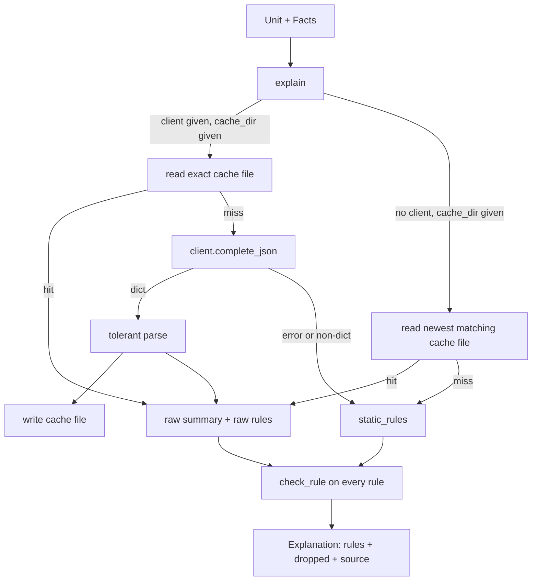
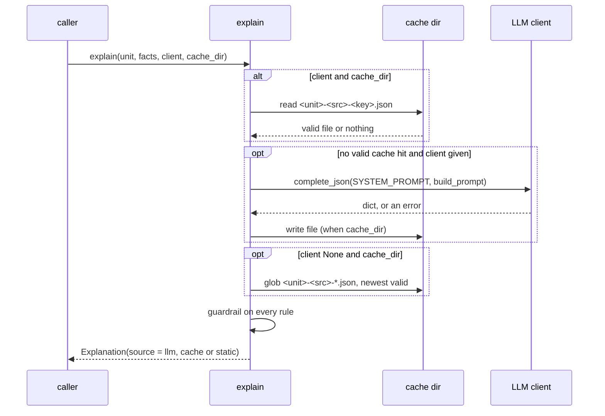

# Design Document

## Overview

The explainer turns one legacy unit and its scanner facts into a plain-English `Explanation`: a one-sentence summary and a list of business rules. Every rule cites file lines. An LLM writes the explanation, and a guardrail checks each rule against the code before the rule is shown. A rule that cites a line without a fact, writes a line number in its text, or states a number that is not in the code is dropped and kept with its reason. With no LLM and no cache, a static explanation is built from the scanner facts alone.

The feature adds one module, `src/gravedigger/autopsy/explain.py`, one script, `scripts/explain_sample.py`, and two pinned dependencies in `pyproject.toml`. It adds no test file. The 21 tests in `tests/test_autopsy_explain.py` are the acceptance suite and stay unmodified.

Design rules, from the project steering:

- Python 3.12, type hints everywhere, frozen dataclasses for data, small pure functions, no mutable global state.
- Module level imports are the standard library and `gravedigger` only. The vendor SDKs (`anthropic`, `openai`) are imported inside `complete_json`.
- `Decimal` for every number the guardrail compares. Numbers are built from strings and never go through `float`.
- Secrets come from `gravedigger.config.setting`. The key is never logged, cached, printed or put in an exception message.
- Commands in this document use PowerShell syntax. Files are UTF-8 without BOM, LF line endings.

### Real interfaces this design builds on

Read from the current source:

| Item | Real definition |
|---|---|
| `Unit` (`gravedigger.exhume`) | frozen: `name`, `kind`, `params`, `return_type`, `start_line`, `end_line`, `source`, `sibling_names`, `global_names`. `source` holds the unit's lines exactly as in the body file, joined by `\n`. `start_line` is the file line number of the first source line. |
| `Facts` (`gravedigger.autopsy.scanner`) | frozen: `constants: tuple[Constant, ...]` (each `value: Decimal`, `line`, `col`), `string_literals: frozenset[str]`, `tables_read`, `tables_written` (upper case), `calls`, `branches`, `exceptions_handled` (upper case, spaces removed), `swallows_errors`, `globals_used`. |
| `scanner` public helpers | `find_constants(masked, starts, first_line)`, `find_tables(masked)`, `find_name_uses(masked, names)`, `whole_word(name)`, `scan(unit)`. |
| `tokenizer` | `mask(text)` blanks comments and strings but keeps offsets and newlines. `segments(text)` yields `Segment(kind, start, end, closed)` with kind `code`, `comment` or `string`. `line_starts`, `line_of` (1-based). |
| `blocks` | `find_blocks(masked)` returns `Block` values with `kind`, `start`, `end` and `exception_pos` (offset of the block's own `EXCEPTION` keyword). |
| `config` | `setting(key, default=None) -> str | None`: environment first, then `.env`. |

Facts about the legacy file that shape the design (file line numbers of `legacy/billing_pkg.pkb`, checked against the tests):

| Line | Content | Why it matters |
|---|---|---|
| 42 | `IF p_units > 300 THEN` | constant and branch |
| 43 | `-- RKH 2006: whole consumption ...` | comment only: not evidence |
| 44 | `v_enrg_chg := p_units * 22;` | constant 22 |
| 48 | `-- v_enrg_chg := ... * 15.50);  -- 12-MAR-2006 ...` | commented-out code: not evidence |
| 56 | `v_enrg_chg := p_units * 25;` | constant 25 |
| 96 | `SELECT rate_per_kwh INTO n_rt FROM FPA_RT WHERE ...` | table read (f_fpa) |
| 112 | `o_gst := ROUND((p_enrg + p_fix + p_fpa + o_ed) * 0.17, 2);` | constant 0.17 (p_taxes) |
| 195 | `INSERT INTO BILL_HDR (...` | table written (p_gen_bill) |
| 205 | `WHEN OTHERS THEN` | handler, swallowing errors |
| 206 | `NULL;  -- SKM: batch must never stop` | not a fact carrier: never cite it |

## Architecture



Flow inside `explain`:



Design decisions:

1. **Evidence is computed from the unit alone.** `evidence_lines(unit)` has no `facts` argument in the contract, so it recomputes constants, tables, calls, strings, branches and handlers with the public scanner helpers on the masked source. It does not call `scan`. The guardrail uses `facts` only for the set of allowed numbers.
2. **The guardrail checks the lines before the text.** A rule that cites a bad line is dropped for that reason even when its text also holds an invented number.
3. **The cache stores the raw answer, not the verdict.** The guardrail runs again on every read (Req 7.8), so editing the cache file or tightening the guardrail changes the result without a new LLM call.
4. **One private judging step serves all three sources.** `llm`, `cache` and `static` rules all pass through `_judge`, which is the only place that builds `Dropped` values (Req 3.16).
5. **Client errors never reach the page.** Any `Exception` from `complete_json` becomes a static explanation plus a log warning that holds the unit name and the exception type, never its message.
6. **No temperature is sent.** See "Dependencies and verified facts".

## Components and Interfaces

All in `src/gravedigger/autopsy/explain.py` unless noted.

### Module layout

```python
from __future__ import annotations

import hashlib
import json
import logging
import os
import re
from dataclasses import dataclass, field
from decimal import Decimal
from pathlib import Path
from typing import Any, Literal, Protocol

from gravedigger.autopsy.blocks import Block, find_blocks
from gravedigger.autopsy.scanner import (
    Facts, find_constants, find_name_uses, find_tables, whole_word,
)
from gravedigger.autopsy.tokenizer import line_of, line_starts, mask, segments
from gravedigger.config import setting
from gravedigger.exhume import Unit

logger = logging.getLogger(__name__)

PROMPT_VERSION = "autopsy-explain-1"          # change with SYSTEM_PROMPT or the answer format
CATEGORIES: tuple[str, ...] = ("tariff", "tax", "date", "surcharge", "error", "other")
PROVIDERS: tuple[str, ...] = ("anthropic", "openai")
ANTHROPIC_DEFAULT_MODEL = "claude-haiku-5-5"
OPENAI_DEFAULT_MODEL = "gpt-4o-mini"
Source = Literal["llm", "cache", "static"]
```

`logger` is the one module-level object that is not a constant. It is a stdlib logger handle, holds no application state, and is the usual exception to "no global state".

### Data types (all frozen)

```python
@dataclass(frozen=True)
class Rule:
    text: str
    lines: tuple[int, ...]
    category: str

@dataclass(frozen=True)
class Dropped:
    rule: Rule
    reason: str

@dataclass(frozen=True)
class Explanation:
    unit: str
    summary: str
    rules: tuple[Rule, ...]
    dropped: tuple[Dropped, ...]
    source: Source

class LLMClient(Protocol):
    def complete_json(self, system: str, prompt: str) -> dict[str, Any]: ...

class LLMError(RuntimeError):
    """A provider call failed or returned an unusable answer. The message never holds the API key."""
```

`LLMClient` is a `typing.Protocol` for type hints only. `FakeClient` in the tests satisfies it structurally.

### Public functions

| Function | Signature | Requirements |
|---|---|---|
| `evidence_lines` | `(unit: Unit) -> frozenset[int]` | 2.1 to 2.8 |
| `check_rule` | `(rule: Rule, unit: Unit, facts: Facts) -> str \| None` | 3.1 to 3.17 |
| `build_prompt` | `(unit: Unit, facts: Facts) -> str` | 5.1 to 5.3 |
| `static_rules` | `(unit: Unit, facts: Facts) -> tuple[Rule, ...]` | 8.2 to 8.11 |
| `explain` | `(unit: Unit, facts: Facts, client: LLMClient \| None = None, cache_dir: Path \| str \| None = None) -> Explanation` | 1, 6, 7, 8.1, 8.12 to 8.14 |
| `make_client` | `(provider: str, api_key: str \| None, model: str \| None = None) -> LLMClient \| None` | 4.2 to 4.10 |
| `client_from_settings` | `() -> LLMClient \| None` | 4.11 |

`cache_dir` is accepted as `Path | str` and converted with `Path(cache_dir)` once.

### Private helpers (all pure unless marked I/O)

| Helper | Purpose |
|---|---|
| `_masked_lines(unit) -> tuple[str, ...]` | `mask(unit.source).split("\n")`; index `i` is file line `unit.start_line + i` |
| `_handler_lines(masked, starts, blocks, first) -> frozenset[int]` | lines of exception handlers (see "Evidence lines") |
| `_owner(blocks, pos) -> Block \| None` | innermost block containing offset `pos` (same rule as the scanner's private `_innermost`, re-written here so the module imports only public names) |
| `_code_numbers(facts) -> frozenset[Decimal]` | allowed numbers |
| `_number_tokens(text) -> tuple[tuple[str, bool], ...]` | (token text, followed by `%`) in text order |
| `_shift_down(d) -> Decimal` | `d / 100` without context rounding |
| `_plain(d) -> str` | plain decimal text, no exponent |
| `_judge(rules, unit, facts, ev) -> tuple[tuple[Rule, ...], tuple[Dropped, ...]]` | run the guardrail over rules, keep order |
| `_check(rule, unit, facts, ev) -> str \| None` | the guardrail body; `check_rule` computes `ev` and delegates |
| `_parse_answer(answer) -> tuple[str, tuple[Rule, ...]]` | tolerant reading |
| `_rule_from_entry(entry) -> Rule \| None` | one entry; `None` means skip |
| `_source_hash(unit)`, `_key_hash(unit, client)`, `_cache_name(unit, client)` | cache names |
| `_read_cache_file(path) -> tuple[str, tuple[Rule, ...]] \| None` (I/O) | validate and parse one file |
| `_find_cache(unit, client, cache_dir) -> tuple[str, tuple[Rule, ...]] \| None` (I/O) | exact file or newest match |
| `_write_cache(path, unit, summary, rules) -> None` (I/O) | atomic UTF-8 LF write |
| `_scrub(text, secret) -> str` | remove the key (and key-shaped strings) from a message |
| `_static_summary(unit) -> str` | static summary text |

## Evidence lines

`evidence_lines(unit)` returns the file line numbers of live code lines that hold a Fact_Carrier.

**Why masked lines decide "live".** `mask(unit.source)` replaces every comment and every string with spaces, keeping newlines and offsets. A comment-only line (43, 48) becomes blank, so nothing can match it. A code line with a trailing comment keeps its code part and loses the comment, so it stays a candidate. Any text found by searching the masked text is therefore live code by construction.

**Strings are the one exception to "search the masked text".** A string literal is blanked in the masked text, so a line whose only fact is a string (a `DBMS_OUTPUT.PUT_LINE('...')` argument) would be invisible. For strings the design uses the tokenizer segments of the *unmasked* source: every segment of kind `string` marks its lines as evidence. A string inside a comment is part of a `comment` segment, never a `string` segment, so it adds nothing. A string that spans several lines marks every line from its first to its last character.

Algorithm (offsets are into `unit.source`; `first = unit.start_line`):

```
masked  = mask(unit.source)
starts  = line_starts(unit.source)
blocks  = find_blocks(masked)
lines: set[int] = set()

1. constants : for c in find_constants(masked, starts, first)           -> add c.line
2. tables    : read, written = find_tables(masked)
               for each table name T: add every line of masked where whole_word(T) matches
3. calls     : for name in find_name_uses(masked, unit.sibling_names minus unit.name):
               add every line of masked where whole_word(name) matches
4. branches  : for each match of (?<![A-Za-z0-9_$#])(END\s+IF|ELSIF|IF)(?![A-Za-z0-9_$#]) in masked
               whose group does not start with END: add the line of the match start
5. handlers  : for each block b with b.exception_pos not None: add line_of(starts, b.exception_pos)
               for each match of whole word WHEN in masked: owner = _owner(blocks, m.start());
               if owner is not None and owner.exception_pos is not None and owner.exception_pos <= m.start():
               add the line of the match start
6. strings   : for each segment s of segments(unit.source) with s.kind == "string":
               add every line from line_of(starts, s.start) to line_of(starts, max(s.start, s.end - 1))

result = frozenset(n for n in lines if unit.start_line <= n <= unit.end_line)
```

Every line number is `first + line_of(starts, offset) - 1`. The final clamp keeps the result inside the unit even when the source has fewer lines than `end_line - start_line + 1`.

Notes:

- **Step 5 and `CASE ... WHEN`.** A `WHEN` inside a `CASE` has the `case` block as owner. That block has no `exception_pos`, so the line is not a handler line. This matches `find_handlers` in the scanner, which uses the same owner rule.
- **Step 5 and nested blocks.** In `p_gen_bill` the inner `BEGIN ... EXCEPTION WHEN NO_DATA_FOUND ... END;` is its own block with its own `exception_pos`. Its handler lines and the outer `WHEN OTHERS` line (205) are all found.
- **Steps 2 and 3 take any whole-word hit on a live line.** A column that has the same name as a table would add its line. That adds a line a rule may cite and does not let a number through. The scanner has the same tolerance (`find_name_uses`).
- **Step 4 does not use `Facts.branches`**, which is a count. The line positions come from the regex above, the same pattern the scanner counts with.
- **`ELSE` and `RETURN` lines** carry no fact unless they hold a constant. Line 206 (`NULL;`) is not evidence. Static rules never cite it.
- **Complexity** is linear in the source size. `explain` computes the set once and passes it to `_judge`, so a unit with N rules costs one evidence pass.

Check against the tests: 42 (constant 300, branch), 44 (constant 22), 56 (constant 25) are in; 43 and 48 are blank after masking and in no step; 195 (table `BILL_HDR`) and 205 (`WHEN OTHERS` with owner `p_gen_bill`) are in.

## Guardrail

`check_rule(rule, unit, facts)` returns `None` to keep or a reason string to drop. It runs five checks in a fixed order and returns the first failure.

| # | Check | Reason text (exact) |
|---|---|---|
| 1 | `rule.lines` is empty | `It cites no line of the code.` |
| 2 | first line, in ascending order, below `unit.start_line` or above `unit.end_line` | `Line {n} is outside the unit (lines {start}-{end}).` |
| 3 | first line, in ascending order, inside the unit and not in evidence | `Line {n} is not live code with a fact (it may be a comment, a blank line, or code without a number, table, call, branch or handler).` |
| 4 | text matches the line-reference pattern | `The text mentions line numbers. Line numbers belong in the citation, not in the text.` |
| 5 | first number token, in text order, that is not allowed | `The text states the number {token}, which is not in the code.` |

Notes on the order and wording:

- Check 2 runs before check 3, so line 76 in `f_enrg_chg` is reported as outside the unit, not as "not live code".
- `{n}` is the integer. `{token}` is the number text as written, for example `24` or `15.50`.
- Checks 4 and 5 apply to any rule that passed 1 to 3. A rule with no number token passes check 5 trivially (Req 3.11).
- The reasons are plain English so they can be shown on the Autopsy page unchanged.

### Line-reference pattern (check 4)

```python
_LINE_REF = re.compile(r"(?<![A-Za-z0-9_$#])(?:lines?|ll\.|l\.?)\s*\d+", re.IGNORECASE)
```

It matches `line 42`, `lines 10-12`, `L42`, `l. 7` and `ll. 42` in any letter case. The look-behind stops it from firing inside words such as `all 300` (`l` preceded by `l` and `a`), `table 5` or `will 2`. A bare `l` or `line` with no digit does not match. A table name such as `L1_TAB` would match; no unit of the synthetic package has one, and a false drop is the safe direction.

### Number tokens (check 5)

```python
_NUMBER = re.compile(
    r"(?<![A-Za-z0-9_$#])(?:\d+(?:\.\d+)?|\.\d+)(?![A-Za-z0-9_$#])"
)
```

This is the scanner's number shape without the exponent part, with the same "not glued to identifier characters" guard. It gives:

- `A2`, `p_2`, `T1_X` yield no token, because the digit follows a letter or underscore (Req 3.8).
- `22.` at the end of a sentence yields `22`; a dot not followed by a digit is not part of the number.
- `1.5%` yields the token `1.5` with a following `%`.
- `Rs25` (letters glued to digits) yields no token. This is a known hole: an invented number written without a space slips through. The system prompt tells the model to write a space, and the sample script shows what the model really does. It is listed in "Residual risks".

`_number_tokens(text)` returns `(token, is_percent)` in text order, where `is_percent` is true when the character right after the match is `%`.

### Allowed numbers

```python
def _code_numbers(facts: Facts) -> frozenset[Decimal]:
    numbers: set[Decimal] = set()
    for c in facts.constants:
        numbers.add(c.value)
        numbers.add(abs(c.value))
    for literal in facts.string_literals:
        for token, _ in _number_tokens(literal):
            numbers.add(Decimal(token))
    return frozenset(numbers)
```

`Decimal` equality and hashing are by value, so `Decimal("5")`, `Decimal("5.0")` and `Decimal("5.00")` are one element of the set (Req 3.9). The absolute value covers `5` for a constant `-5` (Req 3.10).

A token is allowed when `Decimal(token)` is in the set, or when it is a percentage and `_shift_down(Decimal(token))` is in the set:

```python
def _shift_down(d: Decimal) -> Decimal:
    sign, digits, exponent = d.as_tuple()
    return Decimal((sign, digits, exponent - 2))   # exact: d / 100, no rounding
```

`Decimal.scaleb` and `/` round to the context precision (28 digits). Rebuilding from the tuple is exact for any length. `17%` becomes `0.17` and `1.5%` becomes `0.015`. `Decimal(token)` cannot fail: the regex only yields digit strings with at most one dot, and a token never contains `NaN` or an exponent.

A percentage token is also accepted when the plain number is in the set (a text such as "10% ... 10 units" with the code constant 10). This follows Req 3.6 literally: the token is rejected only when it is in neither form.

### Number formatting for static rules

```python
def _plain(d: Decimal) -> str:
    return "0" if d == 0 else format(d.normalize(), "f")
```

`format(Decimal("1E+2"), "f")` is `100`, `format(Decimal("0.015"), "f")` is `0.015`, and `Decimal("0.10").normalize()` is `0.1`. The `d == 0` branch avoids `-0` and `0E+1`. The format code `f` never writes an exponent (Req 8.8).

## Prompts

### PROMPT_VERSION

`PROMPT_VERSION = "autopsy-explain-1"`. It is part of both cache hashes. Any edit to `SYSTEM_PROMPT`, to the answer schema, or to the `build_prompt` layout bumps the number, which makes old cache files unreachable by exact lookup (Req 7.5).

### System prompt (full draft)

`SYSTEM_PROMPT` is a module constant string.

```text
You explain legacy Oracle PL/SQL billing code to people who do not read code.
You receive one function or procedure. Every code line starts with its file line
number, then a vertical bar, then the code. After the code you receive FACTS that
a scanner found. Write a structured answer with a summary and a list of rules.

summary
  One sentence in plain English that says what this unit does.

rules
  The business rules a billing analyst would recognise: rates and thresholds,
  slabs, taxes, dates and due dates, surcharges and fees, and error handling.
  One rule per idea. For every rule give:
  - text: plain English that a non-programmer can read. Say what happens and when.
    Avoid variable names and PL/SQL words.
  - lines: the file line numbers, as integers, taken from the left of the bars.
    Cite at least one line. Cite only live code lines that hold a number, a table,
    a string, a call to another unit, an IF or ELSIF, or an error handler.
  - category: one of tariff, tax, date, surcharge, error, other.

A checker rejects every rule that breaks one of these rules:
  1. Never write a line number in text. "line 42", "lines 10-12" and "L42" are not
     allowed. Line numbers belong only in lines.
  2. In text, use only numbers that appear in the code. Write a percentage when the
     code holds the fraction: 17% is allowed for 0.17 and 1.5% for 0.015. Do not
     compute new numbers, totals or worked examples. Put a space between a word and
     a number ("Rs 22", not "Rs22").
  3. Never base a rule on a comment or on commented-out code. An old rate in a
     comment is history, not a rule.
  4. Describe what the code does, even when it looks wrong, for example a rate that
     jumps at a threshold, tax charged on tax, or an error that is silently ignored.
     Do not fix, judge or soften it.
  5. Do not invent rules. If the unit has few rules, return few.
  6. Tariff codes such as A1 and A2 may be written as they are.

Return only the structured answer.
```

This covers Req 5.4 (one-sentence summary), 5.5 (rule topics), 5.6 (lines and categories), 5.7 (no line numbers in text) and 5.8 (only code numbers, percentage form). The OpenAI client appends `_JSON_FORMAT_NOTE` (below) because JSON mode needs the word JSON and a description of the shape in the prompt.

### Answer format

```python
def _answer_schema() -> dict[str, Any]:
    return {
        "type": "object",
        "properties": {
            "summary": {"type": "string", "description": "One plain-English sentence."},
            "rules": {
                "type": "array",
                "items": {
                    "type": "object",
                    "properties": {
                        "text": {"type": "string"},
                        "lines": {"type": "array", "items": {"type": "integer"}},
                        "category": {"type": "string", "enum": list(CATEGORIES)},
                    },
                    "required": ["text", "lines", "category"],
                },
            },
        },
        "required": ["summary", "rules"],
    }
```

It is a function, so each call returns a fresh dict and no mutable global exists. The Anthropic client passes it as the tool `input_schema`. The OpenAI client describes it in text:

```python
_JSON_FORMAT_NOTE = (
    'Answer with one JSON object and nothing else, in this shape: '
    '{"summary": "<one sentence>", "rules": [{"text": "<plain English>", '
    '"lines": [<integer file line numbers>], "category": "<tariff|tax|date|surcharge|error|other>"}]}'
)
```

The `enum` is only a hint to the model. The reader accepts any string and maps unknown values to `other` (Req 6.7).

### build_prompt layout

`build_prompt(unit, facts)` returns text in this order:

```text
UNIT: f_enrg_chg (function, file lines 38-69)

CODE (each line is <file line number>|<code>):
38|  FUNCTION f_enrg_chg (p_tariff VARCHAR2, p_units NUMBER) RETURN NUMBER IS
39|    v_enrg_chg NUMBER := 0;
...
42|      IF p_units > 300 THEN
43|        -- RKH 2006: whole consumption at top rate once past 300
44|        v_enrg_chg := p_units * 22;
...

FACTS (found by a scanner, not by you):
- Numbers in live code: 300 (line 42), 22 (line 44), 200 (line 46), ...
- Tables read: none
- Tables written: none
- Calls to other units: none
- Branches (IF and ELSIF): 6
- Errors handled: none
- Errors swallowed (WHEN OTHERS THEN NULL): no
- Package globals used: g_dbg
- Comment lines and commented-out code are shown for context only. Do not cite them.
```

Rules for the layout:

- Code lines are `f"{unit.start_line + i}|{line}"` for each line of `unit.source.split("\n")`, with a trailing `\r` removed. The line number is not padded, so the text contains `44|` and the code text is untouched (`p_units * 22` appears as in the file). Req 5.2 and the test `test_prompt_shows_code_with_file_line_numbers` need exactly this.
- The header holds the unit name, so `"f_enrg_chg" in prompt` holds.
- Facts lists use `sorted` for sets, so the prompt is deterministic. Numbers use `_plain`, with `(line N)` from `Constant.line`. A repeated value keeps each of its lines, in order of appearance.
- Empty sets print `none`. `Errors swallowed` prints `yes` or `no` from `facts.swallows_errors`.
- The prompt holds no API key and no setting.

## Static fallback

`static_rules(unit, facts)` returns a tuple of `Rule` values built from facts. It first computes `masked_lines = _masked_lines(unit)`, `ev = evidence_lines(unit)` and `blocks`, then builds groups in this fixed order. Inside each group items are sorted by name, so equal input gives equal output (Req 8.12).

| Group | Text | Category | Lines |
|---|---|---|---|
| each table in `tables_read` | `Reads data from table {T}.` | `data` | first line that reads `T` |
| each table in `tables_written` | `Writes data to table {T}.` | `data` | first line that writes `T` |
| each name in `exceptions_handled` | `Handles the error condition {NAME}.` | `error` | first handler line that holds `NAME` |
| `swallows_errors` | `Errors are swallowed: WHEN OTHERS THEN NULL hides every failure, so the unit never reports a problem.` | `error` | first handler line that holds `OTHERS` |
| `constants` not empty | `The code uses these fixed numbers: {list}.` | `other` | all distinct constant lines, ascending |

`{list}` is the distinct values in order of first appearance, each through `_plain`, joined by `, `. Distinctness is by `Decimal` value.

Category `data` is outside the suggested set `CATEGORIES`. It is allowed because static rules are built directly and never pass through the answer reader. Consumers must not assume `Rule.category in CATEGORIES`.

### Finding the cited line

All searches run on the masked lines, so a comment that names a table (for example line 134, "-- p_gen_bill : ... insert into BILL_HDR") can never be cited.

```python
def _first_line(masked_lines, first, pattern) -> int | None:
    for i, text in enumerate(masked_lines):
        if pattern.search(text):
            return first + i
    return None
```

Patterns, tried in order until one hits:

- **Table read:** `(?<![A-Za-z0-9_$#])(?:FROM|JOIN)\s+(?:[A-Za-z_][A-Za-z0-9_$#]*\s*\.\s*)?{T}(?![A-Za-z0-9_$#])`, then `whole_word(T)` as the fallback.
- **Table written:** `(?<![A-Za-z0-9_$#])(?:INSERT\s+INTO|UPDATE|DELETE\s+(?:FROM\s+)?)\s+(?:[A-Za-z_][A-Za-z0-9_$#]*\s*\.\s*)?{T}(?![A-Za-z0-9_$#])`, then `whole_word(T)`.
- **Handler of `NAME`:** the first line in `_handler_lines` whose masked text matches `whole_word(NAME)`. `NAME` is escaped by `whole_word`.
- **Swallow rule:** same as the handler search with `OTHERS`.

A single-line pattern keeps the line unambiguous (`FROM FPA_RT` is on line 96, `INSERT INTO BILL_HDR` on line 195, `WHEN OTHERS` on line 205). The fallback to the first whole-word hit covers statements broken across lines (`INSERT INTO` at the end of one line, the table on the next). The tests need `FPA_RT` on 96, `BILL_HDR` on 195 and `WHEN OTHERS` on 205.

A rule whose line search finds nothing, or whose line is not in `ev`, is skipped. A static rule therefore always cites a line the guardrail accepts (Req 8.11), even for hand-made `Facts`.

### Static summary

`_static_summary(unit)` returns `f"{unit.name} is a {unit.kind} of the billing package. No AI explanation is available, so the list below comes from the facts in the code alone."` The text holds the unit name and the word `function` or `procedure` (Req 8.3).

## Reading the model answer

`_parse_answer(answer: dict) -> tuple[str, tuple[Rule, ...]]` never raises.

```
summary = answer.get("summary"); if not a str -> ""
rules   = answer.get("rules");   if not a list -> []
for entry in rules: r = _rule_from_entry(entry); keep r when not None
```

`_rule_from_entry(entry)` returns `None` and writes `logger.debug("explain: skipped a malformed rule entry (%s)", reason)` when:

- `entry` is not a `dict`;
- `entry["text"]` is missing, not a `str`, or only whitespace;
- `entry["lines"]` is missing, not a `list`, or holds anything that is not an `int` (a `bool` counts as not an int, because `True` is an `int` subclass in Python).

Otherwise it returns `Rule(text, tuple(lines), category)` where `category` is the value when it is a `str` in `CATEGORIES`, else `"other"`. A rule is never dropped for its category (Req 6.7). A rule with an empty `lines` list is well-formed; the guardrail drops it with the "cites no line" reason (Req 3.2).

The whitespace-only `text` check is an addition to Req 6.6, which names only a non-string text. It keeps Req 1.6 (kept rules have non-empty text) true without a guardrail rule that Req 3 does not list.

The test answer `{"rules": [{"text": 5}, "nonsense", {"lines": "x"}]}` gives three skipped entries: a non-string text, a non-dict, and an entry with no text. Result: source `llm`, `rules == ()`, summary `""`.

## Cache

### Names

```python
def _source_hash(unit: Unit) -> str:
    raw = "\x00".join((unit.source, PROMPT_VERSION))
    return hashlib.sha256(raw.encode("utf-8")).hexdigest()[:12]

def _key_hash(unit: Unit, client: LLMClient | None) -> str:
    provider = getattr(client, "provider", "unknown")
    model = getattr(client, "model", "unknown")
    raw = "\x00".join((unit.source, str(provider), str(model), PROMPT_VERSION))
    return hashlib.sha256(raw.encode("utf-8")).hexdigest()[:12]

def _cache_name(unit, client) -> str:
    return f"{unit.name}-{_source_hash(unit)}-{_key_hash(unit, client)}.json"
```

The NUL separator keeps `("ab", "c")` and `("a", "bc")` apart. `unit.name` is a lower-case identifier (`A-Za-z0-9_$#`), safe as a file name on Windows and not a glob metacharacter.

### Lookup

- **Client given and `cache_dir` given:** read exactly `cache_dir / _cache_name(unit, client)`. If it is missing or invalid, call the client (Req 7.3).
- **No client and `cache_dir` given:** `cache_dir.glob(f"{unit.name}-{_source_hash(unit)}-*.json")`, sorted by `(st_mtime_ns, name)` descending, and the first file that `_read_cache_file` accepts wins (Req 7.4). A client without `provider` and `model` writes `unknown` into the key hash, and the glob finds that file without knowing the key (Req 7.12, 7.13).
- **`cache_dir` is `None`:** no file is read or written (Req 7.14). A `cache_dir` that does not exist reads as "no hit".

### File format and validity

```json
{
  "unit": "f_enrg_chg",
  "summary": "Works out the energy charge from the units used and the tariff.",
  "rules": [
    {"text": "...", "lines": [42, 44], "category": "tariff"}
  ]
}
```

`_read_cache_file(path)` returns `None` when the file cannot be read as UTF-8, is not JSON (a BOM makes `json.loads` fail, which is the desired behaviour), is not an object, or lacks `unit: str`, `summary: str`, `rules: list` (Req 7.10). Rule entries go through the same `_rule_from_entry` filter as a live answer. A hand-added entry with a bad shape is skipped; a well-formed invented rule is dropped by the guardrail, because `explain` always judges the cached rules again (Req 7.8).

The file stores the entries that survived shape filtering, before the guardrail. Their category is already normalised (`other` for unknown values). Reading the file back gives the same `Rule` values, so reading and judging gives the same `rules` and `dropped` as the call that wrote it. This is the round trip of Req 7.9: equal except `source`.

### Write

```python
def _write_cache(path: Path, unit: Unit, summary: str, rules: tuple[Rule, ...]) -> None:
    payload = {
        "unit": unit.name,
        "summary": summary,
        "rules": [{"text": r.text, "lines": list(r.lines), "category": r.category} for r in rules],
    }
    text = json.dumps(payload, ensure_ascii=False, indent=2) + "\n"
    path.parent.mkdir(parents=True, exist_ok=True)
    tmp = path.with_name(path.name + ".tmp")
    tmp.write_text(text, encoding="utf-8", newline="\n")
    os.replace(tmp, path)
```

- `encoding="utf-8"` writes no BOM. `newline="\n"` stops Windows from turning `\n` into `\r\n` (Req 7.15). The trailing newline is written explicitly.
- `os.replace` swaps the file in one step, so a crash never leaves a half-written file under the real name. The `.tmp` name does not match `*.json`, so a leftover temp file is never read or counted.
- A write replaces an invalid existing file (Req 7.10) and a second call with the same client rewrites nothing, because the first file is a hit (Req 7.7).
- An `OSError` from the write is logged as a warning with the unit name and the exception type, and the explanation is returned anyway. A cache that cannot be written must not lose the answer that was already paid for.
- Static explanations write no file (Req 7.16). The payload holds the unit name, the summary and the rules, so the API key is not in it (Req 7.17).

## The explain function

```python
def explain(unit, facts, client=None, cache_dir=None) -> Explanation:
    ev = evidence_lines(unit)
    directory = Path(cache_dir) if cache_dir is not None else None
    if client is not None:
        hit = _read_cache_file(directory / _cache_name(unit, client)) if directory else None
        if hit is not None:
            return _finish(unit, facts, ev, hit, "cache")
        raw = _ask(unit, facts, client)               # None on any failure
        if raw is not None:
            if directory is not None:
                _try_write(directory / _cache_name(unit, client), unit, raw)
            return _finish(unit, facts, ev, raw, "llm")
    elif directory is not None:
        hit = _find_cache(unit, directory)
        if hit is not None:
            return _finish(unit, facts, ev, hit, "cache")
    return _static(unit, facts, ev)
```

- `_ask` calls `client.complete_json(SYSTEM_PROMPT, build_prompt(unit, facts))` once. It catches `Exception`, logs `explain %s: the model call failed (%s)` with `unit.name` and `type(exc).__name__` only, and returns `None`. A result that is not a `dict` logs `explain %s: the model returned %s, not an object` with the unit name and the type name, and returns `None`. Otherwise it returns `_parse_answer(answer)`.
- `_finish` calls `_judge` and builds the `Explanation`. `_static` does the same with `static_rules` and `_static_summary`, so the static rules also pass through the guardrail (Req 3.16).
- When a client is given and there is no `cache_dir`, the client is called exactly once (Req 1.8).
- When the client fails, a cache file made by a *different* client is not used. That is deliberate: the exact name is the contract, and the newest-file search is reserved for "no client" calls (Req 7.3, 7.4).

`_judge` keeps input order:

```python
def _judge(rules, unit, facts, ev):
    kept, dropped = [], []
    for rule in rules:
        reason = _check(rule, unit, facts, ev)
        (kept.append(rule) if reason is None else dropped.append(Dropped(rule, reason)))
    return tuple(kept), tuple(dropped)
```

## LLM clients

Both clients are frozen dataclasses with the key kept out of `repr`, so a log line or a debugger print of the client never shows the key.

```python
@dataclass(frozen=True)
class AnthropicClient:
    api_key: str = field(repr=False)
    model: str = ANTHROPIC_DEFAULT_MODEL
    provider: str = "anthropic"
    max_tokens: int = 4096
    timeout: float = 60.0

@dataclass(frozen=True)
class OpenAIClient:
    api_key: str = field(repr=False)
    model: str = OPENAI_DEFAULT_MODEL
    provider: str = "openai"
    max_tokens: int = 4096
    timeout: float = 60.0
```

### Anthropic: structured output by tool use

```python
def complete_json(self, system: str, prompt: str) -> dict[str, Any]:
    if not self.api_key:
        raise LLMError("LLM_API_KEY is not set.")
    try:
        import anthropic
    except ImportError:
        raise LLMError('The "anthropic" package is not installed. Run: pip install -e ".[dev]"') from None
    tool = {
        "name": "record_explanation",
        "description": "Record the summary and the business rules of the unit.",
        "input_schema": _answer_schema(),
    }
    try:
        client = anthropic.Anthropic(api_key=self.api_key, timeout=self.timeout, max_retries=2)
        message = client.messages.create(
            model=self.model,
            max_tokens=self.max_tokens,
            system=system,
            tools=[tool],
            tool_choice={"type": "tool", "name": tool["name"]},
            messages=[{"role": "user", "content": prompt}],
        )
    except Exception as exc:
        raise LLMError(f"Anthropic call failed ({type(exc).__name__}): {_scrub(str(exc), self.api_key)}") from None
    for block in message.content:
        if getattr(block, "type", None) == "tool_use" and isinstance(block.input, dict):
            return dict(block.input)
    raise LLMError("The Anthropic answer was not structured: it holds no tool call.")
```

- **Forced tool choice** (`tool_choice` of type `tool`) makes the model answer through the tool, so the answer is a dict that follows the schema. The tool input of the first `tool_use` block is returned (Req 4.13).
- **No `temperature`.** See the dependency section.
- **`max_tokens=4096`** is far above the size of a rule list for a 40-line unit, and far below the model limit. If a long answer is cut off, the tool block may be missing and the "not structured" error is raised.
- **Errors.** The vendor call sits in one `try`. `except Exception` is wide on purpose: SDK errors (authentication, rate limit, connection, timeout) are all handled the same way by `explain`. The new error is raised `from None`, so the original exception, which may repeat the key in its text or its request details, is not chained into any traceback or log. The missing-key check and the "no tool call" error are outside the `try`, so they are not rewrapped.
- **Risk R-1: forced tool choice with thinking.** Anthropic's thinking rules have restricted forced `tool_choice` before. The Haiku 5.5 documentation could not be checked down to that detail. If the first sample run returns an HTTP 400 that names `tool_choice` or thinking, switch to `{"type": "any"}`, which also forces a tool call when only one tool is given. This is a one-line change inside `AnthropicClient` and does not change the contract.

### OpenAI: JSON mode

```python
def complete_json(self, system: str, prompt: str) -> dict[str, Any]:
    if not self.api_key:
        raise LLMError("LLM_API_KEY is not set.")
    try:
        import openai
    except ImportError:
        raise LLMError('The "openai" package is not installed. Run: pip install -e ".[dev]"') from None
    try:
        client = openai.OpenAI(api_key=self.api_key, timeout=self.timeout, max_retries=2)
        response = client.chat.completions.create(
            model=self.model,
            max_completion_tokens=self.max_tokens,
            response_format={"type": "json_object"},
            messages=[
                {"role": "system", "content": f"{system}\n\n{_JSON_FORMAT_NOTE}"},
                {"role": "user", "content": prompt},
            ],
        )
    except Exception as exc:
        raise LLMError(f"OpenAI call failed ({type(exc).__name__}): {_scrub(str(exc), self.api_key)}") from None
    content = response.choices[0].message.content if response.choices else None
    try:
        parsed = json.loads(content or "")
    except ValueError:
        parsed = None
    if not isinstance(parsed, dict):
        raise LLMError("The OpenAI answer was not structured: it is not a JSON object.")
    return parsed
```

- JSON mode (`response_format={"type": "json_object"}`) needs the word JSON in the messages; `_JSON_FORMAT_NOTE` supplies it and the shape (Req 4.14, 5.9).
- `max_completion_tokens` is the current name of the limit parameter and is accepted by both the classic `gpt-4o-mini` and the GPT-6 reasoning models. `max_tokens` is not accepted by the reasoning models.
- `json.loads` raising `ValueError` (`JSONDecodeError` is a subclass) and a non-dict result both give the "not structured" error (Req 4.15).

### Scrubbing

```python
_KEY_SHAPED = re.compile(r"\b(?:sk|key)-[A-Za-z0-9_\-]{8,}")

def _scrub(text: str, secret: str) -> str:
    if secret:
        text = text.replace(secret, "[key removed]")
    return _KEY_SHAPED.sub("[key removed]", text)
```

The exact key is removed first. The pattern also removes key-shaped strings, such as the partly masked key that some APIs echo in an authentication error (`sk-ab...wxyz`). Error messages the SDK builds from the *response* of the vendor do not hold the key in the normal case; the scrub is a second layer, and `from None` is the first (Req 9.3).

### make_client and client_from_settings

```python
def make_client(provider: str, api_key: str | None, model: str | None = None) -> LLMClient | None:
    name = provider.strip().lower()
    if name not in PROVIDERS:
        raise ValueError(f"Unknown LLM provider {provider!r}. Supported providers: anthropic, openai.")
    if not api_key or not api_key.strip():
        return None
    key = api_key.strip()
    if name == "anthropic":
        return AnthropicClient(api_key=key, model=model or ANTHROPIC_DEFAULT_MODEL)
    return OpenAIClient(api_key=key, model=model or OPENAI_DEFAULT_MODEL)

def client_from_settings() -> LLMClient | None:
    return make_client(
        setting("LLM_PROVIDER", "anthropic") or "anthropic",
        setting("LLM_API_KEY"),
        setting("LLM_MODEL") or None,
    )
```

- The provider is checked first, so `make_client("acme-ai", None)` raises (Req 4.3, 4.5). The error text holds the provider the caller typed, not the key.
- Lower-casing and stripping the provider is a small tolerance for values read from `.env`, such as `Anthropic`. `acme-ai` is still rejected.
- `make_client` reads no setting and imports no SDK (Req 4.6, 4.7). Building a client only stores strings, so `test_known_providers_build_without_network` passes without the SDKs installed.
- An empty `LLM_MODEL` in `.env` falls back to the default (`or None`).
- `LLM_MODEL` must belong to the chosen provider; the code does not check this. A mismatch fails at call time and the explainer falls back to static.

## Sample script

`scripts/explain_sample.py` is not part of the test suite and runs only after the user approves (one run costs about one cent).

```
load_package(spec_text, body_text)        # legacy/billing_pkg.pks and .pkb, read as UTF-8
client = client_from_settings()           # None when LLM_API_KEY is not set
cache  = REPO_ROOT / "golden" / "autopsy"

if client is None and any cache file is missing for any of the 8 units:
    print "LLM_API_KEY is not set and the cache in golden/autopsy is incomplete." ; exit(1)   # no LLM call

for unit in package.units:
    facts = scan(unit)
    out   = explain(unit, facts, client=client, cache_dir=cache)
    print unit name, source, summary, each kept rule with its lines, each dropped rule with its reason
```

- "Cache file exists for a unit" is tested with `cache.glob(f"{unit.name}-{_source_hash(unit)}-*.json")`. The script imports `_source_hash` from the module; a leading underscore is acceptable for a script of the same package, and it avoids a second copy of the hash. With a client, a missing file is created by `explain`; a second run finds every file and makes no call (Req 11.3).
- The script prints `out.source` per unit so the user sees which units came from the model and which from the cache. It prints no key, no settings and no exception text beyond what `explain` logs (Req 9.4).
- The exit message names the missing key and the folder, never a value.

## Dependencies and verified facts

Checked on the web and in the project's virtual environment. Dates are the dates on the sources.

### (a) Anthropic model id `claude-haiku-5-5`: verified

[Anthropic's announcement of Claude Haiku 5.5](https://www.anthropic.com/claude-haiku-5-5) says developers can start with the model id `claude-haiku-5-5` on the Claude Platform, and [the models overview](https://platform.claude.com/docs/en/models/overview) lists Claude Haiku 5.5 as the fastest current model (1M-token context, 128K max output, low per-token price). The user-mandated default stands, with no flag needed for existence.

### (b) OpenAI default `gpt-4o-mini`: exists, JSON mode works, but it is deprecated

- OpenAI's [deprecations page](https://developers.openai.com/api/docs/deprecations) lists GPT-4o mini (`gpt-4o-mini-2024-07-18`) as deprecated with a notice date of Oct 14, 2026, a shutdown date of Jan 14, 2027, and `gpt-6-luna` as the recommended replacement. The page lists the dated snapshot; whether the bare alias `gpt-4o-mini` shuts down on the same date was not stated, so assume it does.
- JSON mode (`response_format={"type": "json_object"}`) is documented for the GPT-4o family in [an OpenAI community thread](https://community.openai.com/t/is-the-gpt4-o-model-compatible-with-json-mode/760533). That source is older than the deprecation notice; the sample run confirms it in practice.
- The hackathon deadline (Dec 4, 2026) is before the shutdown date, so `gpt-4o-mini` works for the whole competition. **Decision:** keep `gpt-4o-mini` as the default, as Req 4.10 says, and **flag it**: it is a deprecated model. The default lives in the one constant `OPENAI_DEFAULT_MODEL`. Moving to `gpt-6-luna` later is a one-line change plus a `PROMPT_VERSION` bump, after one sample run. Sources describe `gpt-6-luna` as a reasoning model that accepts JSON mode in Chat Completions but rejects `temperature`; this is a second reason not to send a temperature.

### (c) SDK versions and pins

| Package | Latest stable found | Source | Pin |
|---|---|---|---|
| `anthropic` | 2.8.0, uploaded Nov 10, 2026, pure-Python wheel (`py3-none-any`), needs Python 3.10 or later | [PyPI](https://pypi.org/project/anthropic/) | `anthropic==2.8.0` |
| `openai` | 3.51.0, released Nov 12, 2026 | [GitHub releases](https://github.com/openai/openai-python/releases) | `openai==3.51.0` |

Both pins follow the project rule of exact pins for fragile wheels (`oracledb==3.4.0`). A dry run in the project's `.venv`, `pip install --dry-run anthropic==2.8.0 openai==3.51.0`, reports that pip would install only `anthropic-2.8.0`, `openai-3.51.0`, `docstring_parser-0.18.0`, `sniffio-1.3.1` and `jiter-0.19.0`.

Transitive wheels, from that dry run and `pip list`:

- Already installed and working (they come with `mcp>=2`): `httpx2 2.16.0`, `httpcore2`, `h11`, `anyio`, `idna`, `certifi`, `truststore`, `pydantic 2.14.3`, `pydantic_core 2.50.4` (compiled), `typing_extensions`, `typing-inspection`, `annotated-types`, `opentelemetry-api`.
- New: `docstring_parser` and `sniffio` (pure Python) and **`jiter-0.19.0`**, a compiled wheel (`cp312-win_amd64`). It is the only new compiled file and the most likely target of Smart App Control. `pydantic_core` is already installed, so it is not at risk for this feature.

The Python SDKs moved to `httpx2` (anthropic 1.0.0 on Aug 20, 2026, openai 3.0.0 on Aug 12, 2026), which the environment already has through `mcp`. Anthropic 1.0.0 also removed `temperature`, `top_p` and `top_k` from the typed `messages.create` signature ([migration notes](https://www.digitalapplied.com/blog/anthropic-python-sdk-v1-breaking-change-migration)); a hold-back release `0.125.0` exists for projects that cannot migrate.

`pyproject.toml` change (design only; the implementation task writes it):

```toml
dependencies = [
    "oracledb==3.4.0",
    "mcp>=2,<3",
    "streamlit>=1.40",
    "anthropic==2.8.0",   # PINNED: LLM explainer; pin an older release if Smart App Control blocks a wheel
    "openai==3.51.0",     # PINNED: LLM explainer (fallback provider)
]
```

### Task-time install check

```powershell
.venv\Scripts\Activate.ps1
pip install -e ".[dev]"
python -c "import anthropic, openai, jiter; print(anthropic.__version__, openai.__version__, jiter.__version__)"
```

If the install or the import fails with `An Application Control policy has blocked this file`, the message names the file. Identify the blocked package, then pin an older, widely used release of it, in this order:

1. `jiter` blocked: pin an older `jiter` first, for example `pip install "jiter<0.19"` with the newest version that installs, and put the same pin in `pyproject.toml` as a direct dependency with a comment. `anthropic` and `openai` accept `jiter>=0.4.0,<1`, so any version in that range is valid.
2. `anthropic` or `openai` blocked (they are pure Python, so this is unlikely): step down one minor version at a time, for example `anthropic==2.7.0`, then the last `1.x`, and finally the hold-back `anthropic==0.125.0`; for `openai` step down through earlier `3.x`. Keep the code as written, because it uses only `messages.create` and `chat.completions.create`, which exist in all of these lines. The Anthropic client sends no `temperature`, so the 1.0 signature change does not matter.
3. Any other transitive wheel blocked (`pydantic_core`, `httpx2`, `anyio`): pin an older release of that package, because Smart App Control judges each file by reputation and a new release often has none yet.
4. After any pin change, rerun the import line above and `.venv\Scripts\python.exe -m pytest -q`. Record the final pins and the reason in `docs/kiro-log.md`.

The vendor SDKs are not needed by the 21 tests (the clients import them inside `complete_json`), so a blocked wheel never breaks the test suite. It breaks only the sample script and the live app.

### Sampling parameters: decision

The task asked for `temperature 0`. The design omits it from both clients:

- anthropic 1.0 and later removed `temperature` from the typed signature. It can only travel through `extra_body`.
- The Anthropic thinking documentation says several current models (Fable 5, Mythos 5, Opus 5, Opus 4.8, Opus 4.7, Sonnet 5) reject any non-default `temperature`, `top_p` or `top_k` with HTTP 400. Haiku 5.5 is not in that list, but the list may predate it, so sending the parameter risks an error for no benefit.
- `gpt-6-luna`, the recommended OpenAI replacement, also rejects `temperature`.
- Repeatability comes from the cache, which stores the first answer and serves it again. That is the property the demo and the committed samples need.

If a later sample run shows too much variation on `gpt-4o-mini`, the OpenAI client can send `temperature=0` for that model only.

## Data Models

| Type | Fields | Notes |
|---|---|---|
| `Rule` | `text: str`, `lines: tuple[int, ...]`, `category: str` | frozen; `lines` keeps the order given |
| `Dropped` | `rule: Rule`, `reason: str` | frozen |
| `Explanation` | `unit: str`, `summary: str`, `rules: tuple[Rule, ...]`, `dropped: tuple[Dropped, ...]`, `source: Literal["llm","cache","static"]` | frozen; tuples keep answer order |
| `AnthropicClient`, `OpenAIClient` | `api_key` (hidden from `repr`), `model`, `provider`, `max_tokens`, `timeout` | frozen |
| Cache file | `{"unit": str, "summary": str, "rules": [{"text", "lines", "category"}]}` | UTF-8, LF, no BOM, trailing newline |

## Requirement to test coverage

Test names are shortened. T4 is `test_guardrail_drops_unsupported_rules_with_a_reason` with its four parameters: `[2]` invented number 24, `[3]` commented-out line 48, `[4]` line 76 outside the unit, `[5]` no line.

| Id | Test (in `tests/test_autopsy_explain.py`) |
|---|---|
| T1 | `test_evidence_lines_are_live_code_with_facts` |
| T2 | `test_evidence_lines_include_sql_and_handlers` |
| T3 | `test_guardrail_keeps_rules_backed_by_code` |
| T4 | `test_guardrail_drops_unsupported_rules_with_a_reason` (4 cases) |
| T5 | `test_percentages_match_decimal_constants` |
| T6 | `test_prompt_shows_code_with_file_line_numbers` |
| T7 | `test_explain_with_client_keeps_and_drops` |
| T8 | `test_malformed_model_answer_does_not_crash` |
| T9 | `test_cache_avoids_a_second_call` |
| T10 | `test_cache_is_used_without_any_client` |
| T11 | `test_cache_is_rechecked_by_the_guardrail` |
| T12 | `test_static_fallback_needs_no_model` |
| T13 | `test_static_rules_cite_the_right_lines` |
| T14 | `test_static_rules_pass_the_guardrail` |
| T15 | `test_no_key_means_no_client` |
| T16 | `test_unknown_provider_is_rejected` |
| T17 | `test_known_providers_build_without_network` (2 cases) |

That is 2 + 1 + 4 + 1 + 1 + 1 + 1 + 3 + 3 + 1 + 1 + 2 = 21 tests. "Inspection" means a reviewer reads the named code against the criterion. "Sample script" means the one approved real run, plus a read of its output.

| Requirement | Covered by |
|---|---|
| 1.1 unit name | T7 |
| 1.2, 1.3 frozen dataclasses | inspection (`@dataclass(frozen=True)`) |
| 1.4 source labels | T7 (`llm`), T9 (`cache`), T12 (`static`) |
| 1.5 tuples, order | T7 |
| 1.6, 1.7 kept and dropped lists | T7 |
| 1.8 one client call | T7 |
| 2.1, 2.2 constants as evidence | T1 |
| 2.3 tables, strings, calls, branches, handlers | T2 (tables, handlers); inspection (strings, calls, branches) |
| 2.4 no comment lines | T1 |
| 2.5 within the unit | inspection (final clamp) |
| 2.6, 2.7 specific lines | T1, T2 |
| 2.8 pure | inspection |
| 3.1 keep or reason | T3, T4 |
| 3.2 no line cited | T4 `[5]` |
| 3.3 outside the unit | T4 `[4]` |
| 3.4 not live code | T4 `[3]` |
| 3.5 line reference in text | inspection (no test uses one) |
| 3.6 unknown number | T4 `[2]` |
| 3.7 percentage form | T5 |
| 3.8 glued digits (`A2`) | T3 |
| 3.9, 3.10 value equality, absolute value | inspection |
| 3.11 no number token | inspection |
| 3.12 keep a good rule | T3 |
| 3.13 to 3.15 named examples | T3, T4, T5, T7 |
| 3.16 guardrail on every source | T7 (llm), T11 (cache), T14 (static) |
| 3.17 pure | inspection |
| 4.1 `complete_json` exists | T17 |
| 4.2 client types | T17 |
| 4.3 unknown provider | T16 |
| 4.4 no key gives `None` | T15 |
| 4.5 provider checked first | inspection (T16 passes a key, so the order is not observable) |
| 4.6, 4.7 no setting read, no SDK import | inspection; T17 passes without the SDKs |
| 4.8 `provider` and `model` attributes | inspection |
| 4.9, 4.10 default models | inspection (sections (a) and (b) above) |
| 4.11 settings | inspection; sample script |
| 4.12 lazy SDK import | T17 and every other test (module imports without the SDKs) |
| 4.13 to 4.16 real calls, errors | sample script; inspection |
| 5.1, 5.2 prompt content | T6 |
| 5.3 facts in the prompt | inspection; sample script |
| 5.4 to 5.9 system prompt, schema | inspection; sample script |
| 6.1, 6.2 client error or non-dict | inspection (no test passes a failing client) |
| 6.3, 6.4 `llm` source, empty summary | T8 |
| 6.5 `rules` not a list | inspection |
| 6.6 skipped entries | T8 |
| 6.7 category fallback | inspection |
| 6.8 shaped entries judged | T7 |
| 6.9 the named answer | T8 |
| 7.1 cache write | T9 |
| 7.2 file keys | T9 (valid JSON), T11 (keys read and written) |
| 7.3 exact read | T9 |
| 7.4 newest match without client | T10 |
| 7.5 key sensitivity | inspection |
| 7.6 same name | T9 |
| 7.7 one file, `cache` second | T9 |
| 7.8 guardrail again | T11 |
| 7.9 round trip | T9 (rules equal); inspection (`dropped`) |
| 7.10, 7.11 invalid file | inspection |
| 7.12, 7.13 `unknown` hash parts | T10 (`FakeClient` has no `provider` or `model`) |
| 7.14 no `cache_dir` | T7 |
| 7.15 UTF-8, LF, no BOM | inspection |
| 7.16, 7.17 no static file, no key | inspection |
| 8.1 static fallback | T12 |
| 8.2 `static_rules` | T13 |
| 8.3 summary text | inspection |
| 8.4, 8.5 table rules | T13 (`FPA_RT` on 96, `BILL_HDR` on 195) |
| 8.6 handler rules | T14; inspection |
| 8.7 swallow rule | T12, T13 |
| 8.8 plain decimals | T14 (text passes the guardrail); inspection |
| 8.9, 8.10 named examples | T13 |
| 8.11 all eight units pass | T14 |
| 8.12 deterministic | inspection |
| 8.13, 8.14 no key, no network | T12 |
| 9.1 to 9.4 secrets | inspection; sample script |
| 10.1, 10.2 imports, no global state | inspection |
| 10.3 files only in `cache_dir` | inspection |
| 10.4 pins | inspection (`pyproject.toml`), install check |
| 10.5 fake client accepted | T7 |
| 11.1 to 11.6 sample script | sample script |
| 12.1 74 tests pass | `.venv\Scripts\python.exe -m pytest -q` |
| 12.2 tests unmodified | `git status --short tests` shows no change |
| 12.3 offline, no key | T1 to T17 (they use `FakeClient` and no network) |
| 12.4 code rules | inspection |
| 12.5 this table | this section |

## Correctness Properties

*A property is a characteristic or behavior that should hold true across all valid executions of a system-essentially, a formal statement about what the system should do. Properties serve as the bridge between human-readable specifications and machine-verifiable correctness guarantees.*

These properties are stated in prose. By Req 12.5 they are not turned into new test files. The 21 acceptance tests exercise the concrete instances named in the table above, and the rest are checked by inspection and by the sample script. A reviewer can try any of them in an interactive session without committing it.

### Property 1: Evidence stays on live lines of the unit

For any unit, every line number in `evidence_lines(unit)` lies between `unit.start_line` and `unit.end_line`, and no line is a blank line, a comment-only line or a line of commented-out code.

**Validates: Requirements 2.1, 2.4, 2.5**

### Property 2: The guardrail is total and pure

For any rule, unit and facts, `check_rule` returns either `None` or a non-empty string, never raises, and returns the same value when called twice with the same arguments.

**Validates: Requirements 3.1, 3.17**

### Property 3: A kept rule is backed by the code

For any rule, unit and facts, if `check_rule` returns `None`, then the rule cites at least one line, every cited line is in `evidence_lines(unit)`, the text matches no line-reference pattern, and every number token of the text is a code number, the absolute value of one, or a percentage of one.

**Validates: Requirements 3.2, 3.3, 3.4, 3.5, 3.6, 3.12**

### Property 4: Numbers compare by value

For any code constant `c` and any text that writes the same value as `c`, `-c`, or `c * 100` followed by `%` (with any number of trailing zeros, such as `5`, `5.0`, `5.00`), the guardrail accepts that number token, and for any value that is none of these it rejects the token.

**Validates: Requirements 3.7, 3.9, 3.10**

### Property 5: Digits glued to letters are not numbers

For any text in which every digit run is directly preceded or followed by a letter or underscore, the guardrail finds no number token and applies only the line checks.

**Validates: Requirements 3.8, 3.11**

### Property 6: Reading an answer never fails

For any value returned by `complete_json` (a dict of any shape, a non-dict, or an exception), `explain` returns an `Explanation` and does not raise. A dict gives source `llm`; anything else gives source `static`.

**Validates: Requirements 6.1, 6.2, 6.3, 6.4, 6.5, 6.6, 6.7**

### Property 7: Every well-formed rule is either kept or dropped, in order

For any answer, each well-shaped rule entry appears exactly once, in `rules` or in `dropped`, never in both; each malformed entry appears in neither; and `rules` and `dropped` each keep the order of the answer.

**Validates: Requirements 1.5, 1.6, 1.7, 6.6, 6.8**

### Property 8: Cache round trip

For any answer written to a cache directory by a client, reading it back (with the same client, or with `client=None`) gives an `Explanation` equal to the first one in every field except `source`, which is `cache`, and a second call with the same client leaves one file and makes no client call.

**Validates: Requirements 7.3, 7.4, 7.7, 7.9**

### Property 9: The cache name follows the inputs

For any two calls, the cache file name is equal exactly when the unit source, the provider, the model and `PROMPT_VERSION` are equal, with `unknown` for a missing `provider` or `model` attribute.

**Validates: Requirements 7.5, 7.6, 7.12**

### Property 10: A cache file cannot smuggle in a rule

For any cache file, including one edited by hand, every rule of the returned explanation passes the guardrail, and an invalid file is ignored.

**Validates: Requirements 7.8, 7.10, 7.11**

### Property 11: Static rules are sound and repeatable

For any unit of the legacy package and its scanned facts, `static_rules` returns the same tuple on every call, and `check_rule` keeps every rule of it.

**Validates: Requirements 8.2, 8.11, 8.12**

### Property 12: Constants are written without exponents

For any constant, the number text produced by `_plain` holds no `E` or `e`, parses back (`Decimal(text)`) to a value equal to the constant, and never reads `-0`.

**Validates: Requirements 8.8**

### Property 13: The key does not leave the client

For any API key and any vendor error text that contains the key, the message of the `LLMError` raised by `complete_json` does not contain the key, and no cache file, log record or `repr` of a client contains it.

**Validates: Requirements 7.17, 9.1, 9.3**

### Property 14: Data values are immutable

For any `Explanation`, `Rule` or `Dropped`, assigning to a field raises `dataclasses.FrozenInstanceError` and leaves the value unchanged.

**Validates: Requirements 1.2, 1.3**

## Error Handling

| Situation | Behaviour |
|---|---|
| Model call raises (network, auth, rate limit, timeout, SDK missing, no key) | Log a warning with the unit name and the exception type. Return a static explanation. Nothing is cached. |
| Model returns something that is not a dict | Same as above, with the returned type name in the log. |
| Anthropic answer has no `tool_use` block, or an OpenAI answer is not a JSON object | `LLMError("... was not structured ...")`, then the same fallback. |
| Answer is a dict of the wrong shape | The good parts are used. Bad entries are skipped with a debug log; a missing summary becomes `""`. |
| Rule fails the guardrail | Kept in `dropped` with its reason. |
| Cache file missing, unreadable, not JSON, or of the wrong shape | Ignored. A client call replaces the file; with no client the result is static. |
| Cache directory cannot be written | Warning with the unit name and exception type. The explanation is returned and no file is left half written. |
| `make_client` with an unknown provider | `ValueError` that names the provider and lists the two supported ones. |
| `make_client` with no key | Returns `None`. The caller falls back to cache or static. |
| `complete_json` called with an empty key | `LLMError("LLM_API_KEY is not set.")`. |
| Sample script with no key and a missing cache file | Exit with a message that names the missing key and the folder. No call is made. |

Log messages hold the unit name and the exception *type*, never `str(exc)`, a prompt, an answer, or a setting value.

### Residual risks

- **R-1** Forced `tool_choice` may be rejected for a thinking-capable model. The first sample run shows it. The fallback is `{"type": "any"}`.
- **R-2** `Rs25`-style text (letters glued to digits) hides an invented number from the guardrail. The system prompt forbids it, and the sample output shows whether the model complies. Closing the hole would also drop `A2`, which Req 3.8 protects.
- **R-3** `gpt-4o-mini` is deprecated and shuts down on Jan 14, 2027. It works for the competition. Moving to `gpt-6-luna` is one constant and a version bump.
- **R-4** A rule can be true to the cited line and still wrong in meaning. The guardrail proves that numbers and lines come from the code, not that the sentence is right. The Autopsy page shows each rule next to its cited lines so a person can check it.
- **R-5** `jiter-0.19.0` is a new compiled wheel and may be blocked by Smart App Control. The install check above covers it.

## Testing Strategy

Property-based testing applies to this feature: the guardrail, the evidence set, the answer reader, the cache and the static rules are pure functions or deterministic file logic with large input spaces. The project rule is that every requirement becomes at least one Hypothesis property. Req 12.5 overrides that for this feature: acceptance rests on the 21 tests of `tests/test_autopsy_explain.py` alone, and the total stays at 74. This is why the properties above are prose.

- **Tests.** The 21 tests are example-based and use `FakeClient`. They need no network and no `LLM_API_KEY`. Run:

```powershell
.venv\Scripts\python.exe -m pytest tests\test_autopsy_explain.py -q
.venv\Scripts\python.exe -m pytest -q
```

  The second command must report 74 passed.
- **Test file unchanged.** `git status --short tests` shows no change in any test file.
- **Inspection checklist** for the rows marked "inspection" in the table: frozen dataclasses; module-level imports are standard library and `gravedigger` only; no `float`, no `round()`; every `except Exception` logs a type name and not a message; no `print` and no `logger` call with a key; cache write uses `newline="\n"` and `encoding="utf-8"`; `PROMPT_VERSION` is part of both hashes.
- **Sample script.** One approved run covers the real SDK paths (Req 4.13 to 4.16, 5.x, 9.x, 11.x): it shows whether forced tool choice works (R-1), what the model writes, how many rules the guardrail drops, and that a second run makes no call.
- **No hidden state.** Nothing in the module is cached between calls. `evidence_lines` is recomputed per call to `check_rule`; `explain` computes it once per unit.
- **Tag convention.** The usual tag `Feature: autopsy-explain, Property N` applies to any property check a reviewer chooses to run ad hoc; none is committed.
