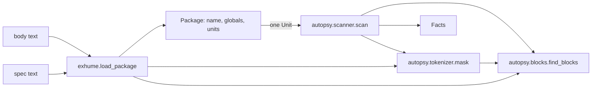

# Design Document

## Overview

Exhume and the Autopsy scanner turn raw PL/SQL text into typed, line-accurate facts. Exhume (`gravedigger.exhume.load_package`) splits a package body into units. The scanner (`gravedigger.autopsy.scanner.scan`) reads one unit and reports constants, string literals, tables, calls, branches, handled exceptions, swallowed errors and global use. Every constant carries the file line it came from.

The design rests on three ideas:

1. **Mask first, then match.** One shared tokenizer blanks comments and string literals while keeping every character offset and every newline. All later regex work runs on the masked text, so commented-out rates (15.50, 21) and text such as `'rate 99 -- not a comment'` can never leak into a fact. Because offsets are unchanged, a match position in the masked text is also a position in the original text.
2. **One block walker.** A small stack-based walker finds nested blocks (`FUNCTION`, `PROCEDURE`, `BEGIN`, `DECLARE`, `IF`, `LOOP`, `CASE`) in masked text. Exhume uses it to find top-level units and their closing `END`. The scanner uses it to find exception handlers. Neither needs a full PL/SQL parser.
3. **Pure, stdlib-only, immutable.** Every function is pure. All data types are frozen dataclasses. Only `re`, `bisect`, `dataclasses`, `decimal` and `typing` are imported (Requirement 14.1).

### Research findings that shaped the design

No web research was needed. The inputs are the repo itself.

- `legacy/billing_pkg.pkb` has a nested block inside `p_gen_bill` (a `BEGIN ... EXCEPTION WHEN NO_DATA_FOUND ... END;` around the `PYMT` lookup) and a unit-level `WHEN OTHERS THEN NULL;`. A flat "find END name;" approach is not enough, so a block walker is used.
- `tests/test_autopsy_scanner.py` expects `p_gen_bill.exceptions_handled == {"NO_DATA_FOUND", "OTHERS"}`. `NO_DATA_FOUND` is only handled in the nested block. See the decision "Exception_Section covers nested handlers" below.
- Tests compare `Facts` fields with plain `set` literals (`== {"FPA_RT"}`, `== set()`). A `frozenset` compares equal to a `set`, so frozen dataclasses can hold `frozenset` fields.
- Tests read `u.name`, `u.kind`, `u.return_type`, `u.params`, `u.start_line`, `u.end_line`, `u.source`, `p.name`, `p.mode`, `p.datatype`, `g.name`, `c.value`, `c.line`, `pkg.name`, `pkg.globals`, `pkg.units` and call `scan(unit)`. `(unit,) = pkg.units` needs `units` to be a sequence of known length, so a tuple is used.
- `tests/conftest.py` defines the Hypothesis profiles `dev` (200 examples) and `ci` (2000, derandomized). Property tests rely on these profiles and do not set their own `max_examples`.

### Design decisions

| Decision | Rationale |
| --- | --- |
| `mask()` blanks string delimiters as well as string text. | The masked text then contains no `'`, no `--` and no `/*`. That gives a simple, checkable invariant (Requirement 5.8). |
| Table, call, branch and handler regexes run on masked text only. | Requirements 6.3, 8.7, 9.4, 10.5, 11.9 and 12.6 all follow from this one rule. |
| `Unit` carries `sibling_names` and `global_names` as defaulted fields with `repr=False`. | `scan(unit)` takes one argument yet must know the package's unit and global names (Requirements 9 and 12). Names (not a `Package` reference) avoid a cycle and keep `Unit` hashable. |
| Facts use `frozenset` for sets and a `tuple` for constants. | Immutable, deterministic, equal to plain sets in tests. Constants stay ordered by position (Requirement 6.1). |
| `Constant.value` is `Decimal(literal_text)`. | `0.10` keeps two decimals and no float is created (Requirement 6.2, product rule "money is Decimal"). |
| Exception_Section covers the handler section of every block in the unit, not only the outermost one. | Requirement 11.3 and the acceptance test need `NO_DATA_FOUND` for `p_gen_bill`, and it is handled only in a nested block. The glossary wording "the unit's own `EXCEPTION` keyword" is read as "an `EXCEPTION` keyword inside the unit". See Open Points. |
| Errors use `ExhumeError(ValueError)`. | Requirement 1.7 demands `ValueError`. Other malformed-input errors (3.6, 4.8, 13.5) use the same type so callers catch one class. |

## Architecture



Module layout (all under `src/gravedigger/`):

| Module | Responsibility | Imports |
| --- | --- | --- |
| `autopsy/tokenizer.py` | `segments`, `mask`, `string_literals`, line helpers | `re`-free state machine, `bisect`, `dataclasses`, `typing` |
| `autopsy/blocks.py` | `find_blocks` (block structure of masked text) | `re`, `dataclasses`, `tokenizer` helpers |
| `exhume.py` | `load_package`, `Package`, `Unit`, `Param`, `Global`, `ExhumeError` | `re`, `dataclasses`, `autopsy.tokenizer`, `autopsy.blocks` |
| `autopsy/scanner.py` | `scan`, `Facts`, `Constant`, small typed helpers | `re`, `dataclasses`, `decimal`, `exhume`, `autopsy.*` |

`autopsy/__init__.py` stays as it is (docstring only), so importing `gravedigger.autopsy.tokenizer` pulls in nothing else.

Line-number rule: lines are counted by the `\n` character, starting at 1 for the first line of the text given. `\r` is whitespace and never starts a new line. For the legacy file this makes line `N` of the body equal line `N` of `legacy/billing_pkg.pkb` (Requirement 3.1). Database line numbers are never used.

## Components and Interfaces

### `autopsy/tokenizer.py`

```python
from dataclasses import dataclass
from typing import Literal

SegmentKind = Literal["code", "comment", "string"]


@dataclass(frozen=True)
class Segment:
    kind: SegmentKind
    start: int      # inclusive offset in the input
    end: int        # exclusive offset
    closed: bool    # False only for an unterminated comment or string


def segments(text: str) -> tuple[Segment, ...]: ...
def mask(text: str) -> str: ...
def string_literals(text: str) -> tuple[str, ...]: ...
def line_starts(text: str) -> tuple[int, ...]: ...
def line_of(starts: tuple[int, ...], pos: int) -> int: ...      # 1-based
def column_of(starts: tuple[int, ...], pos: int) -> int: ...    # 1-based
```

`segments` is a single left-to-right state machine with three states:

- **code**: `--` starts a line comment, `/*` starts a block comment, `'` starts a string. Anything else stays code.
- **line comment**: runs up to, not including, the next `\n` or `\r`.
- **block comment**: runs through the first `*/` found after the opening `/*` (so `/*/` does not close itself). Not nested, as in Oracle.
- **string**: a `'` followed by another `'` is an escaped quote and stays in the string. A lone `'` closes it. So `''` alone is the empty string, and `''''` is the one-character string `'`.

Unterminated comments and strings extend to the end of the input with `closed=False`. No error is raised (Requirement 5.7). Quote characters inside a comment, and `--` or `/*` inside a string, are consumed by the state they are in (Requirements 5.5, 5.6).

`mask(text)` builds its result from `segments`. Code is copied. Every character of a comment or string segment, delimiters included, becomes a space, except `\n` and `\r`, which are kept. The result has the same length and the same newline positions as the input (Requirements 5.1 to 5.4).

`string_literals(text)` returns the content of each string segment in order. It strips the delimiters and turns each `''` into `'` (Requirements 7.1, 7.2, 7.7, 7.8). An unterminated literal is reported with the text up to the end of the input.

### `autopsy/blocks.py`

```python
@dataclass(frozen=True)
class Block:
    kind: Literal["function", "procedure", "begin", "declare", "if", "loop", "case"]
    name: str | None          # lower-case subprogram name, else None
    depth: int                # number of enclosing blocks; 0 = top level
    start: int                # offset of the opening keyword
    header_end: int | None    # offset of IS/AS for subprograms, else None
    end: int | None           # offset of the closing END keyword; None if never closed
    exception_pos: int | None # offset of this block's own EXCEPTION keyword, if any


def find_blocks(masked: str) -> tuple[Block, ...]: ...   # in opening order
```

The walker reads words (`[A-Za-z_][A-Za-z0-9_$#]*` not preceded by an identifier character, so `$IF` conditional-compilation tokens are skipped) and keeps a stack of open blocks.

- `FUNCTION` / `PROCEDURE`: look ahead for the first `;` or whole-word `IS`/`AS` at parenthesis depth 0. A `;` first means a forward declaration, so no block is opened. Otherwise open a subprogram block and skip to the `IS`/`AS`.
- `DECLARE`: open a block that is not yet "begun".
- `BEGIN`: if the top block is a subprogram or declare block that is not yet begun, mark it begun (its `BEGIN` is its body). Otherwise open a `begin` block (anonymous block, or the package initialisation section).
- `IF`, `LOOP`, `CASE`: open a block. `ELSIF` and `ELSE` open nothing.
- `EXCEPTION`: if the top block is begun, record `exception_pos` on it. In a declarative part (`e_x EXCEPTION;`) the top block is not begun, so it is ignored. `EXCEPTION_INIT` is a different word.
- `END`: pop exactly one block and record `end` as the offset of this `END`. If the next word is `IF`, `LOOP` or `CASE`, consume it. A stray `END` on an empty stack (the package's own `END billing_pkg;`) is ignored.

Blocks still open at the end of the input keep `end=None`. Because a sub-block is a `Block` with its own `depth`, "top-level unit" means `kind in {"function", "procedure"}` and `depth == 0`.

Known limits, accepted for this scope: quoted identifiers (`"if"`), `q'[...]'` literals, and a CASE expression whose closing `END` is directly followed by `IF`/`LOOP`/`CASE`.

### `exhume.py`

```python
class ExhumeError(ValueError): ...

def load_package(spec_text: str, body_text: str) -> Package: ...

# internal helpers (private, pure, typed)
def _package_name(spec_masked: str) -> str: ...
def _spec_globals(spec_masked: str, package: str) -> tuple[Global, ...]: ...
def _require_body_header(body_masked: str) -> None: ...
def _top_level_units(body_text: str, body_masked: str, blocks: tuple[Block, ...]) -> tuple[Unit, ...]: ...
def _parse_header(unit_name: str, header_masked: str, kind: str) -> tuple[tuple[Param, ...], str | None]: ...
def _split_top_level(text: str, sep: str) -> list[str]: ...
def _parse_param(unit_name: str, text: str) -> Param: ...
def _slice_lines(text: str, starts: tuple[int, ...], first: int, last: int) -> str: ...
```

`load_package` steps:

1. Mask the spec. Find `CREATE OR REPLACE [EDITIONABLE|NONEDITIONABLE] PACKAGE <name>` where `<name>` is not `BODY`, case-insensitively. No match raises `ValueError` (Requirement 1.7). The name is lower-cased (1.1).
2. Globals (Requirements 1.2 to 1.4). Take the masked spec between the first `AS`/`IS` after the header and the closing `END <name>;`. Split on `;`. For each statement, skip it when its first word is `FUNCTION`, `PROCEDURE`, `TYPE`, `SUBTYPE`, `CURSOR` or `PRAGMA`, or when its second word is `CONSTANT` or `EXCEPTION`. Every other statement is a variable, and its first word, lower-cased, becomes a `Global`. Order is declaration order. Constants and exceptions are not "global variables" and are left out on purpose.
3. Mask the body and check for `CREATE OR REPLACE ... PACKAGE BODY`. If it is missing, raise `ExhumeError` (Requirement 13.5).
4. Run `find_blocks` on the masked body. Keep blocks with `depth == 0` and kind `function`/`procedure`. Nested units have `depth > 0` and are dropped (Requirement 2.7). `FUNCTION x` in a comment or string is already masked (2.8). Forward declarations open no block.
5. For each kept block: if `end is None`, raise `ExhumeError` naming the unit, before anything is returned (Requirement 3.6). Otherwise compute `start_line = line_of(start)` and `end_line = line_of(end)`, where `end` is the offset of the closing `END` keyword. The `source` is the original body text from the start of `start_line` to the end of `end_line`, without the final line break (a trailing `\r` is dropped too). That makes the source the exact file text of those lines (Requirement 3.4). Banner comments above `start_line` fall outside it (3.5).
6. Header parsing. The header is `masked[block.start : block.header_end]`.
   - Kind comes from the keyword, name from the next word, lower-cased (2.3, 2.10).
   - If a `(` follows the name, find its matching `)`. Unbalanced parentheses raise `ExhumeError` naming the unit (4.8). Split the contents on commas at parenthesis depth 0. Each piece must match `name [IN | OUT | IN OUT] [NOCOPY] datatype [:= expr | DEFAULT expr]`, otherwise raise `ExhumeError` naming the unit (4.8). An empty piece, as in `(a NUMBER,)`, is also an error.
   - Name is lower-cased. Mode is `IN` when absent, otherwise `IN`, `OUT` or `IN OUT` upper-cased (4.3 to 4.5). Datatype is upper-cased, with runs of whitespace collapsed to one space and no space around `.` or `%` (so multi-line and oddly spaced lists parse to the same `Param` values, 4.7).
   - For a function, the return type is the token after `RETURN`, upper-cased (2.4). A function with no `RETURN` raises `ExhumeError` naming the unit. For a procedure, `return_type` is `None` (2.5).
7. Every `Unit` gets `sibling_names` (all unit names, body order) and `global_names` (spec globals, declared order). A body with no units gives `units == ()` and no error (2.9).

### `autopsy/scanner.py`

```python
def scan(unit: Unit) -> Facts: ...

# small typed helpers, each pure and unit-testable on its own
def _masked_with_lines(unit: Unit) -> tuple[str, tuple[int, ...]]: ...
def find_constants(masked: str, starts: tuple[int, ...], first_line: int) -> tuple[Constant, ...]: ...
def find_tables(masked: str) -> tuple[frozenset[str], frozenset[str]]: ...     # (read, written)
def find_name_uses(masked: str, names: Iterable[str]) -> frozenset[str]: ...   # whole-word, case-insensitive
def count_branches(masked: str) -> int: ...
def find_handlers(masked: str, blocks: tuple[Block, ...]) -> tuple[frozenset[str], bool]: ...
def whole_word(name: str) -> re.Pattern[str]: ...
```

`scan(unit)` masks `unit.source`, builds the line index, runs `find_blocks` once, and assembles `Facts`:

- **Constants (Requirement 6).** Pattern `(?<![A-Za-z0-9_$#])(?:\d+(?:\.\d+)?|\.\d+)(?:[eE][+-]?\d+)?(?![A-Za-z0-9_$#])` on masked text. The lookbehind keeps digits inside identifiers out (`v_x1`, 6.8). The value is `Decimal(match.group())`, built from text. `line = unit.start_line + (newlines before the match)` and `col` is 1-based within that line. Matches arrive in position order, which is the required line-then-column order. A leading minus is not part of the literal; the constant is the literal's magnitude.
- **String literals (Requirement 7).** `frozenset(string_literals(unit.source))`.
- **Tables (Requirement 8).** Write patterns first: `INSERT\s+INTO`, `UPDATE` (skipped when the previous word is `FOR`, so `FOR UPDATE` is not a write) and `DELETE\s+(?:FROM\s+)?`, each followed by `(?:schema\.)?table`. Read patterns then match `FROM|JOIN` plus table, ignoring any table token already claimed as a write target, so `DELETE FROM t` and `INSERT INTO t` never appear in `tables_read` (8.6). `\s+` covers newlines and tabs (8.4). The optional schema prefix is dropped (8.5). Names are upper-cased in sets, so each appears once (8.8). Known limit: `EXTRACT(x FROM d)` and `TRIM(... FROM s)` can look like a read of `d` or `s`.
- **Calls and globals (Requirements 9, 12).** `find_name_uses` searches `whole_word(name)` (case-insensitive, no identifier character on either side) over masked text. Calls use `unit.sibling_names` minus `unit.name`. Globals use `unit.global_names`. Results are lower-case names in a `frozenset`.
- **Branches (Requirement 10).** One scan with `(?<![A-Za-z0-9_$#])(END\s+IF|ELSIF|IF)(?![A-Za-z0-9_$#])`, case-insensitive. Count matches that are not `END IF`.
- **Handlers (Requirement 11).** A handler region is `masked[b.exception_pos : b.end]` for every block `b` with an `exception_pos`. A `WHEN` at offset `p` counts only when the innermost block containing `p` (largest `start` with `start <= p < end`) is a block whose `exception_pos < p`. This drops `WHEN` that belongs to a `CASE` or `IF` inside a body, and `WHEN` outside any handler section (11.8). For each counted `WHEN ... THEN` clause, the condition text is split on whole-word `OR`, and each name is upper-cased into `exceptions_handled`. The handler body runs from the end of `THEN` to the next counted `WHEN` or to the block's `END`. If the names include `OTHERS` and the body, stripped, equals `NULL;` in any case, `swallows_errors` is `True`. Comments are already blanked, so "ignoring whitespace and comments" is automatic (11.4). No `EXCEPTION` keyword gives an empty set and `False` (11.2).

All sets are `frozenset`, so no output depends on hash order, and `scan` makes no I/O or network call (Requirements 14.2, 14.3).

## Data Models

All types are `@dataclass(frozen=True)`. Assigning to any field raises `dataclasses.FrozenInstanceError` (Requirement 1.6).

```python
# gravedigger/exhume.py
@dataclass(frozen=True)
class Param:
    name: str                    # lower-case, e.g. "p_prev"
    mode: str                    # "IN" | "OUT" | "IN OUT"
    datatype: str                # upper-case, e.g. "NUMBER"


@dataclass(frozen=True)
class Global:
    name: str                    # lower-case, e.g. "g_dbg"


@dataclass(frozen=True)
class Unit:
    name: str                    # lower-case
    kind: Literal["function", "procedure"]
    params: tuple[Param, ...]
    return_type: str | None      # None for a procedure
    start_line: int              # 1-based, line of FUNCTION/PROCEDURE keyword
    end_line: int                # 1-based, line of closing END <name>;
    source: str                  # exact text of lines start_line..end_line
    sibling_names: tuple[str, ...] = field(default=(), repr=False)  # all unit names of the package
    global_names: tuple[str, ...] = field(default=(), repr=False)   # all spec global names


@dataclass(frozen=True)
class Package:
    name: str                    # lower-case, e.g. "billing_pkg"
    globals: tuple[Global, ...]
    units: tuple[Unit, ...]      # body order
```

```python
# gravedigger/autopsy/scanner.py
@dataclass(frozen=True)
class Constant:
    value: Decimal               # built from the literal text, never a float
    line: int                    # 1-based file line
    col: int                     # 1-based column in that line


@dataclass(frozen=True)
class Facts:
    constants: tuple[Constant, ...]          # ordered by (line, col)
    string_literals: frozenset[str]
    tables_read: frozenset[str]              # upper-case
    tables_written: frozenset[str]           # upper-case
    calls: frozenset[str]                    # lower-case sibling unit names
    branches: int
    exceptions_handled: frozenset[str]       # upper-case
    swallows_errors: bool
    globals_used: frozenset[str]             # lower-case global names
```

`Unit.sibling_names` and `Unit.global_names` default to empty tuples so a `Unit` can be built by hand in a test. They take part in equality and hashing, which is harmless. They are excluded from `repr` so printed units stay short.

Field types match how the tests use them: `u.params` and `pkg.units` are tuples, `facts.calls == {...}` compares a `frozenset` with a `set`, and `values(f)` builds a set from `c.value`.

## Correctness Properties

*A property is a characteristic or behavior that should hold true across all valid executions of a system-essentially, a formal statement about what the system should do. Properties serve as the bridge between human-readable specifications and machine-verifiable correctness guarantees.*

Reflection on the prework: the per-criterion prework gave about 60 testable criteria. Several collapse into one property. Calls (9.x) and globals (12.x) use the same whole-word rule, so they share one property. Constants 6.1, 6.2, 6.3 and 6.8 share one property. Unit discovery, line ranges and source slicing share one property. Keyword-case independence (13.4) is kept separate because it ranges over every fact at once. Concrete legacy facts (for example `f_units` 18-31, `99999` on line 23) stay with the existing acceptance tests and are not repeated as properties.

### Property 1: Masking preserves layout

*For any* text, `mask(text)` has the same length as `text`, and a character is `\n` or `\r` in the result exactly when it is in the input at the same offset. So the number of `\n` characters and the number of `\r` characters are also equal.

**Validates: Requirements 5.3, 5.4, 5.8**

### Property 2: Masked text has no comment or quote markers, and masking is idempotent

*For any* text, `mask(text)` contains no `--`, no `/*` and no `'`, and every character is either unchanged from the input or a space replacing a non-newline character. `mask(mask(text)) == mask(text)`.

**Validates: Requirements 5.1, 5.2, 5.8**

### Property 3: Masking matches a structural oracle

*For any* sequence of code pieces, line comments, block comments and string literals (with `--` and `/*` placed inside strings, and quotes placed inside comments), `mask` of the concatenation equals the concatenation of each code piece verbatim and each non-code piece replaced by spaces with its newlines kept.

**Validates: Requirements 5.1, 5.2, 5.5, 5.6**

### Property 4: Unterminated openers mask to the end

*For any* code prefix and any tail that does not contain the matching closer, `mask(prefix + opener + tail)` raises no error, keeps the prefix unchanged, and has only spaces and newline characters after the prefix. The openers are `/*` (tail without `*/`) and `'` (tail without `'`).

**Validates: Requirements 5.7**

### Property 5: String literal round trip

*For any* list of strings `s1..sn` (including the empty string and strings containing `'`, `--`, `/*` and digits), quoting each one (doubling `'`) and placing the results in code gives `string_literals(code) == (s1, ..., sn)`, and `scan(...)` returns `frozenset({s1, ..., sn})`. None of the digits inside those strings appear in `constants`.

**Validates: Requirements 7.1, 7.2, 7.4, 7.7, 7.8**

### Property 6: Constants are exact, live, ordered and located

*For any* unit whose lines mix numeric literals in code (plain decimals such as `0.10`, `99999`, `7`), identifiers containing digits (`v_x1`), and the same kinds of literals inside comments and strings, `scan(unit).constants` contains exactly the code literals in line-then-column order. Each `Constant.value` is a `Decimal` with `str(value)` equal to the literal text, and each `line` equals the line where the generator wrote that literal.

**Validates: Requirements 6.1, 6.2, 6.3, 6.8**

### Property 7: Tables are classified, normalised and live-only

*For any* generated statements using `FROM`, `JOIN`, `INSERT INTO`, `UPDATE` and `DELETE FROM` with random table names, optional schema prefixes, random letter case and random whitespace (spaces, tabs, newlines) between keyword and table, `tables_read` and `tables_written` equal the expected upper-case schema-free sets. A table that appears only after `INSERT INTO`, `UPDATE` or `DELETE FROM` is not in `tables_read`. Tables named only in comments or strings are in neither set.

**Validates: Requirements 8.1, 8.2, 8.3, 8.4, 8.5, 8.6, 8.7, 8.8**

### Property 8: Name uses are whole-word, live-only and case-insensitive

*For any* set of sibling unit names, global names and a scanned unit, and any code that uses some of those names as whole words in random letter case, `scan(unit).calls` equals the used sibling names minus the unit's own name, and `scan(unit).globals_used` equals the used global names. Each name appears once. A name that appears only in a comment, in a string, or inside a longer identifier (extra letter, digit, `_`, `$` or `#` before or after it) is not reported.

**Validates: Requirements 9.1, 9.2, 9.3, 9.4, 9.5, 12.1, 12.2, 12.3, 12.6**

### Property 9: Branch count counts IF and ELSIF only

*For any* generated nesting of `IF`, `ELSIF`, `ELSE` and `END IF` in random letter case, with decoy `IF`/`ELSIF` text in comments and strings, `scan(unit).branches` equals the number of generated `IF` plus `ELSIF` keywords in code.

**Validates: Requirements 10.1, 10.3, 10.5**

### Property 10: Handlers are collected only from handler sections

*For any* unit built from an optional nested block and an outer handler section, where each handler lists names from a pool (single names and `A OR B` lists), and where bodies may contain `CASE WHEN x THEN` expressions, `EXIT WHEN` lines and decoy `WHEN` text in comments and strings, `exceptions_handled` equals the upper-case set of generated handler names, from the nested block and the outer section alike. `swallows_errors` is `True` exactly when an `OTHERS` handler has a body that is only `NULL;` (any letter case, any whitespace or comments around it).

**Validates: Requirements 11.1, 11.4, 11.5, 11.8, 11.9**

### Property 11: Keyword case does not change facts

*For any* generated unit rendered twice with different random letter case on keywords and identifiers (string contents unchanged), `load_package` and `scan` return equal `Package` fields (apart from `source`) and equal `Facts`.

**Validates: Requirements 2.10, 13.4**

### Property 12: Unit discovery, ranges and source slices

*For any* generated package body with 0 to N units of random kind, name, parameters and return type, preceded by banner comments, with optional nested units, forward declarations and decoy `FUNCTION x` / `PROCEDURE y` text in comments and strings, in random keyword case, and for any package name, `load_package` returns exactly the top-level units in body order. Each unit has the expected lower-case name, kind and return type (`None` for procedures), `start_line` and `end_line` equal to the generator's line numbers for the keyword and the closing `END`, and `source` equal to the generator's text of those lines. Banner lines are not in any `source`.

**Validates: Requirements 2.1, 2.3, 2.4, 2.5, 2.7, 2.8, 2.9, 2.10, 3.1, 3.2, 3.4, 3.5, 13.1**

### Property 13: Parameters parse in order and ignore layout

*For any* list of parameters (name, optional mode `IN`/`OUT`/`IN OUT`, datatype, optional default), rendered with random whitespace, line breaks and comments between tokens, `Unit.params` equals the expected `Param` tuple in declared order, with mode `IN` when no mode is written. The result is identical for every rendering of the same list. An empty list gives `()`.

**Validates: Requirements 4.1, 4.2, 4.3, 4.4, 4.5, 4.7**

### Property 14: Package name and globals

*For any* package name and any list of distinct variable names (possibly empty) declared in a spec in random letter case, alongside function and procedure declarations, `load_package` returns `Package.name` as the lower-case name and `Package.globals` as the lower-case names in declared order. Every `Unit.global_names` equals that list.

**Validates: Requirements 1.1, 1.2, 1.3, 1.4**

### Property 15: Malformed input is rejected, never half-loaded

*For any* generated spec text that lacks `CREATE OR REPLACE PACKAGE`, `load_package` raises `ValueError`. *For any* body text that lacks a `PACKAGE BODY` header, `load_package` raises an error. *For any* generated body in which one unit lacks its closing `END`, or has an unparseable parameter list (unbalanced parenthesis, empty piece), `load_package` raises an `ExhumeError` whose message contains that unit's name and returns no units.

**Validates: Requirements 1.7, 3.6, 4.8, 13.5**

### Property 16: Scanning is deterministic

*For any* unit, calling `scan(unit)` twice gives equal `Facts`, and the result does not depend on `PYTHONHASHSEED`.

**Validates: Requirements 14.2**

## Error Handling

| Situation | Behavior |
| --- | --- |
| Spec has no `CREATE OR REPLACE PACKAGE` | `load_package` raises `ValueError` (Requirement 1.7). |
| Body has no `PACKAGE BODY` header | `ExhumeError` (a `ValueError`) (13.5). |
| A top-level unit is never closed | `ExhumeError` naming the unit. Nothing is returned (3.6). |
| Parameter list cannot be parsed, or a function has no `RETURN` | `ExhumeError` naming the unit (4.8). |
| Unterminated comment or string | No error. Text is masked to the end of the input (5.7). |
| Stray `END` outside any block | Ignored by the block walker. The package's own `END billing_pkg;` is such a case. |
| Unit with no constants, tables, calls or handlers | Empty `Facts` collections, `branches == 0`, `swallows_errors == False`. No error. |
| Package body with no functions or procedures | `Package.units == ()`. No error (2.9). |

`scan` never raises for a `Unit` produced by `load_package`. All `ExhumeError` messages start with the unit name or the missing item, so a caller can show them directly.

Known limits, listed so the autopsy can state them as risks: quoted identifiers, `q'[...]'` literals, `EXTRACT(x FROM d)` and `TRIM(... FROM s)` read as table reads, body-private variables are not listed as globals, and `CONSTANT` and `EXCEPTION` declarations are not listed as globals.

## Testing Strategy

PBT applies. Exhume and the scanner are pure functions of text, the input space is large, and the requirements state universal rules (masking invariants, round trips, whole-word matching). The I/O-free design means each property runs 200 examples (`dev`) or 2000 (`ci`) in memory.

**Existing acceptance tests.** `tests/test_autopsy_scanner.py` is not modified (Requirement 14.4). It covers the concrete legacy facts: line ranges, constants and their lines, table sets, calls, branch counts, handlers, and the `tricky_pkg` case.

**Property tests (new files, Hypothesis).**

- `tests/plsql_strategies.py`: shared generators. A `render` helper turns a structured description (units, params, statements, decoys) into PL/SQL text and returns the facts the generator expects (line numbers, name sets, counts). `wrap_unit(lines)` builds a one-unit package through `load_package` for scanner properties, so `Unit` objects always come from Exhume.
- `tests/test_tokenizer_props.py`: Properties 1 to 4.
- `tests/test_scanner_props.py`: Properties 5 to 11 and 16.
- `tests/test_exhume_props.py`: Properties 12 to 15.
- No test sets `max_examples`. Each uses the profile from `tests/conftest.py`, so Property 2 and the masking properties run at least 200 examples under `dev` (Requirement 5.8).
- Each test carries a comment in the form `# Feature: autopsy-scanner, Property N: <title>`. Each property is one `@given` test.

**Example and smoke tests (in `tests/test_autopsy_scanner_units.py`).**

- Frozen dataclasses: assigning to a field of `Package`, `Unit`, `Param`, `Global` and `Facts` raises `FrozenInstanceError` (1.5, 1.6).
- Imports: parse `exhume.py`, `autopsy/tokenizer.py`, `autopsy/blocks.py` and `autopsy/scanner.py` with `ast` and assert every import is standard library or `gravedigger.*` (14.1, 14.3).
- Cross-process determinism: run a small `python -c` script under two different `PYTHONHASHSEED` values and compare the printed sorted facts (14.2).
- Hand-written edge cases for the block walker: `$IF` directives, `END CASE;`, a CASE expression closed by bare `END`, `FOR UPDATE`, a forward declaration, `DELETE FROM t`, `WHEN a OR b THEN`.

**Verification outside the test code.**

- `tests/test_autopsy_scanner.py` stays byte-identical (14.4): check with `git diff -- tests/test_autopsy_scanner.py`.
- `.venv\Scripts\python.exe -m pytest -q` with `ORACLE_DSN` unset passes all tests in `tests/test_autopsy_scanner.py` with none skipped (14.5). A failing test makes pytest exit non-zero and name the test (14.6). That is pytest behavior and is not re-tested.

## Open Points

1. **Glossary versus Requirement 11.3.** The glossary defines Exception_Section as starting at "the unit's own `EXCEPTION` keyword". The acceptance test needs `NO_DATA_FOUND` for `p_gen_bill`, and only a nested block handles it. This design treats every `EXCEPTION` inside the unit as a handler section, and a `WHEN` counts when its innermost enclosing block owns that handler section. Suggested wording for `requirements.md`: "an Exception_Section starts at an `EXCEPTION` keyword that belongs to the unit or to a block nested in it, and ends at the `END` that closes that block."
2. **Column name.** The requirements say "column position". The design names the field `col`. The tests do not read it.
3. **Globals scope.** Only variables declared in the package spec are globals. Constants and exceptions are excluded, and body-private variables are not listed.
