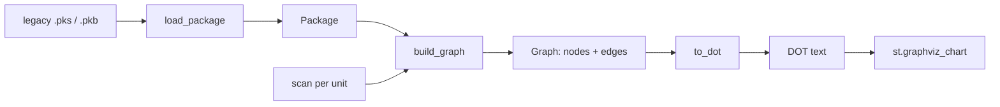
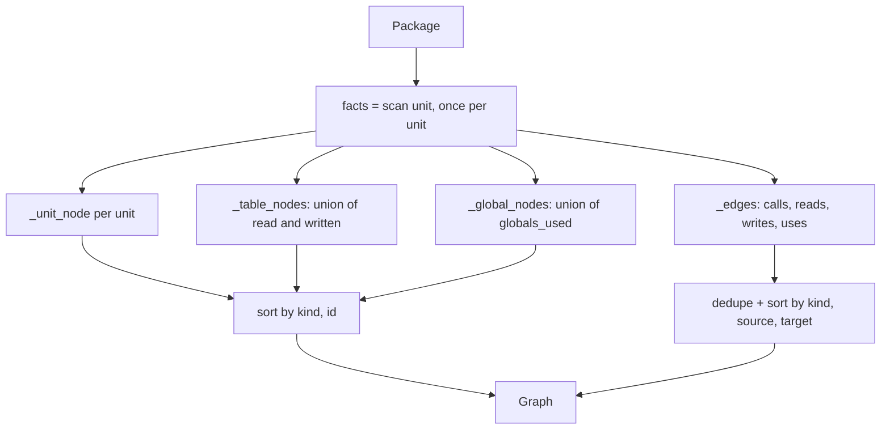
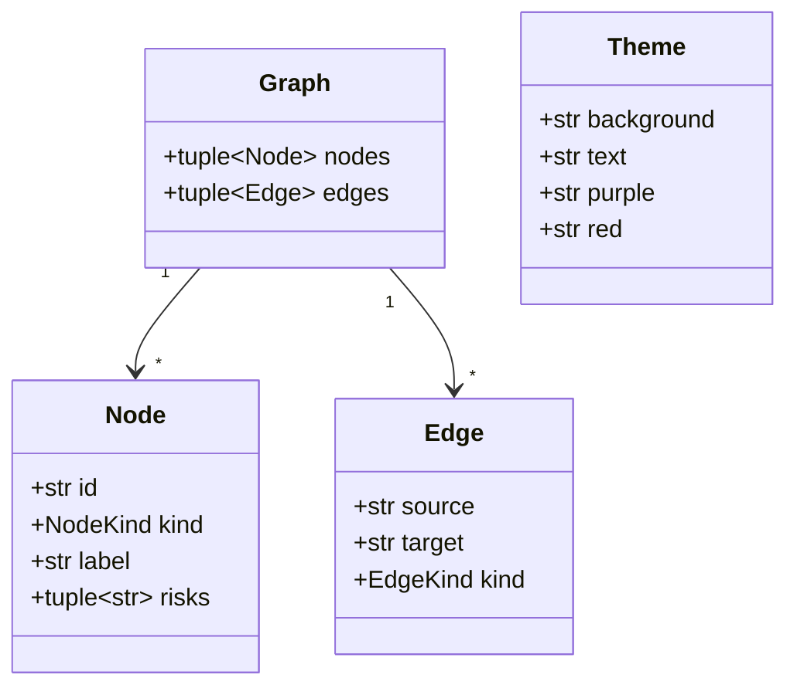

# Design Document

## Overview

The dependency graph turns a loaded PL/SQL package into a small picture: which unit calls which, which tables each unit reads and writes, which package globals each unit touches, and which units hide failures. The feature adds one module, `src/gravedigger/autopsy/graph.py`, with two public functions:

- `build_graph(package: Package) -> Graph` collects facts into nodes and edges.
- `to_dot(graph: Graph) -> str` writes Graphviz DOT text, which the Autopsy page draws with `st.graphviz_chart`.

The module does no PL/SQL parsing. All facts come from the existing `load_package` (`gravedigger.exhume`) and `scan` (`gravedigger.autopsy.scanner`). Design rules:

- Standard library plus `gravedigger` imports only. No `re` import is needed.
- Frozen dataclasses for `Graph`, `Node`, `Edge` and `Theme`.
- Small pure functions and no mutable global state. Module-level constants are immutable (frozen `Theme`, tuples).
- Decimal is not relevant: the graph holds no money.

The acceptance tests in `tests/test_autopsy_graph.py` stay unmodified. This design was checked against them (see "Compatibility with the acceptance tests").

### Real interfaces this design builds on

Read from the current source:

| Item | Real definition |
|---|---|
| `Package` | frozen: `name: str`, `globals: tuple[Global, ...]`, `units: tuple[Unit, ...]` |
| `Global` | frozen: `name: str` (lower case) |
| `Unit` | frozen: `name`, `kind: Literal["function","procedure"]`, `params`, `return_type`, `start_line`, `end_line`, `source`, `sibling_names`, `global_names` |
| `Facts` | frozen: `constants`, `string_literals`, `tables_read: frozenset[str]`, `tables_written: frozenset[str]`, `calls: frozenset[str]`, `branches`, `exceptions_handled`, `swallows_errors: bool`, `globals_used: frozenset[str]` |
| `scan` | `scan(unit: Unit) -> Facts`, pure |
| `load_package` | `load_package(spec_text: str, body_text: str) -> Package` |

Facts about these values that shape the design:

- `Facts.calls` already excludes the unit itself (`scan` filters `n != unit.name`) and holds lower-case sibling names. The set type already removes duplicates, but the builder still deduplicates edges so the guarantee does not depend on that.
- `tables_read` and `tables_written` are upper-case, schema prefix dropped. `globals_used` is lower case.
- A unit that both reads and writes the same table gets one table node and two edges (`reads`, `writes`).
- `scan` is imported into `graph.py` as a module-level name (`from gravedigger.autopsy.scanner import scan`). Tests then replace it with `unittest.mock.patch("gravedigger.autopsy.graph.scan", ...)` to count calls and to feed generated `Facts`.

## Architecture



`build_graph` is the only function that touches `Package` and `Facts`. `to_dot` knows only `Graph`, so it can be tested with hand-made graphs, including ones that `build_graph` would never produce (quotes, line breaks, empty).

Internal flow of `build_graph`:



Design decisions:

1. **Nodes and edges sorted in `build_graph` and again in `to_dot`.** `build_graph` returns canonical order so equal packages give equal `Graph` values (Req 5.6). `to_dot` sorts on its own so hand-made graphs in any order give identical text (Req 6.5).
2. **Risk text lives in `Node.risks`, the label stays short.** `Node.label` is `"<name> (<kind>)"` for units. `to_dot` appends risks to the drawn label (Req 10.3). The label is then a function of the Node alone.
3. **All colours in one frozen `Theme`.** Colour strings appear nowhere else in the module (Req 9.4).
4. **Escaping in one function, `_escape`.** Every id, label and risk goes through it (Req 7.3, 7.4, 10.6).
5. **Name collisions are out of scope.** In PL/SQL a unit, a package global and a table cannot share a case-folded name in one scope in practice, and the unit/global names are lower case while table names are upper case. The builder does not rename. Generators for the properties draw unit, table and global names from disjoint alphabets, and Property 1 asserts uniqueness on that domain.
6. **Calls to unknown names are skipped.** `Facts.calls` is built from `sibling_names`, so unknown names do not occur in real input, but the builder filters against the package's unit names anyway (Req 3.11).

## Components and Interfaces

All in `src/gravedigger/autopsy/graph.py`.

```python
from __future__ import annotations

from dataclasses import dataclass
from typing import Literal

from gravedigger.autopsy.scanner import Facts, scan
from gravedigger.exhume import Package, Unit

NodeKind = Literal["unit", "table", "global"]
EdgeKind = Literal["calls", "reads", "writes", "uses"]


@dataclass(frozen=True)
class Node:
    id: str
    kind: NodeKind
    label: str
    risks: tuple[str, ...] = ()


@dataclass(frozen=True)
class Edge:
    source: str
    target: str
    kind: EdgeKind


@dataclass(frozen=True)
class Graph:
    nodes: tuple[Node, ...]
    edges: tuple[Edge, ...]


@dataclass(frozen=True)
class Theme:
    background: str
    text: str
    purple: str
    red: str
    # plus the other colours used by edge styles, e.g. amber, teal, grey


@dataclass(frozen=True)
class EdgeStyle:
    color: str
    style: str      # "solid" | "dashed" | "dotted"
    penwidth: str   # e.g. "1.2"; compared numerically in tests


def build_graph(package: Package) -> Graph: ...
def to_dot(graph: Graph) -> str: ...
```

`Node.risks` defaults to `()` and the acceptance tests only read fields, so the default is safe. Constructors in the tests' contract (`Node(id, kind, label, risks)`) match the field order.

### Private helpers (all pure)

| Function | Purpose | Requirements |
|---|---|---|
| `_unit_node(unit, facts) -> Node` | id = `unit.name`, label = `f"{unit.name} ({unit.kind})"`, risks = `(SWALLOW_RISK,)` if `facts.swallows_errors` else `()` | 1.1, 2.1, 4.1, 4.2 |
| `_table_nodes(all_facts) -> tuple[Node, ...]` | one node per distinct name in the union of `tables_read` and `tables_written`; label = id; no risks | 1.3, 1.8, 2.3, 4.3 |
| `_global_nodes(all_facts) -> tuple[Node, ...]` | one node per distinct name in the union of `globals_used`; label = id; no risks | 1.5, 2.3, 4.3 |
| `_edges_for(unit, facts, unit_names) -> frozenset[Edge]` | calls (filtered to `unit_names`), reads, writes, uses for one unit | 3.1 to 3.4, 3.11 |
| `_node_key(node)` / `_edge_key(edge)` | sort keys `(kind, id)` and `(kind, source, target)`; plain tuples of `str`, code-point order | 6.3 |
| `_escape(text) -> str` | backslash to `\\`, quote to `\"`, CR LF / CR / LF to `\n` (two characters) | 7.3, 7.4 |
| `_node_statement(node) -> str` | one line; shape by kind; risky units get `color` red | 6.6, 8.2 to 8.4, 10.x |
| `_edge_statement(edge) -> str` | one line; attributes from `EDGE_STYLES[edge.kind]` | 6.6, 8.5 to 8.7 |
| `_unit_label(node) -> str` | `label`, then each risk joined by the two-character `\n`, all escaped | 10.3, 10.4 |

`SWALLOW_RISK` is a module constant, a plain English sentence containing `swallow`, for example `"Swallows errors: WHEN OTHERS THEN NULL hides failures"`. The apostrophe-free, ASCII-only text keeps the DOT file safe on any encoding. (Req 4.1 needs exactly one risk text containing "swallow".)

### `build_graph` outline

```python
def build_graph(package: Package) -> Graph:
    scanned = tuple((unit, scan(unit)) for unit in package.units)   # exactly N calls
    unit_names = frozenset(u.name for u in package.units)
    all_facts = tuple(f for _, f in scanned)
    nodes = (
        *(_unit_node(u, f) for u, f in scanned),
        *_table_nodes(all_facts),
        *_global_nodes(all_facts),
    )
    edges = frozenset().union(*(_edges_for(u, f, unit_names) for u, f in scanned))
    return Graph(
        tuple(sorted(nodes, key=_node_key)),
        tuple(sorted(edges, key=_edge_key)),
    )
```

`scan` runs inside a tuple comprehension, so an exception propagates unchanged and no `Graph` is returned (Req 5.7). An empty package gives empty tuples (Req 1.9); `frozenset().union()` with no arguments is the empty set.

### `to_dot` output shape

```
digraph "autopsy" {
  graph [rankdir=LR, bgcolor="#1a1423", fontcolor="#e8e0f0", fontname="Helvetica"];
  node [fontcolor="#e8e0f0", fontname="Helvetica"];
  edge [fontcolor="#e8e0f0"];
  "g_dbg" [label="g_dbg", shape=note, ...];
  "BILL_HDR" [label="BILL_HDR", shape=cylinder, ...];
  "p_gen_bill" [label="p_gen_bill (procedure)\nSwallows errors: ...", shape=box, style="rounded,filled", color="#ff4d4d", ...];
  "p_gen_bill" -> "BILL_HDR" [color="#...", style=solid, penwidth=2.5];
}
```

Rules:

- One statement per line, `\n` as the only separator, two-space indent.
- Graph preamble written once, with `rankdir=LR` appearing exactly once.
- Node statements first (sorted by kind then id), then edge statements (sorted by kind, source, target).
- Every id and endpoint is double-quoted and escaped.
- Unit node: `shape=box`, `style="rounded,filled"`, `color` = purple (safe) or red (risky), `fillcolor` from Theme.
- Table node: `shape=cylinder`. Global node: `shape=note`. Their outline `color` is a Theme colour that is not red.
- The attribute key is written as ` color=` with a leading space or comma-space, and no other attribute name in the statement ends in `color` except `fillcolor` and `fontcolor`. Tests for "exactly one `color` attribute" therefore match with a negative look-behind, `(?<![A-Za-z])color\s*=`.

Edge styles (one `EdgeStyle` per kind, in a constant mapping built from the Theme):

| Kind | Meaning | color | style | penwidth |
|---|---|---|---|---|
| calls | unit calls unit | purple | solid | 1.5 |
| reads | unit reads table | teal | dashed | 1.0 |
| writes | unit writes table | amber | solid | 3.0 |
| uses | unit uses global | grey | dotted | 1.0 |

Each kind differs from every other in at least one of colour, style, penwidth (Req 8.6), and `writes` is thicker than `reads` (Req 8.5).

### Compatibility with the acceptance tests

`tests/test_autopsy_graph.py` was read against this design:

- `to_dot` output has `"id"` for every node, and edge lines match `"a" -> "b"`. The arrow regex `"([^"]+)"\s*->\s*"([^"]+)"` finds exactly one pair per edge line as long as ids contain no `"`. Real ids never do.
- `_node_attrs` needs a node line of the form `"id" [ ... ]` ending at the line end, and the lazy `(.*?)\]\s*;?\s*$` then captures up to the last `]`. Every node statement ends with `];` on one line. Edge lines start with the quoted source followed by `->`, so they never match the node pattern.
- The risky/safe test needs `color\s*=` in the risky attrs and the attrs to differ. They differ in `color` and in the label.
- Labels: `"f_enrg_chg (function)"` and `"p_gen_bill (procedure)"` pass the substring checks.
- Preamble lines such as `graph [rankdir=LR, ...]` and `node [...]` do not begin with a quoted id, so they cannot be mistaken for node statements.
- Brace counts: the test counts raw `{` and `}`. Real labels contain none, and the preamble adds one pair. `to_dot` writes no braces inside labels. A hand-made label containing braces is covered by a separate property that counts braces outside quoted strings.

## Data Models



Invariants of a graph produced by `build_graph`:

- Node ids are unique.
- Every edge endpoint is a node id. `calls` and `uses`/`reads`/`writes` sources are unit ids. `calls` targets are unit ids, `reads`/`writes` targets are table ids, `uses` targets are global ids.
- No two edges share `(source, target, kind)`.
- Table and global nodes have `risks == ()`.
- `nodes` and `edges` are in canonical sorted order.

## Correctness Properties

*A property is a characteristic or behavior that should hold true across all valid executions of a system-essentially, a formal statement about what the system should do. Properties serve as the bridge between human-readable specifications and machine-verifiable correctness guarantees.*

Prework reflection: node-set criteria (1.1, 1.3, 1.5, 1.7, 1.8, 2.3, 4.3) merge into Property 1. Edge criteria (3.1 to 3.4, 3.9, 3.10, 3.11) merge into Property 3. Escaping criteria (2.4, 7.3, 7.4, 10.6) merge into Property 9. Legacy-package criteria (1.2, 1.4, 1.6, 2.2, 3.5 to 3.8, 4.4, 10.5) are concrete examples already covered by `tests/test_autopsy_graph.py`, and 5.1, 5.3, 5.7, 8.5, 8.6, 9.1 to 9.3 and the empty-graph cases are example tests (see Testing Strategy).

### Property 1: Node set is exactly the units, tables and globals found

*For any* generated Package with arbitrary Facts per unit, the Graph returned by `build_graph` has one `unit` node per unit, one `table` node per distinct name in the union of `tables_read` and `tables_written`, one `global` node per distinct name in the union of `globals_used`, and no other nodes. All node ids are distinct. Every table and global node has a label equal to its id and an empty `risks` tuple.

**Validates: Requirements 1.1, 1.3, 1.5, 1.7, 1.8, 2.3, 4.3**

### Property 2: Unit labels name the unit and its kind

*For any* generated Package, the label of each unit node is non-empty, contains the unit name, and contains the word `function` when the unit kind is `function` and `procedure` when it is `procedure`.

**Validates: Requirements 2.1**

### Property 3: Edge set is exactly the facts, deduplicated and anchored

*For any* generated Package with arbitrary Facts (including `calls` names that match no unit), the edges of the Graph are exactly: a `calls` edge for each unit and each name in its `calls` that is a unit of the Package; a `reads` edge for each name in `tables_read`; a `writes` edge for each name in `tables_written`; a `uses` edge for each name in `globals_used`. No two edges share source, target and kind, and every source and target is the id of a node of the same Graph. `build_graph` raises no error.

**Validates: Requirements 3.1, 3.2, 3.3, 3.4, 3.9, 3.10, 3.11**

### Property 4: Risk flag follows swallows_errors

*For any* generated Package, a unit node has `risks` of length exactly one, with a text containing `swallow` in any letter case, when its Facts have `swallows_errors` true, and `risks == ()` when false.

**Validates: Requirements 4.1, 4.2**

### Property 5: scan runs once per unit

*For any* generated Package of N units, `build_graph` calls `scan` exactly N times, once with each unit, and uses only the returned Facts and the Package for its result.

**Validates: Requirements 5.2, 5.1**

### Property 6: Graph values are immutable and builds are repeatable

*For any* generated Package, two calls to `build_graph` return equal Graph values, and assigning to a field of the Graph, of any of its Nodes or of any of its Edges raises `dataclasses.FrozenInstanceError` and leaves the field unchanged.

**Validates: Requirements 5.4, 5.5, 5.6**

### Property 7: DOT frame is well formed

*For any* Graph (generated directly, including empty graphs and ids or labels with quotes, backslashes, braces and line breaks), `to_dot` returns text that starts with `digraph` after leading whitespace and ends with `}` after trailing whitespace. The number of `{` outside quoted strings equals the number of `}` outside quoted strings. The text contains no carriage return. Every non-empty line is either the `digraph` line, a preamble statement, a node statement, an edge statement or the closing brace. Exactly one `rankdir=LR` appears.

**Validates: Requirements 6.1, 6.2, 6.6, 6.8, 7.5, 8.1**

### Property 8: DOT contains every node and edge once, drawn by kind

*For any* Graph, the DOT text has exactly one node statement per node, with the id in double quotes, and exactly one edge statement per edge, written as quoted source, `->`, quoted target. A `unit` node is `shape=box` with `rounded` in its style, a `table` node is `shape=cylinder`, a `global` node is `shape=note`. All edge statements of one kind carry identical attribute text after the endpoints.

**Validates: Requirements 6.7, 7.1, 7.2, 8.2, 8.3, 8.4, 8.7**

### Property 9: Escaping round trip

*For any* text built from arbitrary characters, including double quotes, backslashes and CR, LF, CR LF line breaks, a DOT string literal produced by the module's escaping, when decoded by a reference DOT unescaper written in the test, equals the original text with every line break replaced by one `\n` line feed. The escaped text contains no raw CR or LF, and every `"` and `\` in it is preceded by an odd-length run of backslashes that forms a valid escape. Node labels and risk texts containing such characters therefore stay on one line in the DOT output.

**Validates: Requirements 2.4, 7.3, 7.4, 10.6**

### Property 10: Output is independent of input order

*For any* Graph and any permutation of its nodes and of its edges, `to_dot` returns identical text. Node statements appear sorted by `(kind, id)` and edge statements sorted by `(kind, source, target)`, using code-point comparison. `to_dot(build_graph(p))` called twice on the same Package returns identical text.

**Validates: Requirements 6.3, 6.4, 6.5**

### Property 11: Risky units are red and say why

*For any* Graph, a unit node with at least one risk has exactly one `color` attribute (matched with a look-behind so `fillcolor` and `fontcolor` do not count) and its value is the Theme red. A unit node with no risk has a `color` that is not red. The drawn label of a risky unit is the label, then each risk text in order, separated by the two-character escaped newline. The drawn label of a safe unit is the label alone and does not end with an escaped newline.

**Validates: Requirements 10.1, 10.2, 10.3, 10.4**

### Property 12: Only theme colours appear

*For any* Graph, every colour value (`#rrggbb` text) in the DOT output is one of the colours defined by the Theme. This includes empty graphs, which still carry `bgcolor` and the `fontcolor` settings.

**Validates: Requirements 9.4, 9.5**

## Error Handling

| Situation | Behaviour |
|---|---|
| Package with no units | Empty `Graph`; `to_dot` gives a valid `digraph` with the preamble only (Req 1.9, 6.8, 7.5, 9.5) |
| Name in `Facts.calls` matches no unit | No edge, no error (Req 3.11) |
| `scan` raises for one unit | The exception propagates unchanged; no partial Graph (Req 5.7) |
| Label, id or risk with `"`, `\`, CR, LF | Escaped by `_escape`; text stays valid (Req 7.3, 7.4, 10.6) |
| Unknown node or edge kind in a hand-made `Graph` | Not supported. `Literal` types document the contract; `to_dot` looks kinds up in constant mappings and raises `KeyError` instead of guessing. No test depends on it |

`WHEN OTHERS THEN NULL` handling is not ported here: this module only reports the legacy risk, taken from `Facts.swallows_errors`.

## Testing Strategy

Dual approach.

**Existing acceptance tests** (`tests/test_autopsy_graph.py`) run unchanged against the real legacy package. They cover the concrete requirements (1.2, 1.4, 1.6, 2.2, 3.5 to 3.8, 4.4, 6.1, 6.2 on real data, 6.4, 10.5).

**Property tests** go in a new file, `tests/test_autopsy_graph_properties.py`. The existing file is not touched.

- Library: Hypothesis (already in the project). Profiles come from `tests/conftest.py`: `dev` 200 examples, `ci` 2000 examples with a fixed seed. Both are at or above the 100 minimum. No per-test `max_examples` override.
- Each property is one `@given` test, tagged with a comment of the form `# Feature: dependency-graph, Property N: <title>`.
- Property 1 to 6 build a `Package` from generated `Unit` values and replace `scan` with a fake: `with patch("gravedigger.autopsy.graph.scan", side_effect=fake)`. The fake looks the generated `Facts` up by unit name. The `with` block is inside the test body, so no function-scoped fixture clashes with `@given`.
- Generators:
  - unit names: lower-case identifiers, unique within a package, from a strategy that never produces upper-case letters;
  - table names: upper-case identifiers;
  - global names: lower-case identifiers with a `g_` prefix, which unit names from the generator avoid (e.g. unit names get a `u_` prefix), so the three name spaces stay disjoint (design decision 5);
  - `Facts` with generated frozensets and a boolean, other fields at neutral values; `calls` sometimes includes names that are not units;
  - `Unit` values with generated `kind`, empty `params`, `return_type=None`, and neutral lines and source.
- Properties 7 to 12 generate `Graph` values directly, with free text for labels, ids and risks (all Unicode categories except surrogates, plus explicit `"`, `\`, `\r`, `\n`, `{`, `}`) so escaping and the frame are stressed beyond real data.
- Test helpers: a small DOT line parser (split on `\n`, classify lines by their first token) and a reference unescaper for Property 9. Both live in the test file.

**Example and unit tests** (same new file) for the criteria that are not universal:

- 5.1 and 5.3: parse `graph.py` with `ast` and assert every import is from the standard library (`sys.stdlib_module_names`) or `gravedigger`, and that `re` is not imported.
- 5.7: patch `scan` to raise `RuntimeError` for the second unit and assert `build_graph` raises that same exception object.
- 1.9, 6.8, 7.5, 9.5: empty Package and empty Graph.
- 8.5 and 8.6: the `EdgeStyle` table has `writes.penwidth > reads.penwidth` numerically and all four styles are pairwise different.
- 9.1 to 9.3: preamble has a dark `bgcolor` and light `fontcolor` on the graph, node and edge defaults; safe units and `calls` edges use the Theme purple. "Dark" and "light" are checked by relative luminance of the hex colour (below 0.2 and above 0.7).
- Ordering of DOT groups: with the real legacy package, `global` statements come before `table` before `unit`, matching code-point order of the kind names.

**Not property-tested.** The visual result in `st.graphviz_chart` is UI rendering, so it is checked by eye on the Autopsy page, not by a test.

**Migration rules.** Rule 9 ("every requirement becomes at least one Hypothesis property") is met by Properties 1 to 12 for every universal requirement. Requirements that are fixed constants or a single legacy fact are covered by the example tests above and by the existing acceptance file, and the reason is recorded in the prework reflection. Rules about Decimal, rounding and NULL handling do not apply to this module.
