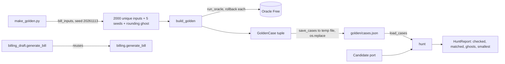

# Design Document

## Overview

The hosted Grave Digger app cannot run Oracle. The ghost hunt therefore bills a large set of inputs in real Oracle once, saves the bills as a golden snapshot (`golden/cases.json`), and later checks any candidate port against that snapshot with no database.

The work adds three modules and one script. All existing modules (`billing.py`, `oracle_runner.py`, `compare.py`, `strategies.py`) and all existing tests stay unchanged.

| File | Role |
|---|---|
| `src/gravedigger/prove/golden.py` | `GoldenCase`, `GOLDEN_PATH`, `save_cases`, `load_cases`, `build_golden` |
| `src/gravedigger/prove/hunt.py` | `Ghost`, `HuntReport`, `hunt` |
| `src/gravedigger/resurrected/billing_draft.py` | the deliberately wrong first draft (`generate_bill`) |
| `scripts/make_golden.py` | builds `golden/cases.json` once, with Oracle running |
| `tests/test_ghost_hunt_properties.py` | the three approved Hypothesis properties (new file) |

The contract is the docstring and the tests of `tests/test_ghost_hunt.py`, which is not modified.

### Research findings that shape the design

- `billing.generate_bill` returns a `Bill` whose eight money fields other than `total` are exact `Decimal` values. The legacy total (pkb line 193) is `ROUND(enrg + fix + fpa + ed + gst + tv + lps, 0)`. `units` is a quantity, not part of the sum. The pre-rounding sum can therefore be rebuilt from a finished `Bill` without touching `billing.py`.
- Python's `round(Decimal)` with no digits argument always uses half-even rounding and returns an `int`. This is the deliberate defect, and it does not depend on the active `decimal` context.
- `compare.diff(oracle, python)` already returns `(FieldDiff("bill", None, python),)` when `oracle` is `None`, which is what R3.7 needs.
- `oracle_runner.py` imports `oracledb` at module level. `golden.py` must stay importable in the hosted app, so it imports `run_oracle` inside `build_golden`. `hunt.py` imports nothing that imports `oracledb`.
- Experiment (Hypothesis 6.170.15, this repo's `bill_inputs()`): with `@seed(20261113)`, `database=None` and `phases=[Phase.generate]`, 2400 examples gave 2094 distinct inputs. Two separate processes produced the same sequence (same SHA-1 of the first 2000 distinct inputs). Setting `derandomize=True` together with `@seed` gave the identical sequence, so the seed wins and the sequence does not depend on the script's source text.
- `@pytest.mark.oracle` tests are skipped when `ORACLE_DSN` is unset (`tests/conftest.py`). Hypothesis profiles are `dev` (200 examples, no deadline) and `ci` (2000, derandomized).

### Requirements inconsistency to be aware of

R5.3 lists `units` among "the eight amounts", and R5.4 sums "the eight amounts". The real sum at pkb line 193 and in `billing.generate_bill` has seven terms, with no `units`. The requirements' own worked example (sum 9048.50, total 9049) only holds with seven. The design uses the seven money amounts and keeps `units` as a copied field. Requirements R5.3/R5.4 should be read that way.

## Architecture



Dependencies between modules:

- `hunt.py` imports `compare.diff`, `compare.FieldDiff`, `golden.GoldenCase` (type only) and `billing.Bill`, `billing.BillInput`. No `oracledb`.
- `golden.py` imports `billing.Bill`, `billing.BillInput` and `config.REPO_ROOT`. `run_oracle` is imported inside `build_golden`.
- `billing_draft.py` imports only `billing`.
- Only `scripts/make_golden.py` and the two `oracle`-marked tests open a database connection.

## Components and Interfaces

### `gravedigger/prove/golden.py`

```python
GOLDEN_PATH: Path = REPO_ROOT / "golden" / "cases.json"   # REPO_ROOT from gravedigger.config

@dataclass(frozen=True)
class GoldenCase:
    input: BillInput
    oracle: Bill | None

def save_cases(path: Path, cases: Iterable[GoldenCase]) -> None: ...
def load_cases(path: Path) -> tuple[GoldenCase, ...]: ...
def build_golden(conn: "oracledb.Connection", inputs: Iterable[BillInput]) -> tuple[GoldenCase, ...]: ...
```

`oracledb` appears only under `TYPE_CHECKING`, so the module imports without the driver.

**`save_cases`**: converts each case to a record (schema below) and writes one UTF-8 text without a byte order mark. Layout is one record per line for readable diffs:

```
[\n<record>,\n<record>,\n...<record>\n]\n
```

Each record comes from `json.dumps(record, separators=(",", ":"), ensure_ascii=True)`. The text is written with `path.write_bytes(text.encode("utf-8"))`, so Windows never rewrites `\n` as `\r\n` (R1.2). An empty list is written as `[]\n`.

Encoding rules (R1.4 to R1.6):

- `Decimal` becomes `format(d, "f")`. This keeps every digit and the scale, never uses exponent notation, and so never produces `e+`. It is always a JSON string.
- `datetime` becomes `isoformat()` (`YYYY-MM-DDTHH:MM:SS`, plus `.ffffff` only if microseconds are non-zero). `date` becomes `isoformat()` (`YYYY-MM-DD`).
- `int` fields (`prev_rdg`, `curr_rdg`) stay JSON integers. They are meter readings, not money.
- `None` becomes `null`.

**`load_cases`**: reads bytes, decodes UTF-8, parses JSON, and returns a tuple in file order.

- Missing file: the `FileNotFoundError` from `Path.read_bytes()` propagates (R1.8).
- Anything else wrong raises `ValueError` whose message names the problem and the record index, for example `"cases.json: record 17: field 'input.mf' is not a decimal string"`. The checks are: top level is a list; each record is an object with exactly the keys `input` and `oracle`; `input` has exactly the eight input keys; `oracle` is `null` or has exactly the ten bill keys; Decimal fields are strings accepted by `Decimal(...)` and finite; datetime fields are strings accepted by `datetime.fromisoformat`; `due_dt` is accepted by `date.fromisoformat`; readings are `int` and not `bool`. `json.JSONDecodeError`, `KeyError`, `TypeError` and `decimal.InvalidOperation` are caught and re-raised as `ValueError(...) from exc` (R1.9).
- `Decimal` is built from the string, never from a float. `rdg_dt` and `pay_dt` return `datetime` with the time part. `due_dt` returns `date`.

**`build_golden`**: for each input in order, calls `run_oracle(conn, b)` and appends `GoldenCase(b, result)`. A `None` result is stored as `oracle=None`. The list is turned into a tuple only after the loop, so an error raised by `run_oracle` propagates unchanged and nothing partial is returned (R2.3). `build_golden` never calls `commit()`. `run_oracle` already rolls back after every input, so the row counts of the five tables are unchanged (R2.4). It opens no connection and reads no settings (R2.6).

### `gravedigger/prove/hunt.py`

```python
@dataclass(frozen=True)
class Ghost:
    input: BillInput
    oracle: Bill | None
    python: Bill
    diffs: tuple[FieldDiff, ...]

@dataclass(frozen=True)
class HuntReport:
    checked: int
    matched: int
    ghosts: tuple[Ghost, ...]

    @property
    def smallest(self) -> Ghost | None: ...

def hunt(port: Callable[[BillInput], Bill], cases: Iterable[GoldenCase]) -> HuntReport: ...
```

`hunt` materialises `cases` with `tuple(cases)` once, then for each case calls `port(case.input)` once, computes `diffs = diff(case.oracle, python)`, and either counts a match or appends `Ghost(case.input, case.oracle, python, diffs)`. It returns `HuntReport(checked=len(cases), matched=len(cases) - len(ghosts), ghosts=tuple(ghosts))`. Port exceptions are not caught (R3.9). The function is pure: no I/O, no global state, so two calls give equal reports (R3.11).

`smallest` returns `None` for no ghosts. Otherwise it returns `min(self.ghosts, key=_size)` where `_size(g)` takes `bill = g.oracle if g.oracle is not None else g.python` and returns `(bill.units, bill.total)`. Python's `min` returns the first of equal keys, which satisfies R4.4. The result is always an element of `ghosts` (R4.6).

### `gravedigger/resurrected/billing_draft.py`

```python
def generate_bill(inp: BillInput) -> Bill: ...
```

The module docstring contains `DELIBERATELY` and says: this module is wrong on purpose, because Python's built-in `round()` rounds half to even and Oracle `ROUND` rounds half up.

How the draft recovers the pre-rounding sum while reusing the port:

```python
from gravedigger.resurrected import billing

def generate_bill(inp: BillInput) -> Bill:
    """... (names round(), BILLING_PKG.p_gen_bill, pkb line 193, the 9048.50 example)"""
    port = billing.generate_bill(inp)
    pre = port.enrg + port.fix + port.fpa + port.ed + port.gst + port.tv + port.lps
    # DELIBERATE DEFECT: built-in round() rounds half to even; Oracle ROUND rounds half up.
    total = Decimal(str(round(pre)))
    return dataclasses.replace(port, total=total)
```

- `port` already holds the correct `units`, `enrg`, `fix`, `fpa`, `ed`, `gst`, `tv`, `lps` and `due_dt`, so R5.3 and R5.5 hold by construction and no port code is copied.
- The seven fields are exact `Decimal` values with at most four decimal places and magnitude below 10^12, so the sum is exact within the default 28-digit context. It is the same value the legacy code had just before `ROUND` at pkb line 193.
- `round(pre)` on a `Decimal` takes no digits argument, returns an `int`, and rounds half to even. `Decimal(str(int))` meets R5.4. For 9048.50 it gives 9048 (even integer part, rounds down). For 9047.50 it gives 9048, the same as Oracle.
- This is the only `round()` call on money in the repository, and it carries the comment required by R5.9. `billing.py` is untouched, so its existing scan test for `round` and `float` still passes (R5.10).

### `scripts/make_golden.py`

Module docstring documents: the fixed seed (`20261113`), `derandomize=True`, the draw size, the dedupe rule, and that it ports no legacy unit (R9.4). It reads settings only through `gravedigger.config` and never prints a password.

Layout:

```python
SEED_VALUE = 20261113
DRAW_COUNT = 2000       # distinct inputs wanted from bill_inputs()
OVERDRAW = 2600         # examples requested, so duplicates cannot leave us short

def draw_inputs(known: Sequence[BillInput]) -> list[BillInput]: ...
def known_inputs() -> list[BillInput]: ...      # 5 SEED inputs (sorted by cust) + rounding ghost
def write_atomically(cases: Sequence[GoldenCase], target: Path) -> None: ...
def main() -> int: ...

if __name__ == "__main__":
    raise SystemExit(main())
```

**Drawing 2000 reproducible inputs.** `draw_inputs` runs a Hypothesis test only to collect values:

```python
got: list[BillInput] = []

@seed(SEED_VALUE)
@settings(max_examples=OVERDRAW, derandomize=True, database=None,
          phases=[Phase.generate], suppress_health_check=list(HealthCheck), deadline=None)
@given(bill_inputs())
def collect(b: BillInput) -> None:
    got.append(b)

collect()
```

- `@seed` fixes the sequence. `derandomize=True` is added as documented belt and braces. The experiment showed both give the same sequence.
- `database=None` stops the example database from replaying earlier runs. `Phase.generate` only skips shrinking and reuse, which a collecting test never needs.
- **Dedupe handling.** The strategy filters and maps, so distinct choice sequences can yield equal inputs (2094 distinct from 2400 in the experiment). The script walks `got` in order, keeps an input if it is not in a `seen` set already holding the five seed inputs and the rounding ghost input, and stops at `DRAW_COUNT`. `BillInput` is a frozen dataclass of hashable fields, so it works as a set key. If fewer than 2000 distinct inputs result, the script prints a message and exits with code 1 before connecting to Oracle. With 2600 requested examples the expected distinct count is about 2270.
- The final list is: 5 seed inputs (ascending customer number), the rounding ghost input, then the 2000 drawn inputs, giving 2006 cases. Dropping seed duplicates from the draw keeps every snapshot input unique.

**Main flow** (`main`):

1. Build the input list (no Oracle yet). Not enough distinct inputs: print message, return 1.
2. Open the connection with `oracledb.connect(**oracle_params())`. Any `RuntimeError` (missing settings) or `oracledb.Error` prints a plain-English message ("Could not reach Oracle. Start the container with scripts/start-oracle.ps1, then run this again."), plus only the exception class name, and returns 2. No file is written (R7.7). The message never includes settings values.
3. `cases = build_golden(conn, inputs)`.
4. If any `case.oracle is None`: print that input and return 1, no file written (R7.5).
5. `write_atomically(cases, GOLDEN_PATH)`.
6. Print the number of cases written, and `len(hunt(billing_draft.generate_bill, cases).ghosts)` as the draft's ghost count (R7.6). Return 0.

**Atomic write.** `write_atomically` makes `golden/`, writes to `golden/cases.json.tmp` with `save_cases`, re-reads it with `load_cases` and checks `== tuple(cases)`, then calls `os.replace(tmp, target)`. `os.replace` is atomic on the same volume on Windows and POSIX. On any exception the temp file is deleted (`Path.unlink(missing_ok=True)`) and the earlier snapshot stays intact (R7.8). `.gitignore` is not touched, and `golden/cases.json` is committed (R7.11).

**Seeds import.** The five seed inputs live in `tests/test_resurrect_billing.py` (`SEED`). The script adds `REPO_ROOT / "tests"` to `sys.path` and imports `SEED` from there, so there is one definition. The cost is that the script needs the dev dependencies (pytest) installed. `test_golden_snapshot_is_big_and_includes_the_known_cases` would catch any drift.

### Probe customer leaves no trace (R10)

`run_oracle` inserts probe rows (`cust_no` 900001, `bill_mon` '209912') and always rolls back, and `build_golden` never commits. The check runs through the `grave-digger-oracle` MCP server's `run_sql` tool, which is read-only and uses a separate session. It therefore sees only committed data. One query returns all six numbers:

```sql
SELECT 'CUST_MST' AS tbl, COUNT(*) AS n FROM CUST_MST WHERE cust_no = 900001
UNION ALL SELECT 'MTR_RDG', COUNT(*) FROM MTR_RDG WHERE cust_no = 900001
UNION ALL SELECT 'PYMT',    COUNT(*) FROM PYMT    WHERE cust_no = 900001
UNION ALL SELECT 'BILL_HDR (probe)', COUNT(*) FROM BILL_HDR WHERE cust_no = 900001
UNION ALL SELECT 'FPA_RT (209912)',  COUNT(*) FROM FPA_RT  WHERE bill_mon = '209912'
UNION ALL SELECT 'BILL_HDR (all)',   COUNT(*) FROM BILL_HDR
```

Expected after `make_golden.py` has finished: `0, 0, 0, 0, 0, 5`. The same query is run once before the script as a baseline, and the report states the six numbers (R10.4). Passing the query to the tool uses the argument names in the tool's own schema, which the implementing task loads first. A non-zero probe count means something committed. Stop and investigate in that case.

## Data Models

### `golden/cases.json` schema

Top level is a JSON array. Each element is a record with exactly two keys, in this order.

```json
[
{"input":{"tariff":"A1","load_kw":"2.00","prev_rdg":1000,"curr_rdg":1005,"mf":"1","rdg_dt":"2024-01-10T00:00:00","fpa_rate":"0.35","pay_dt":null},"oracle":{"units":"5","enrg":"50.00","fix":"25.00","fpa":"1.75","ed":"0.75","gst":"13.18","tv":"35","lps":"0","total":"126","due_dt":"2024-01-24"}},
{"input":{"tariff":"A1","load_kw":"2","prev_rdg":0,"curr_rdg":345,"mf":"1","rdg_dt":"2024-01-10T00:00:00","fpa_rate":null,"pay_dt":null},"oracle":null}
]
```

| Path | JSON type | Python type | Notes |
|---|---|---|---|
| `input.tariff` | string | `str` | `"A1"` or `"A2"` |
| `input.load_kw`, `input.mf` | string | `Decimal` | `format(d, "f")` |
| `input.prev_rdg`, `input.curr_rdg` | integer | `int` | meter readings |
| `input.rdg_dt` | string | `datetime` | ISO 8601, time part kept |
| `input.fpa_rate` | string or null | `Decimal \| None` | |
| `input.pay_dt` | string or null | `datetime \| None` | ISO 8601, time part kept |
| `oracle` | object or null | `Bill \| None` | null when Oracle wrote no row |
| `oracle.units`, `enrg`, `fix`, `fpa`, `ed`, `gst`, `tv`, `lps`, `total` | string | `Decimal` | |
| `oracle.due_dt` | string | `date` | `YYYY-MM-DD` |

No JSON number is used for money. The key order in each record follows the dataclass field order.

### In-memory types

`GoldenCase`, `Ghost` and `HuntReport` are frozen dataclasses with the field orders in the requirements. Money is `Decimal` everywhere, built from strings or integers. `Bill`, `BillInput` and `FieldDiff` are reused unchanged.

## Correctness Properties

*A property is a characteristic or behavior that should hold true across all valid executions of a system-essentially, a formal statement about what the system should do. Properties serve as the bridge between human-readable specifications and machine-verifiable correctness guarantees.*

This feature has three approved Hypothesis tests, all in `tests/test_ghost_hunt_properties.py`. Other requirements are covered by `tests/test_ghost_hunt.py` or by example checks during the tasks (see Testing Strategy).

Reflection result: R1.7, R3.5 and R5.3/R5.6 test three different modules and none implies another, so nothing is merged or dropped.

### Property 1: Golden file round trip

*For any* list of `GoldenCase` values, including cases whose `oracle` is `None`, `load_cases(path)` after `save_cases(path, cases)` returns a tuple equal to the saved list, in the same order, in every field.

**Validates: Requirements 1.7** (and so 1.3 to 1.5)

### Property 2: Hunt report adds up

*For any* candidate port and any list of `GoldenCase` values, `hunt(port, cases)` returns a report with `checked` equal to the number of cases and `checked` equal to `matched` plus the length of `ghosts`.

**Validates: Requirements 3.5**

### Property 3: The draft differs from the port only by half-even rounding of the total

*For any* `BillInput` produced by `bill_inputs()`, the draft bill equals the port bill in every field except `total`, and the two totals differ if and only if the pre-rounding sum has a fractional part of exactly 0.50 and an even integer part. When they differ, the draft total is the port total minus exactly 1.

**Validates: Requirements 5.3, 5.6**

## Error Handling

| Situation | Behaviour |
|---|---|
| `load_cases` on a missing file | `FileNotFoundError` (R1.8) |
| `load_cases` on bad JSON or wrong shape | `ValueError` naming the record and field (R1.9) |
| `run_oracle` raises inside `build_golden` | the original error propagates, no partial tuple (R2.3) |
| Candidate port raises inside `hunt` | the original error propagates (R3.9) |
| Oracle returned no bill for a case in `hunt` | ghost with `oracle=None`, first diff field `bill` (R3.7) |
| `make_golden.py`: settings missing or connection fails | plain-English message, exit 2, no file written (R7.7) |
| `make_golden.py`: a case has `oracle=None`, or fewer than 2000 distinct inputs | message with the offending input or count, exit 1, no file written (R7.5) |
| `make_golden.py`: failure while saving | temp file deleted, earlier snapshot untouched (R7.8) |

The legacy `WHEN OTHERS THEN NULL` (pkb lines 205-206) is the reason `run_oracle` can return `None`. The hunt reports it as a ghost and does not hide it. The strategy's `fits_bill_header` filter prevents it in the snapshot.

## Testing Strategy

Property-based testing applies to the three pure pieces above (serialisation round trip, report arithmetic, draft versus port). It does not apply to the script, the Oracle build, the MCP check or the project-rule checks. Those use example and integration checks.

### Property tests (`tests/test_ghost_hunt_properties.py`, new file)

Library: Hypothesis. Exactly three tests, one per property, each named after its requirement. The file adds no other property (R11.8). Each runs under the active profile (`dev`: 200 examples, no deadline), with no Oracle and no network, and all three together must finish in under 5 seconds (R11.7). `bill_inputs()` is built once at module level and shared, because its half-paisa pool is computed at construction.

```python
# Feature: ghost-hunt, Property 1: Golden file round trip
@given(st.lists(golden_cases(), max_size=5))
def test_r1_7_save_then_load_returns_the_same_cases(cases): ...

# Feature: ghost-hunt, Property 2: Hunt report adds up
@given(ports(), st.lists(golden_cases(), max_size=8))
def test_r3_5_checked_equals_matched_plus_ghosts(port, cases): ...

# Feature: ghost-hunt, Property 3: Draft differs only by half-even rounding of the total
@given(bill_inputs())
def test_r5_3_r5_6_draft_differs_from_port_only_by_half_even_total(inp): ...
```

**Generators.**

- `golden_cases()`: `st.builds(GoldenCase, bill_inputs(), st.one_of(st.none(), port_bills, arbitrary_bills))`. `port_bills` is `bill_inputs().map(billing.generate_bill)`. `arbitrary_bills` is `st.builds(Bill, ...)` with `st.decimals(min_value=-10**12, max_value=10**12, places=4, allow_nan=False, allow_infinity=False)` for money and `st.dates()` for `due_dt`. This also covers scales and signs the port never makes. Datetime fields in inputs already include time parts.
- `ports()` for Property 2: `st.sampled_from` over `billing.generate_bill`, `billing_draft.generate_bill`, and a perturbing port built from a drawn `delta` in `{-1, 0, 1}` and a drawn modulus `k` in `1..4`. The perturbing port returns `dataclasses.replace(billing.generate_bill(b), total=total + delta)` when `hash(b) % k == 0`, else the port bill. Cases whose `oracle` is `None` or tampered come from `golden_cases()`. Together, matches, mismatches and missing bills all occur.
- The tests for Properties 1 and 2 are marked with `st.lists(..., max_size=...)` small enough to keep the 5-second budget.

**Property 1 body.** Because `tmp_path` is a function-scoped fixture and Hypothesis would reuse it across examples, the test makes its own folder per example with `tempfile.TemporaryDirectory()`, calls `save_cases(path, cases)`, then asserts `load_cases(path) == tuple(cases)`. `GoldenCase` equality is field-by-field value equality, so all fields are compared exactly. Exact text (scale) preservation is separately checked by the example test `test_save_and_load_round_trip_exactly` in `tests/test_ghost_hunt.py`, which also checks there is no `e+` in the file.

**Property 2 body.** `report = hunt(port, cases)`, then `assert report.checked == len(cases)` and `assert report.checked == report.matched + len(report.ghosts)`.

**Property 3 body: computing the pre-rounding sum independently of the draft.** The test never reads the draft's internals and never takes the sum from a `Bill`. It re-derives the sum from the `BillInput` by chaining the port's public unit functions in the order of pkb lines 170-193, which is what the legacy procedure does before its final `ROUND`:

```python
def pre_rounding_sum(b: BillInput) -> Decimal:
    """Sum before ROUND at pkb line 193, rebuilt from the unit functions."""
    u = billing.units(b.prev_rdg, b.curr_rdg, b.mf)
    enrg = billing.energy_charge(b.tariff, u)
    fix = billing.fixed_charge(b.tariff, b.load_kw, enrg)
    fpa = billing.fpa(u, b.fpa_rate)
    ed, gst = billing.taxes(enrg, fix, fpa)
    due = billing.due_date(b.rdg_dt)
    lps = billing.lps(enrg, due, b.pay_dt)
    tv = Decimal("35") if b.tariff == "A1" else Decimal("60")
    return enrg + fix + fpa + ed + gst + tv + lps
```

The assertions are:

1. `port = billing.generate_bill(inp)` and `draft = billing_draft.generate_bill(inp)`.
2. Every field of `Bill` except `total` is equal, using `dataclasses.fields(Bill)`.
3. `pre = pre_rounding_sum(inp)`. Since all charges are non-negative, `pre >= 0`. `expect_differ = (pre % 1 == Decimal("0.5")) and (int(pre) % 2 == 0)`.
4. `(draft.total != port.total) == expect_differ`.
5. If `expect_differ`, `port.total - draft.total == Decimal(1)`. Otherwise `draft.total == port.total`.

The check against the legacy rule is independent in two ways: the sum comes from unit functions rather than the draft's field arithmetic, and the expected outcome comes from the half-even rule stated arithmetically on `pre`, not from calling `round`. `bill_inputs()` has a `half_paisa` scenario that builds sums ending in .50, so the "differ" branch is exercised often. The test adds `@example(GHOST_INPUT)` (the rounding ghost input, expected total 9049 versus 9048) to pin the known case. An `@example` is not a separate property.

### Example and integration checks (no new test files)

| Requirement | Covered by |
|---|---|
| R1.1 to R1.6, R1.10 | `test_save_and_load_round_trip_exactly`; example checks run in the tasks for frozen-ness, LF endings, no BOM, `GOLDEN_PATH` |
| R1.8, R1.9 | one-off example checks in the tasks (missing file, malformed JSON) |
| R2.1 to R2.6 | `test_build_golden_uses_real_oracle` (`oracle`-marked) plus the row-count check in R10 |
| R3.1 to R3.4, R3.6 to R3.11 | `test_the_real_port_has_no_ghosts`, `test_a_missing_oracle_bill_is_a_ghost`, and a one-off import check that `oracledb` is not imported by `hunt` |
| R4 | `test_smallest_ghost_is_fewest_units_then_lowest_total` and a tie example check |
| R5.1, R5.2, R5.7 to R5.10 | `test_draft_is_clearly_labelled_as_deliberately_wrong`, `test_the_draft_looks_right_on_every_seed_bill`, `test_the_draft_is_haunted_by_the_rounding_ghost`, and a source scan for `round(` outside the draft |
| R6 | `test_ghost_hunt.py` hunt tests |
| R7, R8 | running `scripts/make_golden.py`, then `test_golden_snapshot_is_big_and_includes_the_known_cases`, `test_real_port_matches_every_golden_bill`, `test_draft_port_is_caught_on_the_golden_snapshot`, `test_golden_snapshot_is_genuine_oracle_output` |
| R9 | source checks: no `float`, type hints, docstrings name the legacy unit, UTF-8 without BOM, LF, `git status` shows nothing under `tests/` except the new file |
| R10 | the MCP `run_sql` query above, before and after the script |
| R11 | full `.venv\Scripts\python.exe -m pytest -q -rs` with Oracle up: zero failed, zero skipped |

### Final run order

1. Implement `golden.py`, `hunt.py`, `billing_draft.py`, `make_golden.py` and the property test file.
2. Run the MCP baseline query, then `scripts\start-oracle.ps1` if needed, then `.venv\Scripts\python.exe scripts\make_golden.py`.
3. Run the MCP query again and record the six counts.
4. Run the full test suite and report the test count, the oracle tests passed, the number of golden cases, the draft's ghost count, and the smallest ghost (input, Oracle total, draft total).
