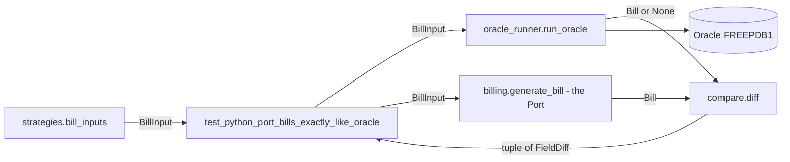
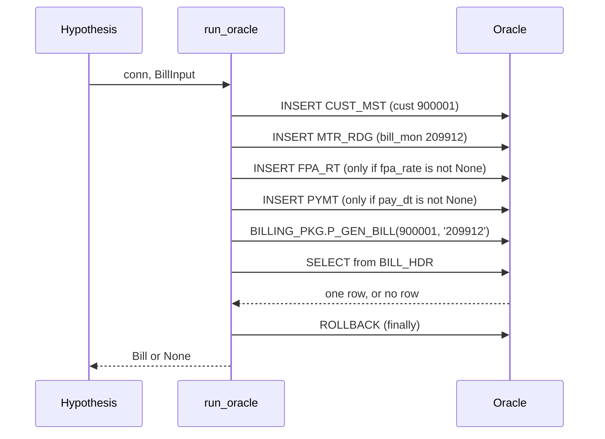

# Design Document

## Overview

The Prove stage shows that `gravedigger.resurrected.billing.generate_bill` (the Port) bills exactly like `BILLING_PKG.p_gen_bill` in Oracle. Hypothesis draws a random `BillInput`. `run_oracle` bills it in real Oracle through one probe customer and rolls back. `diff` compares the Oracle bill with the Port bill field by field. Any difference is a Ghost.

Three new modules go under `src/gravedigger/prove/`:

| Module | Public name | Role |
|---|---|---|
| `strategies.py` | `bill_inputs()` | Hypothesis strategy: legal, edge-weighted `BillInput` values |
| `compare.py` | `FieldDiff`, `diff()` | Exact field-by-field comparison |
| `oracle_runner.py` | `run_oracle(conn, BillInput)` | One probe bill through the real legacy procedure |

The contract is the module docstring and the tests in `tests/test_prove_equivalence.py`. No test function, assertion or test file is edited or added. The only change under `tests/` is `deadline=None` on the `dev` and `ci` profile registrations in `tests/conftest.py`. The spec also fixes four stale line numbers in `.kiro/specs/resurrect-billing/design.md` (see the last section of this document).

### Findings from the real database

These were checked with the grave-digger-oracle MCP tools (`describe_object`, `run_sql`, `run_plsql`, which rolls back) and a short driver script. They fix the design details below.

| Topic | Finding | Design consequence |
|---|---|---|
| Which rows `p_gen_bill` reads | Customer by `cust_no` (PK `PK_CUST_MST`). Reading by `(cust_no, bill_mon)` (PK `PK_MTR_RDG`). Payment by `(cust_no, bill_mon)` (PK `PK_PYMT`). FPA rate by `bill_mon` only (PK `PK_FPA_RT`). The loop inserts one `BILL_HDR` row per customer found. | The probe uses `cust_no` 900001 and `bill_mon` '209912'. Each key can hold at most one row, so no ambiguity is possible. |
| Column types | `MTR_RDG.rdg_dt`, `PYMT.pay_dt`, `BILL_HDR.due_dt` and `gen_dt` are `DATE`, not `TIMESTAMP`. `DATE` keeps whole seconds. `PYMT.pay_dt` keeps the time part. | `datetime` is bound as a plain `DATE`. A bound value with microseconds is truncated, not rounded (checked: `13:45:07.9` is stored as `13:45:07`). The strategy produces whole seconds only, so the truncation never matters. |
| `BILL_HDR` limits | `units`, `enrg_chg`, `fix_chg`, `fpa`, `ed`, `gst`, `tv_fee`, `lps` are `NUMBER(12,2)`. `total` is `NUMBER(12)`. | Matches requirement 1.6: each of the eight amounts must be below 10^10 in absolute value, and the total below 10^12. |
| `WHEN OTHERS THEN NULL` swallows overflow | With `mf` 9999.99 and 99999 units on tariff A1, `p_gen_bill` returned normally and `BILL_HDR` had 0 rows for the probe. | An out-of-range bill gives `None` from `run_oracle`, which `diff` reports as a false Ghost. The strategy must filter such inputs (requirement 1.8). |
| Date overflow is swallowed too | A reading date of 9999-12-25 gave 0 rows (due date overflows year 9999). Python would raise `OverflowError` in `due_date` for the same input. | Avoided by the 2000..2099 range. Kept as a documented note (see "Documented note: Oracle vs Python calendar difference"). |
| Calendar before 1582-10-15 | Oracle `DATE` uses the Julian calendar before 1582-10-15. `TO_DATE('1500-02-28')+2` gives 1500-03-01 and `TO_DATE('1582-10-04')+1` gives 1582-10-15. 1000-03-01 is a Friday in Oracle and a Saturday in Python's `datetime`. 1583-01-01 is a Saturday in both. | Python and Oracle disagree on weekday and on day arithmetic for early dates, which would give false Ghosts in the Sunday rule for early dates. Avoided by the 2000..2099 range. See "Date limits" below. |
| Connection | `oracle_params()` returns `dsn`, `user`, `password` from `ORACLE_DSN`, `ORACLE_USER`, `APP_USER_PASSWORD`. `oracledb` is pinned at 3.4.0 and `connection.thin` is `True`. Nothing calls `init_oracle_client`. | `run_oracle` receives an open connection. It never connects and never reads settings. The test fixture's `oracle_params()` call is the only connection path. |
| Number fetching | A plain fetch returns floats for non-integer `NUMBER` values. A cursor `outputtypehandler` that returns `cursor.var(decimal.Decimal, arraysize=cursor.arraysize)` for `DB_TYPE_NUMBER` returns `Decimal` (checked: `Decimal('5')`, `Decimal('126')`). | The runner sets this handler on its own cursor. It does not use the global `oracledb.defaults.fetch_decimals`. |
| Binding | `Decimal` values bind and read back exactly (`9999.99`, `0.01`, `0.0001`). `datetime(1000,3,1)` is stored as 1000-03-01. | No conversion helpers are needed for binds. |
| Clean state | Before any run: 0 rows for `cust_no` 900001 in each table, 0 rows in `FPA_RT` for '209912'. `BILL_HDR` has 5 rows. `p_gen_bill` contains no `COMMIT`. | Rollback after each call restores the state. |

### Date limits (adopted in requirements 1.5 and 1.9)

Requirements 1.5 and 1.9 limit `rdg_dt` to **2000-01-01 00:00:00 .. 2099-12-31 23:59:59** (realistic billing dates). `pay_dt` is `None` or a whole-second datetime from **2000-01-01 00:00:00 to 2100-01-31 23:59:59**. The upper bound 2100-01-31 is chosen so that a payment can fall on the due date of a December 2099 reading (reading plus 14 days, plus at most one day for the Sunday shift, is at most 2100-01-15). The narrow range avoids both traps below, so the Port and Oracle use the same calendar for every generated date.

**Documented note: Oracle vs Python calendar difference.** Oracle `DATE` uses the Julian calendar before 1582-10-15. The Port computes the weekday and the +14 days with Python's `date.weekday()` and `timedelta` on `datetime` values (`billing.py`, `due_date`, lines 164-168), and Python defines `date` as proleptic Gregorian. For early dates the two disagree: 1000-03-01 is a Friday in Oracle and a Saturday in Python, `TO_DATE('1500-02-28')+2` gives 1500-03-01 in Oracle, and 1583-01-01 is a Saturday in both. This is a calendar difference, not a billing rule, and the migration rules forbid fixing rules during the port. Separately, Oracle swallows a due date beyond year 9999 (`WHEN OTHERS THEN NULL`, observed at a reading date of 9999-12-25, boundary day not probed), while Python raises `OverflowError`. Neither is a generation limit any more. The final report states this finding as a risk.

## Architecture



One example, in order:



### Design decisions

| Decision | Rationale |
|---|---|
| `run_oracle` never catches Oracle errors. A `try/finally` does the rollback and nothing else. | User guidance and requirements 4.9 and 6.6. A broken run must fail loudly, not look like a match. |
| One shared connection and an explicit rollback after every call, never a commit. | Requirement 4.10. The fixture in the test file already rolls back at teardown. |
| `run_oracle` takes an open connection and does no config work. | Keeps it pure with respect to settings (requirement 7.2). The tests own the connection. |
| The cursor's `outputtypehandler` is set per cursor. | No global state (tech rule). |
| `diff` uses `Decimal` equality (`!=`), which ignores trailing zeros and has no tolerance. | Requirements 3.5 and 3.6. `Decimal("10.50") == Decimal("10.5")` is true and `Decimal("0.01") != Decimal("0")` is true. |
| The strategy filters out bills that overflow `BILL_HDR`. It does not clamp them. | Clamping would hide the edge. Filtering keeps every kept input exact. |
| The strategy uses the Port's `units` and `due_date` only to aim at edges, never to decide correctness. | Oracle remains the ground truth. A wrong aim only lowers the hit rate. |
| No example counts appear in code. The profile sets them. | User guidance and requirement 6.3 and 6.4. |

## Components and Interfaces

### `gravedigger/prove/compare.py`

```python
@dataclass(frozen=True)
class FieldDiff:
    field: str
    oracle: Decimal | date | None
    python: Decimal | date | Bill

def diff(oracle: Bill | None, python: Bill) -> tuple[FieldDiff, ...]: ...
```

`diff` is a docstring-labelled port check for the whole of `BILLING_PKG.p_gen_bill`.

- `oracle is None`: return `(FieldDiff("bill", None, python),)`.
- Otherwise walk `dataclasses.fields(Bill)` in declaration order (`units, enrg, fix, fpa, ed, gst, tv, lps, total, due_dt`). For each field, compare `getattr(oracle, f) != getattr(python, f)`. Collect a `FieldDiff(f.name, o, p)` for each difference, values unchanged.
- `due_dt` is a `date` and is compared by `!=`, which is exact date equality. A `datetime` is never accepted as equal to a `date` by accident, because `datetime(2024,1,1) != date(2024,1,1)` is true.
- Each field appears at most once because each is visited once.

The shape of the `oracle` and `python` attributes is deliberately loose (`object`-like) so the test's `FieldDiff("total", D("2056"), D("2055"))` compares equal by dataclass equality.

### `gravedigger/prove/oracle_runner.py`

```python
PROBE_CUST_NO = 900001
PROBE_BILL_MON = "209912"

def run_oracle(conn: oracledb.Connection, b: BillInput) -> Bill | None: ...
```

Docstring names `BILLING_PKG.p_gen_bill` (pkb lines 146-207 in the file, 134-195 in the database).

Steps inside one `try:` / `finally: conn.rollback()`:

1. Open a cursor with the `Decimal` output handler.
2. `INSERT INTO CUST_MST (cust_no, cust_nm, tariff, load_kw, mf) VALUES (:c, 'probe', :t, :l, :m)`. The name is a constant string, not a `BillInput` value.
3. `INSERT INTO MTR_RDG (cust_no, bill_mon, prev_rdg, curr_rdg, rdg_dt) VALUES (...)`.
4. If `fpa_rate is not None`: `INSERT INTO FPA_RT (bill_mon, rate_per_kwh) VALUES (:m, :r)`.
5. If `pay_dt is not None`: `INSERT INTO PYMT (cust_no, bill_mon, pay_dt) VALUES (...)`. `pay_amt` is left NULL.
6. `cursor.callproc("BILLING_PKG.P_GEN_BILL", [PROBE_CUST_NO, PROBE_BILL_MON])`.
7. `SELECT units, enrg_chg, fix_chg, fpa, ed, gst, tv_fee, lps, total, due_dt FROM BILL_HDR WHERE cust_no = :c AND bill_mon = :m`, then `fetchall()`.
8. No row: return `None`. One row: build a `Bill` with `Decimal` numbers and `due_dt.date()`. The primary key allows at most one row, so more than one is impossible.

All values are bind variables. The only literal SQL text is the fixed statement text above. Column names, table names and the probe key come from module constants.

`due_dt` comes back from the driver as a `datetime` at midnight, and `.date()` returns a real `datetime.date`, so `type(got.due_dt) is date` holds.

### `gravedigger/prove/strategies.py`

```python
def bill_inputs() -> st.SearchStrategy[BillInput]: ...
```

Docstring names `BILLING_PKG.p_gen_bill`, `f_units`, `f_due_dt` and `f_lps` as the units whose edges it targets.

**Legal ranges** (requirements 1.1 to 1.5 and 1.9, with the date limits above):

| Field | Domain | Built from |
|---|---|---|
| `tariff` | `"A1"` or `"A2"` | `st.sampled_from` |
| `prev_rdg`, `curr_rdg` | `int`, 0 to 99999 | `st.integers` |
| `load_kw`, `mf` | `Decimal`, 0.01 to 9999.99, 2 places | `st.integers(1, 999999)` then `Decimal(n).scaleb(-2)` |
| `fpa_rate` | `None` or `Decimal`, 0 to 9999.9999, 4 places | `st.none()` or `st.integers(0, 99999999)` then `scaleb(-4)` |
| `rdg_dt` | `datetime`, whole seconds, 2000-01-01 00:00:00 to 2099-12-31 23:59:59 | `st.datetimes(min_value, max_value)` then `replace(microsecond=0)` |
| `pay_dt` | `None` or `datetime`, whole seconds, 2000-01-01 00:00:00 to 2100-01-31 23:59:59 | same |

`Decimal` values come from integers and `scaleb`, never from `float`.

**Edge scenarios.** `bill_inputs` is an `@st.composite` strategy. First it draws a scenario from a list in which common cases appear several times. Then it draws the fields the scenario needs. Weighting is guidance only. Requirement 2 asks for reachability, not for counts.

| Scenario | How the fields are aimed |
|---|---|
| `random` | Every field drawn freely. Appears most often. |
| `units_edge` | Pick a target from 0, 99, 100, 101, 200, 201, 300, 301, 345. Set `mf = 1`, `prev` free, `curr = prev + target` (always within 99999). |
| `rollover` | `curr < prev`. |
| `shop` | `tariff = "A2"`. |
| `no_fpa` | `fpa_rate = None`. |
| `unpaid` | `pay_dt = None`. |
| `sunday_due` | Choose a reading date whose date plus 14 days is a Sunday. |
| `pay_on_due_day` | `pay_dt` is the due date (from the Port's `due_date`) at a drawn time later than 00:00:00. |
| `pay_midnight` | `pay_dt` is exactly the due date at 00:00:00. |
| `half_paisa` | Draw from a pool of `(tariff, load_kw, units)` combinations found by a small deterministic scan when `bill_inputs()` is called. A combination qualifies when the Port's unrounded sum before the final ROUND has fractional part 0.50. `mf = 1`, `fpa_rate = None`, `pay_dt = None`. |

A scan of random A1 and A2 inputs gave a 0.7% to 0.9% hit rate for the half-paisa case, which is too low for a search of a few thousand examples. The pool makes it a constructive edge instead of a filter. If the scan finds no member, the scenario falls back to `random`.

**Discard rule** (requirement 1.8). After the scenario draw, the result passes `.filter(fits_bill_header)`. The predicate calls `generate_bill` and checks that the eight amounts are below 10^10 and the total is below 10^12 in absolute value, and that `generate_bill` did not raise `OverflowError`. Large `mf` values with large reading gaps overflow, so the scenario list keeps `mf` small most of the time to keep the reject rate low.

### Hypothesis settings in the existing test file

| Test | Own `settings` | Effect |
|---|---|---|
| `test_inputs_fit_the_legacy_columns` | `max_examples=300`, `too_slow` suppressed. **No `deadline` of its own.** | `settings(...)` inherits `deadline=None` from the loaded `dev` or `ci` profile (conftest loads it before the test module is imported). The 300 examples hold under both profiles. |
| `test_strategy_reaches_the_edges` via `find` | `max_examples=3000`, `database=None`. No deadline of its own, inherits `None` from the profile. | The predicates are pure and fast. The real risk is a `NoSuchExample` failure if an edge is too rare, which is why the strategy aims at the edges instead of filtering for them. A heavy `filter` also risks a health-check failure inside `find`, so the discard rate must stay low. |
| `test_python_port_bills_exactly_like_oracle` | `deadline=None`, `function_scoped_fixture` and `too_slow` suppressed. **No `max_examples`.** | The profile alone sets the count (requirements 6.3 and 6.4). Each example makes about 5 inserts, one call, one select and one rollback against a local container. Its `deadline=None` is explicit and matches the profiles. |

The deadline flakiness risk (a first-call stall such as a cold import or an antivirus scan on Windows) is removed by setting `deadline=None` on the `dev` and `ci` profile registrations in `tests/conftest.py`. This is configuration only. The strategy still does no heavy work per draw. The half-paisa scan runs once per `bill_inputs()` call, not per draw, and costs a few hundred `generate_bill` calls.

## Data Models

No new data types except `FieldDiff`. `BillInput` and `Bill` are the frozen dataclasses already in `gravedigger.resurrected.billing`.

Mapping from `BILL_HDR` columns to `Bill` fields:

| `BILL_HDR` column | Type | `Bill` field |
|---|---|---|
| `units` | `NUMBER(12,2)` | `units` |
| `enrg_chg` | `NUMBER(12,2)` | `enrg` |
| `fix_chg` | `NUMBER(12,2)` | `fix` |
| `fpa` | `NUMBER(12,2)` | `fpa` |
| `ed` | `NUMBER(12,2)` | `ed` |
| `gst` | `NUMBER(12,2)` | `gst` |
| `tv_fee` | `NUMBER(12,2)` | `tv` |
| `lps` | `NUMBER(12,2)` | `lps` |
| `total` | `NUMBER(12)` | `total` |
| `due_dt` | `DATE` | `due_dt` (`date`) |
| `cust_no`, `bill_mon`, `gen_dt` | not compared | none |

Mapping from `BillInput` to the inserted rows:

| `BillInput` field | Table.column |
|---|---|
| `tariff`, `load_kw`, `mf` | `CUST_MST.tariff`, `load_kw`, `mf` |
| `prev_rdg`, `curr_rdg`, `rdg_dt` | `MTR_RDG.prev_rdg`, `curr_rdg`, `rdg_dt` |
| `fpa_rate` | `FPA_RT.rate_per_kwh` (row only when not `None`) |
| `pay_dt` | `PYMT.pay_dt` (row only when not `None`) |

`gen_dt` is `SYSDATE` and is ignored. Python's `Decimal` context has 28 digits, Oracle `NUMBER` has 38. Every product in the port stays under 20 digits for legal inputs, so the precision difference cannot show up.

## Correctness Properties

*A property is a characteristic or behavior that should hold true across all valid executions of a system, a formal statement about what the system should do. Properties serve as the bridge between human-readable specifications and machine-verifiable correctness guarantees.*

This design adds no tests. Each property below is already checked by a test in `tests/test_prove_equivalence.py`, whose test functions and assertions are not edited. Reflection on redundancy: criteria 1.1 to 1.5 form one invariant (Property 1), and criteria 1.6 and 1.8 form another (Property 2). Edge reachability (2.1 to 2.9) is existential and is checked by `find` in an existing test. Requirements 4.9 to 4.11, 9.1 to 9.3 and the other code-review, configuration and text requirements are verified as described in the Testing Strategy.

### Property 1: Generated inputs fit the legacy columns

*For any* `BillInput` drawn from `bill_inputs()`, the tariff is `A1` or `A2`, the readings are `int` values from 0 to 99999, `load_kw` and `mf` are `Decimal` values from 0.01 to 9999.99 with at most 2 places, `fpa_rate` is `None` or a `Decimal` from 0 to 9999.9999 with at most 4 places, and `rdg_dt` and `pay_dt` have zero microseconds and lie within the allowed date range.

**Validates: Requirements 1.1, 1.2, 1.3, 1.4, 1.5, 1.9**

Existing test: `test_inputs_fit_the_legacy_columns`.

### Property 2: Generated bills fit the BILL_HDR columns

*For any* `BillInput` drawn from `bill_inputs()`, `generate_bill` does not raise, each of `units`, `enrg`, `fix`, `fpa`, `ed`, `gst`, `tv` and `lps` has absolute value below 10^10, and `total` has absolute value below 10^12.

**Validates: Requirements 1.6, 1.8**

Existing test: `test_inputs_fit_the_legacy_columns`.

### Property 3: The diff reports changed fields exactly

*For any* pair of bills, `diff` returns one `FieldDiff` per differing field, in `Bill` declaration order, with both values unchanged, and `()` when every field is equal. A difference of 0.01 is reported, and `Decimal` values that differ only by trailing zeros are equal. A missing Oracle bill gives one `FieldDiff("bill", None, python)`.

**Validates: Requirements 3.2, 3.3, 3.4, 3.5, 3.6, 3.7, 3.8**

Existing tests: the four `diff` example tests.

### Property 4: Seed bills match the known Oracle bills

*For any* seed customer 1001 to 1005, `run_oracle` returns the bill whose fields equal the recorded Oracle values, and the Port gives the same bill.

**Validates: Requirements 5.1**

Existing tests: the five seed-bill `oracle` tests.

### Property 5: A run leaves no trace (seed 1003)

*For any* run of `run_oracle` on the seed 1003 input, the row counts of the probe tables after the run equal the counts before.

**Validates: Requirements 4.10, 4.11, 9.1, 9.2**

Existing test: the nothing-left-behind `oracle` test.

### Property 6: The 345-unit rounding ghost is caught

*For the* 345-unit half-paisa input, `run_oracle` and the Port are compared exactly, and any rounding difference shows up as a `FieldDiff`.

**Validates: Requirements 5.2**

Existing test: the rounding-ghost `oracle` test.

### Property 7: The Port bills exactly like Oracle

*For any* `BillInput` drawn from `bill_inputs()`, `diff(run_oracle(conn, b), generate_bill(b))` returns `()`, with every field exact and no tolerance.

**Validates: Requirements 6.1, 6.2, 6.5**

Existing test: `test_python_port_bills_exactly_like_oracle`.
## Error Handling

| Situation | Behaviour |
|---|---|
| Oracle raises during an insert, the call or the read | The exception propagates unchanged. The `finally` block rolls back. If the rollback itself fails, Python chains the two errors. |
| `p_gen_bill` swallows an error (`WHEN OTHERS THEN NULL`) and writes no row | `run_oracle` returns `None`. `diff` reports one `FieldDiff("bill", None, python)`. This is a Ghost, and the strategy is designed so that it only happens for a real behavioural difference. |
| A candidate input overflows `BILL_HDR` or the due date | The strategy filter discards it before the test sees it. |
| `ORACLE_DSN` not set | `tests/conftest.py` skips every `oracle` test. `run_oracle` is never called and no connection is attempted. |
| `oracle_params()` finds a missing setting | It raises `RuntimeError` in the `conn` fixture. The Oracle tests error visibly. |
| A Ghost is found | Hypothesis shrinks the input and prints it. The assertion message in the test shows the `diff` tuple, which lists field, Oracle value and Port value. |
| Pre-1583 dates | Not generated (range is 2000..2100). The Julian-calendar finding is stated as a risk in the final report (see the documented note). |

## Testing Strategy

Property-based tests use Hypothesis (already a dev dependency). Nothing is written from scratch. No test file is added and no test function or assertion is changed by this spec. Only `tests/conftest.py` gets `deadline=None` on the `dev` and `ci` profiles. The example count is not written in code. The equivalence test relies on the active profile (`dev` or `ci` from `tests/conftest.py`). The two existing tests that set `max_examples=300` and `3000` keep their own values.

**Existing tests (test functions not modified) and the property each checks:**

| Property | Existing test in `tests/test_prove_equivalence.py` |
|---|---|
| 1, 2 | `test_inputs_fit_the_legacy_columns` |
| Edge reachability (2.1 to 2.9) | `test_strategy_reaches_the_edges` (9 cases, via `find`) |
| 3 | the four `diff` example tests |
| 4 | the five seed-bill `oracle` tests (1001 to 1005) |
| 5 | the nothing-left-behind `oracle` test (seed 1003) |
| 6 | the rounding-ghost `oracle` test (345 units) |
| 7 | `test_python_port_bills_exactly_like_oracle` |

That is 8 tests marked `oracle` (5 seed cases, nothing-left-behind, rounding ghost, equivalence), which matches requirement 6.7.

**Verification without new tests:**

- No trace (requirement 9): a manual MCP `run_sql` check after the final run. Count the rows for `cust_no` 900001 and `bill_mon` '209912' in `CUST_MST`, `MTR_RDG`, `PYMT`, `FPA_RT` and `BILL_HDR`, and confirm `BILL_HDR` still has its 5 seed rows. The existing nothing-left-behind test covers seed 1003 in `pytest`. Record the result in the final report.
- Error propagation (requirements 4.9, 6.6, 9.3): code review. `run_oracle` has no `except` clause, and `try/finally` only calls `conn.rollback()`.
- Rollback (requirement 4.10): code review. `run_oracle` never calls `commit`, and the `finally` block always rolls back.

**Final run (requirement 9.4):** `.venv\Scripts\python.exe -m pytest -q` with the container running and `ORACLE_DSN` set. The report states the example count of the active profile and either "Ghost found" with the smallest failing input or "No Ghost found".

**Why property-based testing fits:** the Port and `diff` are pure functions with large input spaces, and the comparison with Oracle is an equivalence (model-based) property.
## Resurrect Design Line-Number Fix (text only)

The file `.kiro/specs/resurrect-billing/design.md` has four stale citations. Reading `BILLING_PKG` through `describe_object` gives database line numbers. The file `legacy/billing_pkg.pkb` has 12 more lines at the top (header and `CREATE OR REPLACE`), so file line = database line + 12. The tax-on-tax comment is at database lines 93-94, so file lines 105-106. The reads of `CUST_MST`, `MTR_RDG` and `PYMT` are at database lines 150-171, so file lines 162-183. The `INSERT` at 195-198 (database 183-186) is correct and stays.

| Line in `design.md` | Current text | New text |
|---|---|---|
| 57 | `106-107, 112 tax on tax` | `105-106, 112 tax on tax` |
| 134 | `LEGACY QUIRK: tax on tax (lines 106-107, 112)` | `LEGACY QUIRK: tax on tax (lines 105-106, 112)` |
| 160 | `after the database reads at pkb 163-183` | `after the database reads at pkb 162-183` |
| 289 | `(pkb 163-183, 195-198)` | `(pkb 162-183, 195-198)` |

Rules for the edit: match the number strings, not the surrounding phrase. Replace `106-107` with `105-106` and `163-183` with `162-183`, and change no other character. The file uses different wordings around these numbers ("pkb 163-183", "lines 106-107", and a bare table cell), so a phrase match would miss some. Verify by search: afterward, a search for `106-107` and `163-183` in that file returns nothing, and a search for `105-106` and `162-183` finds the four edited places. The other spec files (`requirements.md`, `tasks.md` of resurrect-billing) already use 105-106 and 162-183 and are not touched.
