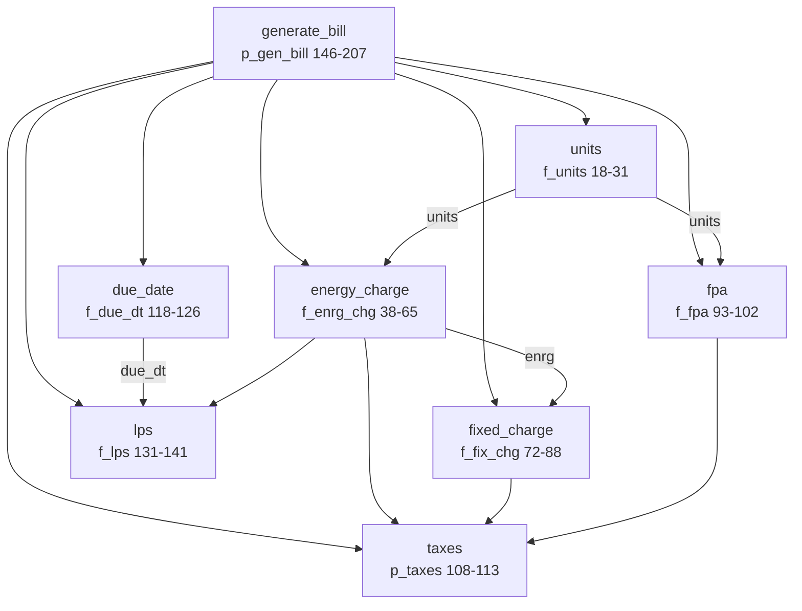

# Design Document

## Overview

This design covers the Python port of the synthetic legacy package `BILLING_PKG` into one module, `src/gravedigger/resurrected/billing.py`. The port is a calculation only. It has no database access, no global state, and no debug output. Its job is to bill exactly like the legacy PL/SQL, quirks included, so that the later Prove spec can compare every field of every bill against Oracle.

The contract is `tests/test_resurrect_billing.py` (30 tests). That file is not modified. Its module docstring fixes the function names, argument order, and the two frozen dataclasses. This design adds the internal rounding approach, per-unit line ranges, and the properties the later equivalence phase will run.

Key decisions:

| Decision | Rationale |
|---|---|
| One module, eight public functions plus two dataclasses | One Python function per legacy unit (tech rule). Names are fixed by the tests. |
| All arithmetic in `Decimal`, constants built from strings | Money rule. `float` never appears, so no binary rounding error. |
| One private helper `_round(value, places)` wrapping `quantize(..., ROUND_HALF_UP)` | Oracle `ROUND` moves halves away from zero. A single helper keeps the rounding points visible and makes the "no built-in `round`" rule easy to check. |
| The FPA rate arrives as an argument (`Decimal | None`) | The legacy `f_fpa` does a table lookup. Lookups belong to the database layer, so the port takes the looked-up rate. `None` mirrors `NO_DATA_FOUND`. |
| Reading dates arrive as `datetime`, due dates leave as `date` | Oracle `DATE` has a time part. `TRUNC` becomes `.date()`. |
| No exception handling inside `generate_bill` | Legacy `WHEN OTHERS THEN NULL` is not copied (migration rule 5). The risk is recorded in the docstring. |

Sources: legacy `legacy/billing_pkg.pkb`, steering files `tech.md` and `migration-rules.md`, and the Oracle evidence table in `requirements.md`. Python behaviour of `Decimal.quantize` and `ROUND_HALF_UP` is from the standard library documentation for `decimal`. No external research was needed beyond that.

## Architecture

The port mirrors the legacy call graph. `generate_bill` is the only caller. Every other function is pure and independent.



Data flow inside `generate_bill` follows pkb lines 170-193 in this order: units, energy charge, fixed charge, FPA, taxes, due date, surcharge, TV fee, total.

### Line ranges

All line numbers refer to `legacy/billing_pkg.pkb`. Ranges are the function bodies as numbered in the file, and each docstring must start with the matching "Ports BILLING_PKG.<unit> (pkb lines X-Y)." sentence.

| Python function | Legacy unit | pkb lines | Quirk lines |
|---|---|---|---|
| `units` | `f_units` | 18-31 | 21-24 rollover |
| `energy_charge` | `f_enrg_chg` | 38-65 | 43-44 cliff; 58-59 unknown tariff |
| `fixed_charge` | `f_fix_chg` | 72-88 | 79-80 minimum charge |
| `fpa` | `f_fpa` | 93-102 | 99-101 `NO_DATA_FOUND` default |
| `taxes` | `p_taxes` | 108-113 | 105-106, 112 tax on tax |
| `due_date` | `f_due_dt` | 118-126 | 122-124 Sunday shift |
| `lps` | `f_lps` | 131-141 | 136 time of day counts; 137 energy base only |
| `generate_bill` | `p_gen_bill` | 146-207 (calculation 170-193) | 187 TV not taxed; 193 total half up; 205-206 `WHEN OTHERS` |

## Components and Interfaces

Module `gravedigger.resurrected.billing`. Imports: `dataclasses`, `datetime` (`date`, `datetime`, `time`, `timedelta`), `decimal` (`Decimal`, `ROUND_HALF_UP`), and `logging` if a warning is needed.

### Constants and helper

```python
_TWO_PLACES = Decimal("0.01")
_ZERO_PLACES = Decimal("1")

def _round(value: Decimal, quantum: Decimal) -> Decimal:
    """Oracle ROUND(value, n): quantize with ROUND_HALF_UP (halves away from zero)."""
    return value.quantize(quantum, rounding=ROUND_HALF_UP)
```

Every magic number from the legacy code is written as `Decimal("...")`, for example `Decimal("22")`, `Decimal("0.015")`, `Decimal("0.17")`. Integer readings (99999) stay `int` where they only combine with other values through `Decimal` multiplication.

### Data types

```python
@dataclass(frozen=True)
class BillInput:
    tariff: str
    load_kw: Decimal
    prev_rdg: int
    curr_rdg: int
    mf: Decimal
    rdg_dt: datetime
    fpa_rate: Decimal | None   # None: no FPA_RT row for the month
    pay_dt: datetime | None    # None: unpaid

@dataclass(frozen=True)
class Bill:
    units: Decimal
    enrg: Decimal
    fix: Decimal
    fpa: Decimal
    ed: Decimal
    gst: Decimal
    tv: Decimal
    lps: Decimal
    total: Decimal
    due_dt: date
```

Field order is the order in the tests' module docstring, because the tests construct both classes positionally.

### Functions

```python
def units(prev: int, curr: int, mf: Decimal) -> Decimal
def energy_charge(tariff: str, units: Decimal) -> Decimal
def fixed_charge(tariff: str, load_kw: Decimal, enrg: Decimal) -> Decimal
def fpa(units: Decimal, rate: Decimal | None) -> Decimal
def taxes(enrg: Decimal, fix: Decimal, fpa: Decimal) -> tuple[Decimal, Decimal]
def due_date(rdg_dt: datetime) -> date
def lps(enrg: Decimal, due_dt: date, pay_dt: datetime | None) -> Decimal
def generate_bill(inp: BillInput) -> Bill
```

The parameter name `units` in `energy_charge` and `fpa`, and `fpa` in `taxes`, shadow the module-level functions inside those bodies only. This is harmless because those bodies never call the shadowed function. `generate_bill` uses distinct local names (`n_unt`, `v_enrg`, and so on, echoing the legacy names) to avoid the clash.

### Per-function behaviour

**`units`** (pkb 18-31). `if curr < prev: (99999 - prev + curr + 1) * mf else (curr - prev) * mf`. No rounding. `int * Decimal` yields a `Decimal` that keeps the scale of `mf`, so `units(100, 250, Decimal("1.5"))` is `Decimal("225.0")`. LEGACY QUIRK: 5-digit rollover (lines 21-24).

**`energy_charge`** (pkb 38-65). For `A1`: if `units > 300` then `units * 22` (LEGACY QUIRK, the cliff, lines 43-44); elif `> 200` then `1000 + 1300 + (units - 200) * 16`, written as `Decimal("100") * 10 + Decimal("100") * 13 + (units - 200) * 16` to keep the legacy shape; elif `> 100` then `1000 + (units - 100) * 13`; else `units * 10`. For `A2`: `units * 25`. Otherwise `Decimal("0")` with no error (lines 58-59). The result goes through `_round(..., _TWO_PLACES)` once, at the single return (line 64). Boundaries are strict `>`, so 100, 200 and 300 fall in the lower slab.

**`fixed_charge`** (pkb 72-88). `A2`: `400 * load_kw`. `A1`: `75 - enrg` if `enrg < 75` else `0` (LEGACY QUIRK, minimum charge, lines 79-80). Other tariffs: `0`. No rounding (line 88). An `A1` charge of exactly 75 gives 0.

**`fpa`** (pkb 93-102). `None` returns `Decimal("0")`, with a comment that this mirrors the legacy `NO_DATA_FOUND` handler (lines 99-101). Otherwise `_round(units * rate, _TWO_PLACES)`.

**`taxes`** (pkb 108-113). `ed = _round(enrg * Decimal("0.015"), _TWO_PLACES)`, then `gst = _round((enrg + fix + fpa + ed) * Decimal("0.17"), _TWO_PLACES)`. The already rounded `ed` is part of the GST base. LEGACY QUIRK: tax on tax (lines 105-106, 112). Returns `(ed, gst)`.

**`due_date`** (pkb 118-126). `d = rdg_dt.date() + timedelta(days=14)`. If `d.weekday() == 6` (Sunday), add one day. `weekday()` is a pure calendar computation, so the result cannot depend on locale; this replaces `TO_CHAR(..., 'DY', 'NLS_DATE_LANGUAGE=ENGLISH')`. `strftime("%a")` must not be used. LEGACY QUIRK: Sunday shift (lines 122-124).

**`lps`** (pkb 131-141). `None` returns 0 (lines 134-135). Otherwise compare `pay_dt > datetime.combine(due_dt, time.min)`. If later, return `_round(enrg * Decimal("0.10"), _TWO_PLACES)`, else 0. LEGACY QUIRK: the due date is a midnight timestamp, so a payment at 10:00 on the due date is late (line 136). The base is the energy charge only (line 137).

**`generate_bill`** (pkb 146-207, calculation 170-193):

```python
n_unt  = units(inp.prev_rdg, inp.curr_rdg, inp.mf)
v_enrg = energy_charge(inp.tariff, n_unt)
v_fix  = fixed_charge(inp.tariff, inp.load_kw, v_enrg)
v_fpa  = fpa(n_unt, inp.fpa_rate)
v_ed, v_gst = taxes(v_enrg, v_fix, v_fpa)       # TV fee is not in the GST base
d_due  = due_date(inp.rdg_dt)
v_lps  = lps(v_enrg, d_due, inp.pay_dt)
v_tv   = Decimal("35") if inp.tariff == "A1" else Decimal("60")
n_tot  = _round(v_enrg + v_fix + v_fpa + v_ed + v_gst + v_tv + v_lps, _ZERO_PLACES)
```

It returns `Bill(n_unt, v_enrg, v_fix, v_fpa, v_ed, v_gst, v_tv, v_lps, n_tot, d_due)`. The docstring records three things: the function does no database access; it does not reproduce `WHEN OTHERS THEN NULL` (lines 205-206); and the swallowed-error risk, where customer 1006 with no meter reading produces no bill row in Oracle, is listed for the autopsy.

## Data Models

| Type | Kind | Notes |
|---|---|---|
| `BillInput` | frozen dataclass | Inputs after the database reads at pkb 162-183. `prev_rdg` and `curr_rdg` are `int`. All other numbers are `Decimal`. |
| `Bill` | frozen dataclass | Equivalent to one `BILL_HDR` row without `cust_no`, `bill_mon` and `gen_dt`. Money and `units` are `Decimal`. `due_dt` is `date`. |

Frozen dataclasses give value equality, so the Prove phase can compare whole bills with `==` and also field by field.

Decimal context: the port relies on the default context (28 significant digits, `ROUND_HALF_EVEN` default which the port never uses because every rounding names its mode). Oracle `NUMBER` holds 38 digits. The generators in the Prove spec keep values far below 28 digits, so this difference is not reachable. If a larger input ever reaches `quantize`, Python raises `InvalidOperation`, and that is allowed to propagate (Requirement 8.7).

Timestamp precision: Oracle `DATE` has one-second resolution and `datetime` has microseconds. Generators for `rdg_dt` and `pay_dt` must use whole seconds so that the "later than due date" comparison means the same in both systems.

## Correctness Properties

*A property is a characteristic or behavior that should hold true across all valid executions of a system-essentially, a formal statement about what the system should do. Properties serve as the bridge between human-readable specifications and machine-verifiable correctness guarantees.*

After reviewing the prework for redundancy, the units equal-reading and rollover criteria merge into one property with two branches. The A1 slab criteria (2.1-2.4) merge into one piecewise property. A2 and unknown-tariff energy results are kept together. The "no extra rounding" criterion (3.5) merges into the fixed-charge property by using inputs with four decimals. Result-type criteria (5.1, 6.4, 9.1, 9.5) merge into the property of the function they describe. Taxes, TV fee and the GST base (8.1-8.3) merge into the composition property. Criteria that are single concrete Oracle values, docstring text, frozen dataclasses, and the AST check for `float` and `round` are example tests, not properties.

### Property 1: Units from meter readings

*For any* previous reading, current reading and multiplying factor, `units` returns `(curr - prev) * mf` when `curr >= prev` (including equal readings, which give 0), and `(99999 - prev + curr + 1) * mf` when `curr < prev`.

**Validates: Requirements 1.1, 1.2, 1.3**

### Property 2: Home tariff slabs and the 300-unit cliff

*For any* non-negative Units value, `energy_charge("A1", u)` equals `u * 10` for `u <= 100`, `1000 + (u - 100) * 13` for `100 < u <= 200`, `2300 + (u - 200) * 16` for `200 < u <= 300`, and `u * 22` for `u > 300`, rounded half up to 2 decimal places.

**Validates: Requirements 2.1, 2.2, 2.3, 2.4, 2.7**

### Property 3: Shop and unknown tariffs

*For any* non-negative Units value, `energy_charge("A2", u)` equals `u * 25` rounded half up to 2 decimals, and *for any* tariff code other than `A1` and `A2`, `energy_charge` returns 0 without raising.

**Validates: Requirements 2.5, 2.6, 2.7**

### Property 4: Energy charge is rounded half up

*For any* Units value with up to four decimal places and any tariff, the energy charge has exactly two decimal places and equals the exact piecewise value rounded with `ROUND_HALF_UP`, so exact halves move away from zero.

**Validates: Requirements 2.7, 9.2**

### Property 5: Fixed charge and the household minimum

*For any* sanctioned load and any energy charge (with up to four decimals), `fixed_charge("A2", kw, e)` equals `400 * kw`; `fixed_charge("A1", kw, e)` equals `75 - e` when `e < 75` and `0` otherwise, with no rounding applied; any other tariff gives 0.

**Validates: Requirements 3.1, 3.2, 3.3, 3.4, 3.5**

### Property 6: Fuel price adjustment

*For any* Units value and any rate, `fpa(u, rate)` equals `u * rate` rounded half up to 2 decimals, and *for any* Units value `fpa(u, None)` equals 0 without raising.

**Validates: Requirements 4.1, 4.2, 9.2**

### Property 7: Taxes with tax on tax

*For any* energy charge, fixed charge and fuel price adjustment (2-decimal values), `taxes` returns a pair of `Decimal` where `ed` is `enrg * 0.015` rounded half up to 2 decimals and `gst` is `(enrg + fix + fpa + ed) * 0.17` rounded half up to 2 decimals, using the rounded `ed`.

**Validates: Requirements 5.1, 5.2, 5.3**

### Property 8: Due date and the Sunday shift

*For any* reading timestamp, `due_date` returns a value of type `date` (not `datetime`) that is never a Sunday. It equals the reading's calendar date plus 14 days, plus one more day exactly when that date is a Sunday. The time part of the reading never changes the result.

**Validates: Requirements 6.1, 6.2, 6.3, 6.4**

### Property 9: Late payment surcharge

*For any* energy charge, due date, and payment timestamp with whole-second resolution, `lps` returns 0 when the payment is `None` or is at or before the due date at 00:00, and otherwise returns `enrg * 0.10` rounded half up to 2 decimals. No other charge enters the calculation.

**Validates: Requirements 7.1, 7.2, 7.3, 7.4**

### Property 10: Bill is the legacy chain of the unit functions

*For any* valid `BillInput`, `generate_bill` returns a `Bill` whose `units`, `enrg`, `fix`, `fpa`, `ed`, `gst`, `lps` and `due_dt` equal the outputs of the unit functions chained in the legacy order, whose `tv` is 35 for `A1` and 60 otherwise, and whose `gst` is the same value `taxes` gives without the TV fee. Every money field and `units` is a `Decimal`, and `due_dt` is a `date`.

**Validates: Requirements 8.1, 8.2, 8.3, 9.1, 9.5**

### Property 11: Total is the half-up rounded sum

*For any* valid `BillInput`, `total` equals `enrg + fix + fpa + ed + gst + tv + lps` rounded half up to 0 decimal places, and is therefore a whole number. A sum ending in exactly .50 rounds up (9048.50 gives 9049), where Python's built-in `round` would not.

**Validates: Requirements 8.4, 9.2**

### Property 12: Input errors propagate

*For any* `BillInput` where a required numeric field is `None`, `generate_bill` raises an exception instead of returning a bill or swallowing the error.

**Validates: Requirements 8.7**

## Error Handling

| Situation | Legacy behaviour | Port behaviour |
|---|---|---|
| Unknown tariff in `energy_charge` or `fixed_charge` | Returns 0 (pkb 58-59, 74) | Returns 0, no exception |
| No FPA rate for the month | `NO_DATA_FOUND` handler returns 0 (pkb 99-101) | `rate is None` returns 0, with a comment naming the legacy handler |
| Unpaid bill | `p_pay_dt IS NULL` returns 0 (pkb 134-135) | `pay_dt is None` returns 0 |
| Missing meter reading (customer 1006) | `WHEN OTHERS THEN NULL` swallows it and no row is written (pkb 205-206) | Out of scope for the port: the caller must build a `BillInput`. Recorded as an autopsy risk in the `generate_bill` docstring. The port does not log inside pure functions. |
| Bad input types (for example a `None` reading) | Swallowed by `WHEN OTHERS` | Python raises `TypeError`. `generate_bill` has no `try` block (Requirement 8.7). |
| Decimal overflow in `quantize` | Not possible in practice | `decimal.InvalidOperation` propagates. Unreachable with the generators used. |

Migration rule 5 asks for a logged warning where the legacy code swallows errors. The port has no such code path to warn from, because the swallow happens at the database-read layer, so the warning belongs to the later loader that builds `BillInput` and is noted as a follow-up for that spec.

## Testing Strategy

Property-based testing applies: every unit is a pure function of its arguments with a large input space and clear universal rules. Library: **Hypothesis** (already in the stack). No custom property framework is written.

### Two layers

1. **Acceptance tests (exist, unchanged).** The 30 tests in `tests/test_resurrect_billing.py` cover the five seed bills, each planted rule with concrete values, the 9048.50 rounding ghost, frozen and `Decimal` types, legacy names in docstrings, and the AST check for `float` and `round`. The full suite must reach 117 passing tests with `.venv\Scripts\python.exe -m pytest -q`.
2. **Property tests (later Prove spec).** Properties 1 to 12 above become Hypothesis tests. This satisfies migration rule 9 (each requirement has at least one property). This task does not write them.

### Property test configuration

- Each property is implemented as a single Hypothesis test.
- Hypothesis profiles follow the tech rules: `dev` with 200 examples (minimum of 100 per property is met), `ci` with 2000 examples and a fixed seed.
- Each test carries a tag comment in this form: `Feature: resurrect-billing, Property N: <property text>`.
- Expected values in the properties are computed by a small independent reference written in the test (plain `Decimal` formulas), not by calling the function under test.

### Generators

- Readings: integers from 0 to 99999, with a bias toward `curr == prev` and `curr < prev` so both branches are covered.
- Units, energy charges and rates: `Decimal` built from strings or `Decimal` strategies with bounded digits (four decimals), never from `float`. Include values near 75, 100, 200, 300 and 301, and values whose exact result ends in a half (for example rate 0.333 with 5 units).
- Tariff: sampled from `A1`, `A2` and a generated unknown code.
- Dates: `datetime` with whole seconds across several years so Sundays and month ends occur, and payment times placed around the due-date midnight.

### Oracle equivalence

The Oracle comparison belongs to the next spec. It will run the same `BillInput` through `generate_bill` and through Oracle (`oracle_runner.py`, tests marked `@pytest.mark.oracle`) and compare every field of the bill exactly. The Oracle evidence table in `requirements.md` already pins the concrete values that the example tests use.

### Out of scope

Database reads and the `INSERT` (pkb 162-183, 195-198), debug output (`g_dbg`), and the `WHEN OTHERS` swallow are not ported. Cleanup of quirks is not done here, because identical behaviour comes first (migration rules).
