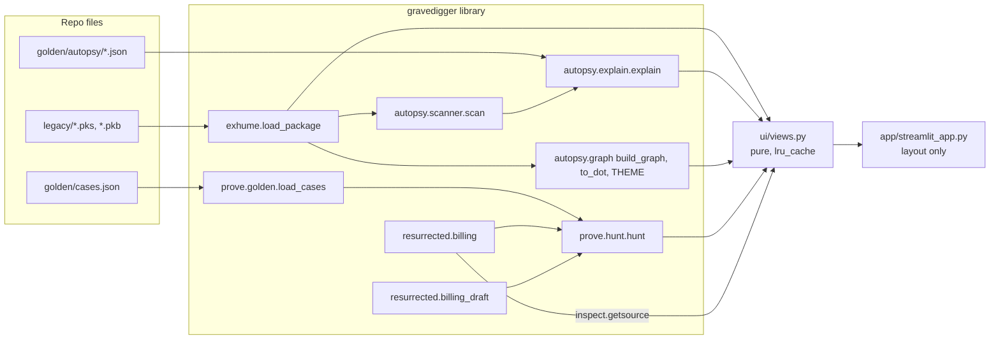

# Design Document

## Overview

The public demo app tells the Grave Digger story in four tabs (Autopsy, Graph, Resurrect, Prove). It runs with no database, no LLM call and no API key. Every fact comes from files in the repository (`legacy/`, `golden/autopsy/`, `golden/cases.json`) and from the Python port.

The feature has four deliverables:

| Deliverable | Path | Role |
|---|---|---|
| Views | `src/gravedigger/ui/views.py` (+ empty `__init__.py`) | Pure functions. No `streamlit` import. All data, text and formatting logic. |
| App | `app/streamlit_app.py` | Thin page. Calls only Views and lays the results out with Streamlit. |
| Theme | `.streamlit/config.toml` | Dark graveyard theme. |
| Cloud requirements | `requirements.txt` (repo root) | Runtime dependencies for Streamlit Community Cloud. |

The acceptance contract is the existing `tests/test_ui.py`, which this design does not change. A second file, `tests/test_ui_properties.py`, holds the Hypothesis properties.

### Research summary

Findings that shaped the design (sources linked):

- Community Cloud picks one dependency file by priority: `uv.lock`, `Pipfile`, `environment.yml`, `requirements.txt`, then `pyproject.toml` ([Streamlit forum, dependency priority](https://discuss.streamlit.io/t/deploy-streamlit-app-that-uses-pixi/120858)). The file may sit in the repo root or beside the entrypoint ([Streamlit docs, app dependencies](https://docs.streamlit.io/streamlit-cloud/get-started/deploy-an-app/app-dependencies)). A root `requirements.txt` therefore wins over `pyproject.toml`, which lets the hosted app skip `oracledb`, `mcp`, `anthropic` and `openai`.
- The code already keeps heavy imports out of the runtime path. `explain.py` imports `anthropic` and `openai` inside the client methods. `golden.py` imports `oracledb` only under `TYPE_CHECKING` and `oracle_runner` only inside `build_golden`. So Views can import `explain`, `golden` and `hunt` with only the standard library and `streamlit` installed.
- `config.REPO_ROOT` is `Path(__file__).parents[2]`. That is the repo root for an editable or `src`-on-path run, but it is wrong for a regular (non-editable) `pip install .`, where the package lands in `site-packages`. Views therefore verify the root (see "Locating repo files").
- `explain()` with `client=None` and a `cache_dir` already does what Requirement 3 needs: it uses the newest cache file named `<unit>-<source hash>-*.json`, else builds a static explanation. Views add no logic of their own there.
- `HuntReport.smallest` orders ghosts by `(units, total)` of the Oracle bill, else the Python bill. `ghost_table` must use the same order.

## Architecture



Layering rules:

1. Views import library modules and the standard library. They never import `streamlit`, `oracledb`, `anthropic`, `openai` or `oracle_runner`, and never call `make_client`, `build_golden`, `run_oracle` or `connect`. (Requirement 8; enforced by `test_no_database_and_no_live_llm_in_the_app`, which parses every file under `src/gravedigger/ui/` and the app.)
2. The App imports `streamlit` and `gravedigger.ui.views` only. It holds no business logic. Anything that needs a decision (a label, a colour, a sentence, a number) is a Views function.
3. Library modules are not changed.

### Design decisions

| Decision | Choice | Rationale |
|---|---|---|
| Cache location | `functools.lru_cache` inside Views, none in the App | See "Caching strategy". |
| Hunt result across reruns | `st.session_state["hunt_shown"]`, set when a button returns True | See "Showing hunt results across reruns". |
| Repo path lookup | Verify `config.REPO_ROOT`, fall back to the working directory and its parents | See "Locating repo files". |
| `python_source` | `inspect.getsource` on the port function, then `textwrap.dedent` | Simple, exact, includes the docstring. |
| Ghost explanation | Re-derive the pre-rounding total from the bill parts, test for a `.50` fraction | See "explain_ghost". |
| Dynamic text in Markdown | Escape with `md_escape`; HTML only for static, escaped pills | See "Rendering labels and notes". |
| Cloud dependencies | Root `requirements.txt` with `streamlit` only, and a `src` path bootstrap in the app | See "Deployment notes". |
| Money format | Western thousands grouping ("Rs 12,599") | Fixed by the requirements and tests. Indian lakh grouping is not used. |

## Components and Interfaces

### Module `gravedigger.ui.views`

Public names and signatures. Every function is pure apart from reading repo files through a cached loader.

```python
# constants
UNIT_ORDER: tuple[str, ...]                       # the 8 unit names in package order (derived, see below)
PORT_OF: Mapping[str, str]                        # MappingProxyType: unit name -> function name in resurrected.billing
GRAPH_LEGEND: tuple[tuple[str, str, str], ...]    # (name, "#rrggbb", plain-English meaning), 5 entries
GHOST_COLUMNS: tuple[str, ...]                    # ("Tariff", "Units", "Oracle total", "Python total", "Difference")
TARIFF_LABELS: Mapping[str, str]                  # {"A1": "A1 (home)", "A2": "A2 (shop)"}
NO_BILL: str                                      # "no bill"
STATIC_NOTE: str                                  # "Showing rules found by the scanner only (no cached AI autopsy)"
TAGLINE: str                                      # "Legacy billing code never dies. It just haunts you."
CI_BADGE_URL: str; CI_WORKFLOW_URL: str           # the two URLs of Requirement 10.6

# money
def rs(amount: Decimal) -> str

# repo files and units
def repo_root() -> Path
def load_units() -> tuple[Unit, ...]
def legacy_source(unit_name: str) -> str
def python_source(unit_name: str) -> str

# autopsy and graph
def build_autopsy_cards(cache_dir: Path) -> tuple[Explanation, ...]
def autopsy_cards() -> tuple[Explanation, ...]
def graph_dot() -> str
def headline() -> Headline

# ghost hunt
def run_hunt(which: Literal["port", "draft"]) -> HuntReport
def ghost_table(report: HuntReport, limit: int = 20) -> list[dict[str, str]]
def explain_ghost(ghost: Ghost) -> str
def hunt_headline(report: HuntReport) -> str

# safe text for the page
def md_escape(text: str) -> str
def pill_html(text: str, colour: str) -> str
def category_colour(category: str) -> str
def citation(rule: Rule) -> str
```

`Rule`, `Explanation`, `Unit`, `Ghost` and `HuntReport` are the library types. `Headline` is new (see Data Models).

#### Money: `rs`

Ports no legacy unit. It formats a `Decimal` for people.

1. Reject anything that is not a `Decimal` with `TypeError` (a `float` is the case that matters; Requirement 1.5).
2. Quantize to two places with `ROUND_HALF_UP` (never the built-in `round()`; steering rule). Amounts with at most two decimal places are unchanged. Amounts with more places are outside the contract and are rounded the way Oracle rounds.
3. The sign is taken from the quantized value, so a negative amount that rounds to zero prints "Rs 0", never "-Rs 0".
4. If the quantized absolute value is whole, format with `"{:,.0f}"`, else with `"{:,.2f}"`. Because the value already has two places, the format call performs no rounding.
5. Return `"-Rs " + text` for a negative amount, else `"Rs " + text`.

#### Locating repo files: `repo_root`

`repo_root()` returns the folder that holds the three data folders. It is `lru_cache`d.

1. Candidate list: `config.REPO_ROOT`, then `Path.cwd()` and each of its parents.
2. A candidate is accepted when it contains `legacy/billing_pkg.pkb`, `golden/autopsy` and `golden/cases.json`.
3. If no candidate is accepted, raise `FileNotFoundError("The graveyard files (legacy/ and golden/) were not found ...")`.

Why: on Streamlit Community Cloud the app runs with the repository root as the working directory, and the checked-out repo is what holds the data files. If someone installs the package non-editably, `config.REPO_ROOT` points into `site-packages`, the marker check fails, and the working directory wins. Locally and in tests, `config.REPO_ROOT` is accepted first, so Views read the same `golden/cases.json` as `gravedigger.prove.golden.GOLDEN_PATH`.

Files are read with `Path.read_text(encoding="utf-8")`, which translates line endings to LF. This keeps unit source text, and so the autopsy cache hash (`_source_hash`), identical on Windows and Linux.

#### Units and sources

- `_package()` is `lru_cache`d. It calls `load_package(spec_text, body_text)` on `legacy/billing_pkg.pks` and `legacy/billing_pkg.pkb`.
- `load_units()` returns `_package().units`, which is package order (`f_units` ... `p_gen_bill`). `UNIT_ORDER` is `tuple(u.name for u in load_units())`, computed lazily through a cached helper so importing Views reads no file.
- `PORT_OF` is a `MappingProxyType` (immutable, so it is not "global mutable state"):

| Unit | Port function |
|---|---|
| f_units | units |
| f_enrg_chg | energy_charge |
| f_fix_chg | fixed_charge |
| f_fpa | fpa |
| p_taxes | taxes |
| f_due_dt | due_date |
| f_lps | lps |
| p_gen_bill | generate_bill |

- `legacy_source(name)` returns the `source` of the matching `Unit`. `Unit.source` holds the exact lines of the unit, from its `FUNCTION` or `PROCEDURE` line to its `END` line (see `exhume._slice_lines`).
- `python_source(name)` extracts a function's source like this:
  1. Look up `PORT_OF[name]`, then `getattr(billing, func_name)`.
  2. `text = inspect.getsource(func)`. All ports are plain top-level functions with no decorators, so the text starts at the `def` line and includes the docstring (which holds "Ports BILLING_PKG.f_lps ...").
  3. `textwrap.dedent(text).rstrip("\n")`, so the first line starts with `def `.
  4. A defensive check: if the result does not start with `def <func_name>(`, raise `ValueError` that names the unit. This would only fire if someone added a decorator.
  `inspect.getsource` needs the `.py` file on disk. It is, on Community Cloud (a plain checkout) and locally.
- Both functions raise `KeyError(f"Unknown unit {name!r}. Known units: ...")` for a name outside the eight (Requirement 2.6). `legacy_source` finds its unit with a dict built from `load_units()`; `python_source` looks in `PORT_OF` first, so both fail the same way.

#### Autopsy: `build_autopsy_cards`, `autopsy_cards`

```python
def build_autopsy_cards(cache_dir: Path) -> tuple[Explanation, ...]:
    return tuple(explain(u, scan(u), client=None, cache_dir=cache_dir) for u in load_units())

@lru_cache(maxsize=None)
def autopsy_cards() -> tuple[Explanation, ...]:
    return build_autopsy_cards(repo_root() / "golden" / "autopsy")
```

- `client=None` is passed as a literal, so no client can be created and no key is read. `make_client` and `client_from_settings` are not imported.
- `explain` already implements Requirement 3.2, 3.5 and 3.6: it finds `golden/autopsy/<unit>-<source hash>-*.json` (for example `f_lps-07a7f7bf60d5-a73ef9386555.json`) and marks the card `source == "cache"`, else it returns a static card with `source == "static"`. The guardrail runs on cached rules too, which is where Dropped_Rules come from.
- `build_autopsy_cards` takes the cache directory as a parameter so a test can point it at an empty or partial copy and see the static fallback. `autopsy_cards()` is the cached zero-argument form the App and the acceptance tests use.

#### Graph and legend

- `graph_dot()` is `lru_cache`d: `to_dot(build_graph(_package()))`. The output starts with `digraph "autopsy" {`, which satisfies `startswith("digraph")`, and contains the nodes `BILL_HDR` and `p_gen_bill`.
- `GRAPH_LEGEND` is built once from `graph.EDGE_STYLES` and `graph.THEME`, so it cannot drift from the drawn graph (Requirement 4.4):

| Name | Colour source | Meaning (plain English) |
|---|---|---|
| calls | `EDGE_STYLES["calls"].color` (purple) | One step of the bill asks another step to do part of the work. |
| reads | `EDGE_STYLES["reads"].color` (teal) | Looks up information in a table. |
| writes | `EDGE_STYLES["writes"].color` (amber) | Saves information into a table. |
| uses | `EDGE_STYLES["uses"].color` (grey) | Uses a setting shared by the whole package. |
| hides errors | `THEME.red` | Swallows every failure, so a problem is never reported. |

#### Headline numbers: `headline`

`headline()` returns `Headline(units_raised=len(load_units()), rules_found=sum(len(c.rules) for c in autopsy_cards()), bills_proven=len(_golden_cases()))`. The App shows `str(units_raised)`, `str(rules_found)` and `f"{bills_proven:,}"`.

#### Ghost hunt: `run_hunt`

```python
_PORTS: Mapping[str, Callable[[BillInput], Bill]] = MappingProxyType(
    {"port": billing.generate_bill, "draft": billing_draft.generate_bill}
)

@lru_cache(maxsize=None)
def _golden_cases() -> tuple[GoldenCase, ...]:
    return load_cases(repo_root() / "golden" / "cases.json")

@lru_cache(maxsize=None)
def run_hunt(which: str) -> HuntReport:
    if which not in _PORTS:
        raise ValueError(f"Unknown hunt {which!r}. Use 'port' or 'draft'.")
    return hunt(_PORTS[which], _golden_cases())
```

- The hunt calls only `hunt` and `load_cases`. No connection is possible: `oracle_runner` is not imported.
- A raised `ValueError` is not cached by `lru_cache`, so only the two valid keys ever occupy the cache.
- `_golden_cases` is the single loader, so `golden/cases.json` is read at most once per process (Requirement 5.5).

#### Ghost table: `ghost_table`

```python
def ghost_table(report: HuntReport, limit: int = 20) -> list[dict[str, str]]
```

1. `ordered = sorted(report.ghosts, key=_ghost_size)` where `_ghost_size(g)` is `(bill.units, bill.total)` for `bill = g.oracle or g.python`. This is the key of `hunt._size`, repeated here so Views do not import a private name. Python's `sorted` is stable and `min` returns the first minimal element, so `ordered[0]` is `report.smallest`. Property 8 pins this.
2. Take `ordered[:max(limit, 0)]`.
3. Each row is a dict with keys in the order of `GHOST_COLUMNS`:
   - **Tariff**: `TARIFF_LABELS.get(g.input.tariff, g.input.tariff)`.
   - **Units**: the `units` of the Oracle bill, or of the Python bill when Oracle wrote none, shown as a plain number with thousands separators (`format(units.normalize(), ",f")`).
   - **Oracle total**: `rs(g.oracle.total)`, or `NO_BILL` when `g.oracle is None`.
   - **Python total**: `rs(g.python.total)`.
   - **Difference**: `rs(g.python.total - g.oracle.total)` (Python minus Oracle, so the draft's `9048` against Oracle's `9049` gives "-Rs 1"), or `"n/a"` when Oracle wrote no bill.
4. An empty report gives `[]`.

#### Ghost explanation: `explain_ghost`

Input is one `Ghost`. Output is plain English with every money amount written by `rs`. Three branches, tested in this order:

**Branch A: Oracle wrote no bill (`ghost.oracle is None`).** Text contains "no bill". Example: "Oracle wrote no bill for this customer, but the Python code produced one of Rs 9,049. The old system hides its errors, so a bill that fails is skipped in silence. Python has no such habit." The text states the usual cause as "usually", since the ghost alone cannot prove it.

**Branch B: half-rupee rounding (the target case).** `_half_rupee_pre_total(ghost)` returns the pre-rounding total or `None`:

```python
def _before_rounding(bill: Bill) -> Decimal:          # mirrors pkb line 193, same terms
    return bill.enrg + bill.fix + bill.fpa + bill.ed + bill.gst + bill.tv + bill.lps

def _half_rupee_pre_total(ghost: Ghost) -> Decimal | None:
    oracle = ghost.oracle
    if oracle is None or tuple(d.field for d in ghost.diffs) != ("total",):
        return None
    pre = _before_rounding(oracle)
    if pre - pre.to_integral_value(rounding=ROUND_FLOOR) != Decimal("0.5"):
        return None
    if oracle.total != pre.quantize(Decimal("1"), rounding=ROUND_HALF_UP):
        return None
    return pre
```

Why it works: the draft (`billing_draft.generate_bill`) keeps every part of the correct port and replaces only the final rounding, so the parts of the Oracle bill and the Python bill are equal and only `total` differs. The pre-rounding total is the sum of the seven parts that the legacy line 193 adds. A tie is exactly `.50`. The third test confirms that Oracle's total is that sum rounded half up, so the explanation is never shown for an unrelated one-rupee gap. Decimal arithmetic is exact at these magnitudes, so the comparisons need no tolerance.

Text (all amounts through `rs`; example: `GHOST_INPUT` of `test_ui.py`):

> "Both systems add this bill up to Rs 9,048.50 before rounding to a whole rupee. That is exactly half a rupee, so the answer depends on the rounding rule. Oracle rounds a half up and bills Rs 9,049. The Python side used round(), which rounds a half to the nearest even number, and bills Rs 9,048. That one-rupee gap is the ghost."

This satisfies Requirements 7.1 to 7.3: both totals, the unrounded half total, the words "half" and "round()".

**Branch C: any other difference.** Lists each differing field with a plain label and both values, for example "Oracle and Python disagree on: total (Rs 100 against Rs 101)". Labels come from a constant map (`units` "units used", `enrg` "energy charge", `fix` "fixed charge", `fpa` "fuel price adjustment", `ed` "electricity duty", `gst` "tax (GST)", `tv` "TV fee", `lps` "late payment surcharge", `total` "total", `due_dt` "due date"). `units` values print as plain numbers, `due_dt` as an ISO date, the rest through `rs`. When only `total` differs but it is not a tie, the text says the two systems add the same parts and round the sum differently.

No branch uses programming words except `round()` (Requirement 7.5).

#### Hunt headline: `hunt_headline`

- No ghosts: `f"No ghosts. All {checked:,} bills match Oracle to the paisa."`
- Ghosts: `f"{n} ghost{'s' if n != 1 else ''} found. {matched:,} of {checked:,} bills match Oracle, but these {n} do not."` (singular wording for 1).

The ghost count `n` is printed without a thousands separator on purpose: `test_prove_tab_draft_is_haunted...` searches for `f"{len(report.ghosts)} ghost"`, and `"1,234 ghost"` would not contain `"1234 ghost"`.

#### Safe text helpers

- `md_escape(text)`: backslash-escapes the Markdown specials `\ ` * _ ~ $ [ ] < >`. It is the only way cached or model-written text reaches `st.markdown` or `st.caption`. Text with no specials is unchanged, so a rule such as "For tariff A1, if units used are above 300, ..." still appears on the page character for character (Requirement 12.5).
- `pill_html(text, colour)`: returns `<span style="background:{colour};color:#1a1423;padding:0.1rem 0.6rem;border-radius:0.8rem;font-weight:600">{html.escape(text)}</span>`. `colour` must match `^#[0-9a-fA-F]{6}$`, else `ValueError`. The only callers pass colours from `THEME` or `GRAPH_LEGEND`.
- `category_colour(category)`: `error` red, `tax` and `surcharge` amber, `data` teal, everything else purple (an unknown category such as the static `data` still gets a colour).
- `citation(rule)`: `"Code line 52"` or `"Code lines 49, 50"` (sorted, joined with commas).

### Page `app/streamlit_app.py`

Structure, top to bottom:

1. **Path bootstrap.** Before any `gravedigger` import, put `<repo>/src` on `sys.path` when it is not there already (`Path(__file__).resolve().parents[1] / "src"`; if `__file__` is not defined, use `Path.cwd() / "src"`). Under pytest `src` is already on the path, so it does nothing. Marked `# noqa: E402` on the imports that follow.
2. `st.set_page_config(page_title="Grave Digger", page_icon="🪦", layout="wide")`, the first Streamlit call.
3. `main()`, called unconditionally at the bottom of the file:
   - `_header()`: `st.title("🪦 Grave Digger")`, `st.caption(TAGLINE)`, the CI badge as plain Markdown `[](CI_WORKFLOW_URL)`, and `st.columns(3)` with three `st.metric` calls ("Units raised", "Rules found", "Oracle bills proven") whose values are strings from `headline()`.
   - `tabs = st.tabs(["🪦 Autopsy", "🕸️ Graph", "⚰️ Resurrect", "👻 Prove"])`, then one function per tab.
4. Missing data files, an unreadable golden file: `main()` catches `FileNotFoundError` and `ValueError` from the first Views call, shows `st.error` with a plain sentence ("The graveyard files could not be read: ..."), and calls `st.stop()`.

Each tab starts with one `st.markdown` or `st.caption` sentence (Requirement 11.2):

| Tab | Opening sentence |
|---|---|
| Autopsy | "Here is what each old billing step really does, in plain English, with the line of old code each rule came from." |
| Graph | "This map shows which step calls which, and which tables each step reads or writes." |
| Resurrect | "Pick a step to see the old Oracle code and its new Python twin side by side." |
| Prove | "Bill every stored Oracle customer again in Python. A ghost is a bill where the two disagree." |

**Autopsy tab.** For each card of `autopsy_cards()`, in order: `st.expander(f"{card.unit}")` (label holds the unit name). Inside:

- If `card.source == "static"`: `st.caption(STATIC_NOTE)`.
- `st.markdown(md_escape(card.summary))`.
- For each kept rule: `st.columns([5, 2])`. Left: `st.markdown(md_escape(rule.text))`. Right: `st.markdown(pill_html(rule.category, category_colour(rule.category)), unsafe_allow_html=True)` and `st.caption(citation(rule))`.
- If `card.dropped`: `st.caption("Rules the checker threw out, because the AI invented them or got them wrong:")`, then per item `st.caption(f"~~{md_escape(d.rule.text)}~~  \nWhy it was dropped: {md_escape(d.reason)}")`. `st.caption` is grey already, so the dropped rules are greyed out without HTML, and the reason is plain text.

**Graph tab.** `left, right = st.columns([4, 1])`. Left: `st.graphviz_chart(graph_dot())`. Right: a heading "Colour key" and one `st.markdown(pill_html(name, colour) + " " + html.escape(meaning), unsafe_allow_html=True)` per `GRAPH_LEGEND` entry. The pill carries the colour and the meaning is text, so the key still reads without colour (Requirement 9.5). `st.graphviz_chart` renders in the browser with a bundled library, so the Cloud host needs no system Graphviz.

**Resurrect tab.** `st.selectbox("Pick a billing step", options=[u.name for u in load_units()], key="resurrect_unit")`. Then `old, new = st.columns(2)`, with `st.code(legacy_source(sel), language="sql")` in `old` and `st.code(python_source(sel), language="python")` in `new`, each under a small caption ("Old: Oracle PL/SQL", "New: Python"). `sql` is the nearest highlighter for PL/SQL.

**Prove tab.** See the next section.

### Caching strategy

**Decision: all caching lives in Views, with `functools.lru_cache`. The App uses no `st.cache_*` decorator.**

| Option | Verdict |
|---|---|
| `st.cache_data` on the App side | Rejected. It pickles and copies the return value on every call. A `HuntReport` for 2,000+ cases (each with `Decimal` and `datetime` values) would be copied on every rerun. It also forces the App, not Views, to own the cache, which Requirement 5.5 and 16.5 put on Views. |
| `st.cache_resource` wrapping Views functions | Rejected. It shares the object by reference, which is what `lru_cache` already does, and adds a second cache layer with its own invalidation. |
| `functools.lru_cache(maxsize=None)` in Views | Chosen. |

Why `lru_cache` works for all three environments:

- **Views stay free of `streamlit`.** `lru_cache` is standard library.
- **`AppTest` works.** `AppTest.from_file` runs the script in the pytest process. Imported modules, and so the caches, persist across `at.run()` calls. The first run fills the caches, later runs and later tests are fast. Nothing in the App depends on a Streamlit runtime cache that `AppTest` might not provide.
- **Community Cloud.** One Python process serves all sessions, and `gravedigger.ui.views` is imported once, so the caches are shared across sessions and across script reruns. Results are immutable (tuples of frozen dataclasses, `str`), so sharing is safe. Two sessions racing on a cold cache may compute the same result twice, which is harmless because every function is deterministic.
- **Development.** Editing `views.py` makes Streamlit reload the module, which drops the caches.

Cached callables: `repo_root`, `_package`, `_golden_cases`, `load_units`, `autopsy_cards`, `graph_dot`, `headline`, `run_hunt`. The legend and `PORT_OF` are built once as immutable values. These caches are the only module-level state (Requirement 16.5). No module-level `list`, `dict` or `set` exists in Views; mappings use `MappingProxyType`.

### Showing hunt results across reruns

Streamlit reruns the whole script on every interaction, and `st.button` returns `True` only on the run right after the click. If the result were drawn inside `if st.button(...)`, it would disappear as soon as the user touched another widget, for instance the Resurrect selectbox.

**Decision: remember the last click in `st.session_state` and draw from that.**

```python
def _tab_prove() -> None:
    st.markdown(PROVE_INTRO)
    col_a, col_b = st.columns(2)
    if col_a.button("Hunt the real port", key="hunt_port"):
        st.session_state["hunt_shown"] = "port"
    if col_b.button("Hunt the wrong draft", key="hunt_draft"):
        st.session_state["hunt_shown"] = "draft"
    shown = st.session_state.get("hunt_shown")
    if shown is not None:
        _show_hunt(shown)
```

- The button's return value sets the state in the same run, before the state is read, so the click draws its result at once. An `on_click` callback is not needed and `AppTest` needs no callback support.
- On every later rerun, `hunt_shown` still holds the choice, so the result stays on screen. Only one hunt is shown at a time: the last one clicked.
- `_show_hunt(which)` calls `run_hunt(which)`. A second click reuses the cached report (Requirement 15.7).
- The branch depends on the report, not on the button. With no ghosts: `st.success(hunt_headline(report))`. With ghosts: `st.error(hunt_headline(report))`, then the caption "The smallest ghost, explained:" and `st.info(explain_ghost(report.smallest), icon="👻")`, then the caption "The first ghosts found:" and `st.dataframe(ghost_table(report), hide_index=True)`. That is the order of Requirement 15.4: error, explanation, table. `report.smallest` is only read when `report.ghosts` is not empty, so it is never `None` there.
- `explain_ghost` output goes to `st.info` unescaped: it is built by Views from `Decimal` values and fixed words, with no user or model text. `test_prove_tab_draft...` compares that exact string with the element value.
- Session state holds only the short string, never the report.

### Rendering labels and notes

| Element | How it is drawn | Why it is safe |
|---|---|---|
| Colour pills (legend entries, rule categories) | `st.markdown(pill_html(...), unsafe_allow_html=True)` | The HTML is a fixed template. The text goes through `html.escape`. The colour is checked against `^#[0-9a-fA-F]{6}$` and comes from `THEME`. No user, cache or model text is placed in a style attribute. |
| Legend meaning | Plain text after the pill, passed through `html.escape` | Static constant, escaped anyway. |
| Grey note for static cards | `st.caption(STATIC_NOTE)` | `st.caption` is small and grey by default. No HTML, and the value equals the exact required text. |
| Dropped rules | `st.caption(...)` with `~~strike~~` and `md_escape` on model text | Grey by default, struck through, reason as text. |
| Kept rule text, summaries, reasons | `st.markdown(md_escape(text))` | Cache files hold model-written text. Escaping stops Markdown links, emphasis and `$` maths. `unsafe_allow_html` stays off, so any HTML in such text is shown as text. |
| CI badge | Plain Markdown image link | No HTML. |
| Errors, risks | `st.error` (red), warnings `st.warning` (amber), success `st.success` (green) | Colour plus a text label in each message (Requirement 9.5). |

`unsafe_allow_html=True` appears only on the pill calls.

### Theme file `.streamlit/config.toml`

```toml
[theme]
base = "dark"
primaryColor = "#9b6bd6"
backgroundColor = "#1a1423"
secondaryBackgroundColor = "#2a2038"
textColor = "#e8e0f0"
```

The five colours equal `THEME.purple`, `THEME.background`, `THEME.fill` and `THEME.text`, so the page and the Graphviz picture share one palette. Streamlit reads this file from the working directory, which is the repo root on Community Cloud and when running `streamlit run app/streamlit_app.py` from the root.

### Deployment notes (Streamlit Community Cloud)

- **Entrypoint:** `app/streamlit_app.py`. **Python:** 3.12 (the project's `requires-python` is `>=3.12`), chosen in the Cloud advanced settings.
- **Dependency file:** add a root `requirements.txt` containing one runtime line, `streamlit>=1.40` (same floor as `pyproject.toml`). Because Cloud prefers `requirements.txt` over `pyproject.toml`, the hosted app installs only Streamlit.
- **What the app does not need at runtime:** `oracledb`, `mcp`, `anthropic`, `openai`, `pytest`, `hypothesis`. The import audit above shows none of them is imported on the path the app uses: the SDK imports in `explain.py` sit inside client methods that are never called, `oracledb` in `golden.py` is `TYPE_CHECKING` only, and `oracle_runner` is imported only inside `build_golden`.
- **Smart App Control and the `oracledb==3.4.0` pin:** that note applies to the Windows developer machine. The pin stays in `pyproject.toml` for local installs (`pip install -e ".[dev]"`) and is not copied to `requirements.txt`, so Cloud never installs `oracledb`. Cloud runs Linux, where Smart App Control does not exist. If a local `pip install streamlit` ever fails with "An Application Control policy has blocked this file", pin an older, widely used Streamlit release, as the tech rule says. Do not raise the `oracledb` pin.
- **Putting `gravedigger` on the path:** the project is not installed on Cloud (no `-e .` in `requirements.txt`, which would pull every dependency of `pyproject.toml` back in). The app's `sys.path` bootstrap makes `import gravedigger` work from the checkout. `repo_root()` finds `legacy/` and `golden/` from the working directory.
- **Files the app reads must be committed:** `legacy/billing_pkg.pks`, `legacy/billing_pkg.pkb`, `golden/cases.json`, `golden/autopsy/*.json`, `.streamlit/config.toml`. None is git-ignored today.
- **Secrets:** none. Do not add `ORACLE_*`, `APP_USER_PASSWORD` or `LLM_API_KEY` to the Cloud secrets.
- **Graphviz:** `st.graphviz_chart` draws in the browser, so no `packages.txt` with the system `graphviz` package is needed.

## Data Models

All library types are reused unchanged. New types and values in Views:

```python
@dataclass(frozen=True)
class Headline:
    """The three numbers at the top of the page."""
    units_raised: int      # len(load_units()) -> 8
    rules_found: int       # sum of kept rules over all Autopsy_Cards
    bills_proven: int      # number of Golden_Cases
```

| Name | Type | Notes |
|---|---|---|
| Ghost row | `dict[str, str]` | Keys exactly `GHOST_COLUMNS`, in order. Every value is text, so `st.dataframe` shows it as written. |
| Legend entry | `tuple[str, str, str]` | `(name, "#rrggbb", meaning)`. Fixed by `test_graph_and_legend`. |
| Hunt kind | `Literal["port", "draft"]` | Any other value raises `ValueError`. |
| Session state | `st.session_state["hunt_shown"]: Literal["port", "draft"] \| None` | Only key the App writes. |
| Widget keys | `resurrect_unit`, `hunt_port`, `hunt_draft` | Fixed by Requirements 14 and 15. |

Money is `decimal.Decimal` everywhere; the only conversions to text are `rs` and the plain number format of units. Strings are the only output of Views that reach the page.

## Correctness Properties

*A property is a characteristic or behavior that should hold true across all valid executions of a system-essentially, a formal statement about what the system should do. Properties serve as the bridge between human-readable specifications and machine-verifiable correctness guarantees.*

Reflection on redundancy: criteria 1.1, 1.2, 1.3, 16.1 and 16.4 all describe one formatting contract and merge into the rupee-formatting property. Criteria 6.1 to 6.3 and 16.3 merge into the table-shape property. Criteria 6.4, 6.5 and 6.7 to 6.9 merge into the table-cell property. Criteria 7.1 to 7.3 merge into the half-rupee explanation property. Criteria 5.1, 5.3 and 16.2 merge into the hunt-equivalence property. Criteria 2.3 and 2.4 merge into the unit-sources property. The UI layout criteria (10 to 15, except 15.2 and 15.3), the theme, the dependency rules and the fixed-data checks are examples, not properties; they are listed in the Testing Strategy.

### Property 1: Rupee formatting round trip

For any `Decimal` amount with at most two decimal places and a non-negative value, `rs(amount)` starts with "Rs ", has the fractional part ".dd" only when the amount has a non-zero fraction (and then exactly two digits), and removing "Rs ", the commas and (when present) the zero fractional part gives a text whose `Decimal` equals the amount. Calling `rs` twice with the same amount gives the same text.

**Validates: Requirements 1.1, 1.2, 1.3, 16.1, 16.4**

### Property 2: Negative amounts put the minus sign first

For any non-zero `Decimal` amount `x` with at most two decimal places, `rs(-x)` equals `"-" + rs(x)` when `x > 0`, and `rs(x)` equals `"-" + rs(-x)` when `x < 0`.

**Validates: Requirements 1.4**

### Property 3: Every unit has both sources

For any unit name in the eight-unit package, `legacy_source(name)` contains the header `FUNCTION name` or `PROCEDURE name` (matching the unit's kind), and `python_source(name)` starts with `def <PORT_OF[name]>(` and contains `BILLING_PKG.<name>`.

**Validates: Requirements 2.3, 2.4**

### Property 4: Unknown units are rejected by name

For any text that is not one of the eight unit names, `legacy_source(text)` and `python_source(text)` each raise `KeyError`, and the error message contains the text.

**Validates: Requirements 2.6**

### Property 5: The autopsy uses the cache when it has an entry and the static fallback when it has not

For any subset `H` of the eight units, when the cache files of the units in `H` are hidden (a temporary copy of `golden/autopsy` without them), `build_autopsy_cards(copy)` returns eight cards in package order, where the card of each unit in `H` has `source == "static"` and every other card has `source == "cache"`. With `make_client`, `client_from_settings` and the provider SDK imports patched to raise, the call still succeeds.

**Validates: Requirements 3.2, 3.5, 3.6**

### Property 6: Hunts equal the library hunt and are repeatable

For any hunt kind in {"port", "draft"}, `run_hunt(kind)` equals `hunt(port_function(kind), load_cases(GOLDEN_PATH))` in `checked`, `matched` and ghosts, `checked` equals the number of Golden_Cases, and a second call returns an equal report.

**Validates: Requirements 5.1, 5.3, 16.2**

### Property 7: Unknown hunts are rejected

For any text other than "port" and "draft", `run_hunt(text)` raises `ValueError`.

**Validates: Requirements 5.4**

### Property 8: The ghost table is limited, ordered and shaped

For any report (including one with no ghosts) and any `limit >= 0`, `ghost_table(report, limit)` has `min(len(report.ghosts), limit)` rows, each row has exactly the keys "Tariff", "Units", "Oracle total", "Python total", "Difference" in that order, the first row describes `report.smallest`, and the rows follow the order of `(units, total)` of the Oracle bill (else the Python bill) from small to large. A report with no ghosts gives `[]`.

**Validates: Requirements 6.1, 6.2, 6.3, 6.6, 16.3**

### Property 9: Ghost table cells are written for people

For any ghost in a report, its row has "Oracle total" equal to `rs(oracle.total)` (or "no bill" when Oracle wrote none), "Python total" equal to `rs(python.total)`, "Difference" equal to `rs(python.total - oracle.total)` when Oracle wrote a bill, and "Tariff" equal to "A1 (home)" for "A1", "A2 (shop)" for "A2", and the tariff code itself for any other text. A Smallest_Ghost whose totals differ by one rupee has "Difference" equal to "Rs 1" or "-Rs 1".

**Validates: Requirements 6.4, 6.5, 6.7, 6.8, 6.9**

### Property 10: A half-rupee ghost is explained with both totals and the unrounded total

For any ghost whose bill parts add up to `n + 0.50` with `n` even, whose Oracle total is `n + 1` and whose Python total is `n` (only `total` differs), `explain_ghost` returns text that contains `rs(n + 1)`, `rs(n)`, `rs(n + 0.50)`, the word "half" (any letter case) and "round()".

**Validates: Requirements 7.1, 7.2, 7.3**

### Property 11: A missing Oracle bill is explained

For any ghost whose `oracle` is `None`, `explain_ghost` returns text that contains "no bill" (any letter case).

**Validates: Requirements 7.4**

### Property 12: Every ghost gets a plain-English explanation

For any ghost in a generated report (half-rupee, other difference, or no Oracle bill), `explain_ghost` returns a non-empty text that contains none of the words "Decimal", "NULL", "None", "quantize", "NO_DATA_FOUND" or "OTHERS", and returns the same text on a second call. The jargon list is a proxy for "plain English".

**Validates: Requirements 7.5, 16.1**

### Property 13: The hunt headline states the ghost count

For any report, `hunt_headline(report)` contains "No ghosts" when the report has no ghosts. When it has `n >= 1` ghosts, the text contains `f"{n} ghost"` (no thousands separator) and the word "ghost".

**Validates: Requirements 15.2, 15.3**

### Property 14: Page text is escaped and pills keep their text

For any text `t`, removing the backslash escapes from `md_escape(t)` gives back `t`, and no Markdown special character of `t` appears unescaped in it. For any text `t` and any colour of the form `#rrggbb`, `html.unescape` of the text inside `pill_html(t, colour)` equals `t`, the output has no tag other than its single `span`, and it contains the colour. For any colour not of that form, `pill_html` raises `ValueError`. For any rule, `citation(rule)` contains every cited line number.

**Validates: Requirements 9.3, 9.5, 12.3, 13.2**

## Error Handling

| Situation | Where | Behaviour |
|---|---|---|
| `legacy/` or `golden/` not found from `config.REPO_ROOT` or the working directory | `repo_root()` | `FileNotFoundError` with a plain sentence. The App catches it in `main()`, shows `st.error`, and calls `st.stop()`. |
| `golden/cases.json` is unreadable or malformed | `_golden_cases()` | `load_cases` raises `ValueError` naming the record and field. The App handles it the same way as above. The failure is not cached, so a fixed file works on the next rerun. |
| `legacy/*.pks` or `*.pkb` is malformed | `_package()` | `ExhumeError` (a `ValueError`). Same handling. |
| Unit name not one of the eight | `legacy_source`, `python_source` | `KeyError` naming the unit. The App never passes one, because the selectbox options come from `load_units()`. |
| Hunt kind not "port" or "draft" | `run_hunt` | `ValueError`. Not cached. |
| `rs` called with a `float` or `int` | `rs` | `TypeError`. Money is `Decimal` only. |
| `pill_html` called with a bad colour | `pill_html` | `ValueError`. Only constants reach it, so the App never triggers it. |
| Autopsy cache has no entry for a unit, or the file is invalid | `explain()` | Static card, `source == "static"`, plus the grey note on the page. Not an error. |
| A cached rule fails the guardrail | `explain()` | The rule becomes a Dropped_Rule and is shown greyed out with its reason. |
| `python_source` finds a function that does not start with `def` | `python_source` | `ValueError` naming the unit. Not expected today. |
| Oracle wrote no bill for a ghost (`oracle is None`) | `ghost_table`, `explain_ghost` | Handled as data: "no bill" cell, "n/a" difference, a dedicated explanation. |
| Report has no ghosts | `ghost_table`, App | `[]`; the App shows the success message and no table. |
| No `ORACLE_DSN`, `APP_USER_PASSWORD` or `LLM_API_KEY` | whole app | Not read at all. Nothing to handle. |

Legacy handling: the legacy `WHEN OTHERS THEN NULL` (pkb lines 205-206) is not reproduced anywhere in this feature. Where Oracle wrote no bill, the app says so in words instead of hiding it.

## Testing Strategy

Property-based testing applies to Views: they are pure functions of `Decimal`, text and library values, with a large input space (amounts, tariff codes, bill parts, reports). It does not apply to the page layout (Streamlit rendering), the theme file, the dependency rules or fixed data checks. Those use example-based tests.

### Test files

| File | Role |
|---|---|
| `tests/test_ui.py` | The approved acceptance contract. Not changed by this feature. Covers the examples and the AppTest runs. |
| `tests/test_ui_properties.py` | New. One Hypothesis test per Correctness Property above. |

### Property tests

- Library: Hypothesis (already a dev dependency). Nothing is written from scratch.
- Each property is one `@given` test. The `dev` profile (200 examples, from `tests/conftest.py`) is the default, `ci` runs 2,000 with a fixed seed. Both exceed the 100-example minimum.
- Each test carries a comment in this form: `# Feature: ui, Property 8: The ghost table is limited, ordered and shaped`.
- Strategies:
  - Amounts: `st.integers(min_value=0, max_value=10**12).map(lambda n: Decimal(n).scaleb(-2))`, plus a signed version. Built from integers so no float is involved (steering: money from strings or integers, never float).
  - Ghost reports: a composite that draws a `BillInput` from `gravedigger.prove.strategies.bill_inputs()`, takes the real port's bill as Oracle's bill (or `None`), and builds the Python bill with `dataclasses.replace(bill, total=bill.total + delta)` for a non-zero `delta`; `diffs` come from `compare.diff`. It also draws the tariff from `st.one_of(st.sampled_from(["A1", "A2"]), st.text())`. Lists of 0 to 30 such ghosts form a `HuntReport`.
  - Half-rupee ghosts for Property 10: draw an even `n` between 2,000 and 10^6, draw six non-negative parts (fixed, FPA, duty, GST, TV, surcharge) of at most 1,000.00 each as cents, and set the energy charge to `n + 0.50 - sum(parts)`. The sum is then exactly `n + 0.50`. Oracle's total is `n + 1` and Python's is `n`.
  - Cache subsets for Property 5: `st.sets(st.sampled_from(UNIT_NAMES))`; each example copies `golden/autopsy` into a `tempfile.TemporaryDirectory()` (not a function-scoped pytest fixture, which Hypothesis rejects) and deletes the chosen files.
  - Hunt kinds: `st.sampled_from(["port", "draft"])`. Invalid kinds: `st.text().filter(lambda s: s not in {"port", "draft"})`.
- Rounding in tests uses `ROUND_HALF_UP` only, never `round()`.

### Example and integration tests

| Requirement | Test |
|---|---|
| 1.5 | `rs(1.5)` raises `TypeError` |
| 2.1, 2.2, 2.5 | `test_units_come_in_package_order`, `test_every_unit_has_a_python_port`, `test_side_by_side_sources` |
| 3.1, 3.3, 3.4 | `test_autopsy_cards_come_from_the_cache_without_any_model`, plus a check that `make_client` is never called |
| 4.1 to 4.4 | `test_graph_and_legend`, plus equality of the legend colours with `EDGE_STYLES` and `THEME` |
| 5.2, 5.5, 5.6 | `test_real_port_hunt_is_clean`; a patched `load_cases` counting calls after `cache_clear()`; a run with `sys.modules["oracledb"] = None` |
| 6.5 | `test_ghost_table_starts_with_the_smallest_ghost_and_is_limited` |
| 7.1 to 7.4 | `test_the_ghost_is_explained_in_plain_english`, `test_a_missing_oracle_bill_is_explained_too` |
| 8.1 | `test_no_database_and_no_live_llm_in_the_app` |
| 8.2 | AppTest run with the three environment variables removed |
| 8.3, 8.4 | Parse `views.py` and the App: Views import no `streamlit`; the App imports only `streamlit` and `gravedigger.ui.views` from the project |
| 9.1 to 9.3 | `test_dark_theme_is_configured`, extended to parse the TOML with `tomllib` and compare with `THEME` |
| 10, 11 | `test_app_starts_and_tells_the_story_in_four_tabs`, `test_headline_numbers`, a check of the badge Markdown |
| 12 | `test_autopsy_tab_shows_every_unit_and_its_rules`; a static card rendered through a small AppTest script that patches `autopsy_cards`, to check the exact grey note and the greyed dropped rule |
| 13 | `test_graph_tab_draws_the_graph_and_legend` |
| 14 | `test_resurrect_tab_shows_old_and_new_code_side_by_side` |
| 15 | `test_prove_tab_real_port_has_no_ghosts`, `test_prove_tab_draft_is_haunted_and_the_smallest_ghost_is_explained`; a second click returns the identical cached report object; after a click, changing the Resurrect selectbox keeps the hunt result on the page |
| 16.5 | No module-level `list`, `dict` or `set` object in `gravedigger.ui.views` (`MappingProxyType` and `tuple` are allowed) |

Criteria 9.4 and 11.3 (mood, plain English for non-programmers) are judged by review of the page text, not by a test. Property 12 is a partial automated proxy.

### Requirement coverage

| Requirement | Properties | Examples |
|---|---|---|
| 1 | 1, 2 | 1.5 |
| 2 | 3, 4 | 2.1, 2.2, 2.5 |
| 3 | 5 | 3.1, 3.3, 3.4 |
| 4 | none | 4.1 to 4.4 |
| 5 | 6, 7 | 5.2, 5.5, 5.6 |
| 6 | 8, 9 | 6.5 |
| 7 | 10, 11, 12 | 7.1 to 7.4 |
| 8 | none | 8.1 to 8.4 |
| 9 | 14 | 9.1 to 9.3 |
| 10 | none | 10.1 to 10.7 |
| 11 | none | 11.1, 11.2 |
| 12 | 14 | 12.1 to 12.6 |
| 13 | 14 | 13.1 to 13.3 |
| 14 | 3 | 14.1 to 14.3 |
| 15 | 13 | 15.1 to 15.7 |
| 16 | 1, 6, 8, 12 | 16.5 |

### Run commands (PowerShell)

```powershell
.venv\Scripts\Activate.ps1
pytest tests/test_ui.py tests/test_ui_properties.py
$env:HYPOTHESIS_PROFILE = "ci"; pytest tests/test_ui_properties.py
streamlit run app/streamlit_app.py   # run by hand to look at the page
```

### Open points for the approver

1. **Dependency file.** The design adds a root `requirements.txt` with `streamlit>=1.40` only. If you prefer to keep a single source (`pyproject.toml`), the alternative is to move `oracledb`, `mcp`, `anthropic` and `openai` into optional extras. That changes the local install command, so it is not proposed here.
2. **Extra Views helpers.** Requirements name nine Views functions. The design adds `headline`, `hunt_headline`, `md_escape`, `pill_html`, `category_colour`, `citation`, `build_autopsy_cards` and `repo_root` so the App holds no logic (Requirement 8.4). None changes a required behaviour.
3. **Difference cell when Oracle wrote no bill** is "n/a". The requirements are silent on it.
